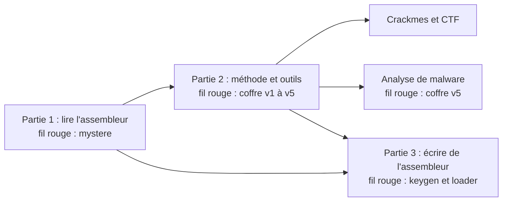

# Cours d'assembleur et de reverse engineering

Un cours progressif, en français, qui mène de la lecture d'un premier désassemblage à la résolution de crackmes et au triage de binaires suspects.

## Approche du cours

En CTF, chaque challenge semble différent des précédents. En réalité, les mêmes briques reviennent sans cesse : une comparaison, une boucle qui transforme une chaîne, un appel de fonction, une protection anti-debug. La difficulté n'est pas de connaître toutes les astuces, mais de **reconnaître les briques**.

Le cours est organisé en trois parties :

1. **Partie 1** : lire l'assembleur x86-64 produit par un compilateur C. L'objectif n'est pas d'écrire de gros programmes en assembleur, mais de reconnaître un `if`, une boucle, un appel de fonction, un tableau, une structure.
2. **Partie 2** : appliquer une **méthode** de reverse identique d'un challenge à l'autre (reconnaître, observer, comprendre, agir), puis l'étendre à l'analyse de malware.
3. **Partie 3** : écrire soi-même quelques programmes en assembleur, ce qui consolide la lecture et prépare aux shellcodes et aux challenges d'exploitation.

Principe central : **les programmes d'exemple sont compilés par l'apprenant**, désassemblés, puis comparés au code C. Ce va-et-vient entre C et assembleur est beaucoup plus formateur que la résolution guidée de challenges.



## Prérequis

Le cours suppose quelques bases, utilisées dès le chapitre 1. Il n'est pas nécessaire d'être expert, mais les notions suivantes doivent être familières :

- **Langage C** : variables, `if`, boucles, fonctions, pointeurs, `char *`, `struct`, `argv`, et quelques fonctions courantes (`strcmp`, `malloc`). Le code à analyser provient de C compilé. Rattrapage : [Learn C (en anglais, interactif)](https://www.learn-c.org/) ou le [C book (en français)](https://zestedesavoir.com/tutoriels/755/le-langage-c-1/).
- **Terminal Unix** : lancer une commande, les redirections (`|`, `<`, `2>`), `echo $?` (code de retour), `chmod +x`. Rattrapage : [la ligne de commande (OpenClassrooms)](https://openclassrooms.com/fr/courses/43538-reprenez-le-controle-a-laide-de-linux).
- **Python de base** : lancer `python3`, manipuler des chaînes et des octets, une boucle `for`. Les scripts de solution et quelques exercices l'utilisent. Rattrapage : [le tutoriel officiel](https://docs.python.org/fr/3/tutorial/).

Les notions d'assembleur, de reverse et les outils (Docker, GDB, Ghidra) sont, eux, expliqués au fil du cours : aucun prérequis de ce côté. Un [glossaire](glossaire.md) regroupe les définitions courtes des termes employés, avec un renvoi au chapitre où chacun est détaillé.

## Plan

### Partie 1 : l'assembleur pour le reverse

| Chapitre | Contenu | Fil rouge |
|---|---|---|
| [01 Les bases](partie1-assembleur/01-bases.md) | Binaire, hexadécimal, octets, mémoire, little endian, signé et non signé | Préparation de l'environnement |
| [02 Registres et premières instructions](partie1-assembleur/02-registres-instructions.md) | Registres, `mov`, `add`, `sub`, `lea`, `imul`, `xor`, opérandes mémoire | Début de `verifier` |
| [03 Comparaisons et sauts](partie1-assembleur/03-comparaisons-sauts.md) | Flags, `cmp`, `test`, sauts conditionnels, `if` / `else` | Première condition |
| [04 Boucles](partie1-assembleur/04-boucles.md) | `while`, `for`, repérage des boucles dans un listing | Les deux boucles |
| [05 La pile et les fonctions](partie1-assembleur/05-pile-fonctions.md) | `push`, `pop`, `call`, `ret`, prologue, variables locales, conventions d'appel | Prototype de la fonction |
| [06 Mémoire, tableaux, chaînes, structures](partie1-assembleur/06-memoire-donnees.md) | Adressage, `movzx`, `movsx`, tableaux, pointeurs, structures | Accès à `s[i]` |
| [07 Du C à l'assembleur, et retour](partie1-assembleur/07-patterns-compilateur.md) | `switch`, optimisations, idiomes du compilateur, x86 32 bits | Réécriture complète en C |

### Partie 2 : le reverse engineering

| Chapitre | Contenu | Fil rouge |
|---|---|---|
| [08 La méthode et les premiers outils](partie2-reverse/08-methode-outils.md) | Méthode en 4 étapes, `file`, `strings`, `ltrace`, `strace`, `objdump` | Coffre v1 |
| [09 Analyse statique avec Ghidra](partie2-reverse/09-ghidra.md) | Projet, décompilateur, renommage, types, références croisées | Coffre v2 (statique) |
| [10 Analyse dynamique avec GDB](partie2-reverse/10-gdb.md) | Points d'arrêt, pas à pas, lecture de la mémoire, modification des registres, GEF | Coffre v2 (dynamique) |
| [11 Les grands classiques des crackmes](partie2-reverse/11-classiques-crackmes.md) | Comparaisons, encodages, keygen, patching, catalogue des schémas | Coffre v3 (keygen) |
| [12 Protections et anti-analyse](partie2-reverse/12-protections.md) | Binaire strippé, anti-debug, mesure du temps, packers, obfuscation | Coffre v4 |
| [13 Initiation à l'analyse de malware](partie2-reverse/13-malware-analysis.md) | Laboratoire, triage, format PE, IOC, comportements typiques, rapport | Coffre v5 |
| [14 Et après ?](partie2-reverse/14-et-apres.md) | Plan d'entraînement, ressources, méthode de progression | |

### Partie 3 : écrire de l'assembleur

Écrire soi-même quelques programmes en assembleur consolide la lecture et prépare aux shellcodes et aux challenges d'exploitation. Les chapitres 15 et 16 (hors fil rouge) se lisent dès la fin de la partie 1 ; leurs fils rouges et le chapitre 17 supposent la partie 2 (voir le début du chapitre 15).

| Chapitre | Contenu | Fil rouge |
|---|---|---|
| [15 Premier programme NASM et appels système](partie3-ecriture/15-nasm-syscalls.md) | NASM, sections, `syscall`, descripteurs, `argv` sur la pile, anti-debug sans libc | `fr15` : afficher un argument |
| [16 Fonctions, libc et alignement](partie3-ecriture/16-fonctions-libc.md) | Écrire une fonction, appeler `printf`, convention System V, alignement de pile sur 16 | keygen v3 en assembleur |
| [17 Shellcode et loader chiffré](partie3-ecriture/17-shellcode.md) | Contraintes d'un shellcode, chaîne sur la pile, octets sans zéro, `mmap`, loader XOR | Analyser un loader |

Le suivi de l'avancement se fait dans la page [Progression](progression.md) (sur le site, les cases cochées sont conservées dans le navigateur).

### Fil rouge

- **Partie 1** : la fonction `verifier` du programme [mystere](fil-rouge/partie1/mystere.c). Au départ, seul son désassemblage est disponible ([mystere_O0.txt](fil-rouge/partie1/mystere_O0.txt)). Chaque chapitre permet d'en comprendre un morceau de plus. Au chapitre 7, la fonction est entièrement réécrite en C et un code valide est trouvé.
- **Partie 2** : le programme "Coffre", de la v1 à la v5 (dossier `fil-rouge/partie2`). Chaque version ajoute une difficulté liée au chapitre : mot de passe en clair, puis chiffré, puis calculé à partir d'un nom, puis protégé contre le débogage, et enfin un faux malware à analyser.
- **Partie 3** : réécrire le keygen du coffre v3 en assembleur, puis analyser un *loader* qui déchiffre un shellcode en mémoire (dossier `fil-rouge/partie3`).

Les **solutions** se trouvent dans le dossier `solutions` ([partie 1](solutions/partie1.md), [partie 2](solutions/partie2.md), [partie 3](solutions/partie3.md)). Il est recommandé de ne les consulter qu'après une recherche sérieuse (au moins 30 minutes par exercice) : c'est pendant la recherche, erreurs comprises, que l'apprentissage se fait.

## Règle du jeu pour le fil rouge de la partie 2

Les sources des coffres sont fournies pour pouvoir les compiler. Les lire avant de résoudre l'exercice supprime évidemment tout l'intérêt. Deux options :

- compiler tous les coffres d'un coup au début, sans ouvrir les fichiers `.c` (commandes ci-dessous) ;
- ne lire le `.c` qu'**après** avoir résolu la version, pour comparer la compréhension obtenue avec le code réel. C'est d'ailleurs un excellent exercice.

## Environnement de travail

Le cours nécessite un Linux x86-64. Sur Mac, il fonctionne dans un conteneur Docker fourni avec le cours : voir le guide [Installation sur Mac](environnement/INSTALLATION-MAC.md). Le point important concerne les Mac Apple Silicon : pour que GDB fonctionne, Docker doit tourner dans une machine virtuelle x86-64 émulée (Colima), le guide détaille la procédure.

Résumé :

```bash
brew install colima docker
colima start reverse --arch x86_64 --cpu 4 --memory 6 --disk 30   # Apple Silicon uniquement
./environnement/lab.sh      # depuis le dossier docs du dépôt : ouvre un shell dans le conteneur
```

Ghidra (chapitre 9) s'installe directement sur macOS.

Sous Linux x86-64 natif, il suffit d'installer les paquets listés dans le [Dockerfile](environnement/Dockerfile) (`build-essential gdb strace ltrace binutils python3...`), ou d'utiliser le même conteneur.

Aucune machine Windows n'est nécessaire. Le chapitre 13 explique comment étudier des malwares Windows sans Windows.

### Compiler tout le fil rouge sans lire les sources

Dans le conteneur (le dossier du cours est monté dans `/cours`) :

```bash
cd /cours/fil-rouge/partie1
gcc -O0 -fno-stack-protector -no-pie -o mystere mystere.c

cd /cours/fil-rouge/partie2
gcc -O0 -o coffre_v1 coffre_v1.c
gcc -O0 -o coffre_v2 coffre_v2.c
gcc -O1 -o coffre_v3 coffre_v3.c
gcc -O1 -o coffre_v4 coffre_v4.c && strip coffre_v4
gcc -O1 -o coffre_v5 coffre_v5.c && strip coffre_v5
```

Le conteneur utilise gcc 13, le compilateur ayant servi à produire les listings du cours : les adresses et instructions obtenues doivent donc correspondre. Avec un autre compilateur, de légères différences sont normales et la logique reste la même.

## Méthode de travail recommandée

1. Lire le chapitre avec un terminal ouvert.
2. Saisir les exemples, les compiler, les désassembler. Une lecture passive ne suffit pas.
3. Faire les exercices du chapitre, puis l'étape du fil rouge.
4. Consulter la solution ensuite seulement.

Comptez environ 2 à 4 heures par chapitre. Un chapitre bien assimilé vaut mieux que trois chapitres survolés.

## Sur l'usage de l'IA en CTF

Se faire guider pas à pas sur un challenge donne peu de résultats durables : la personne ou l'outil qui guide effectue le travail de reconnaissance, c'est-à-dire précisément la compétence à acquérir. Pendant ce cours, une règle simple : réserver l'aide extérieure aux **questions de connaissance** ("que fait l'instruction `cdqe` ?") et jamais aux **questions de raisonnement** ("que fait ce programme ?"). Le chapitre 14 revient sur ce point.
