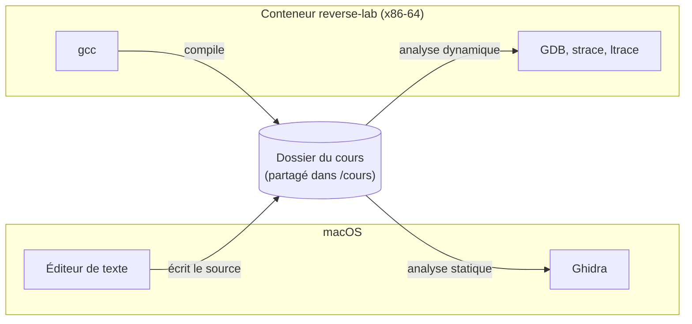

# Installer l'environnement sur Mac

Le cours utilise un Linux x86-64. Sur Mac, il tourne dans un conteneur Docker, décrit par le [Dockerfile](Dockerfile) de ce dossier. Le conteneur contient tous les outils du cours, y compris ceux des chapitres d'approfondissement : gcc 13 (le même que celui des listings) et les bibliothèques 32 bits (`gcc-multilib`), NASM, GDB avec GEF, strace, ltrace, objdump, UPX, Frida, et Python avec z3, angr, YARA et pefile. Vous avez ainsi sous la main, dans le conteneur, les outils des chapitres sur l'analyse dynamique (Frida), la résolution automatique (z3 et angr), le packing (UPX) et les règles YARA.

Ghidra, en revanche, s'installe directement sur macOS. Sous Linux, voir plutôt le guide [Installation sous Linux](INSTALLATION-LINUX.md).

La grande majorité des Mac récents sont des **Apple Silicon** (puces M1, M2, M3, M4...) : c'est le parcours principal, décrit à la section 2. Les anciens Mac Intel sont traités en note à la section 3.

Pour vérifier en cas de doute, dans le Terminal :

```bash
uname -m
```

`arm64` indique un Mac Apple Silicon (section 2) ; `x86_64` un Mac Intel (section 3).

## 1. Vue d'ensemble

Un Mac ne peut pas déboguer du code x86-64 directement. L'environnement du cours tourne donc dans une machine virtuelle Linux x86-64, lancée avec Colima. Sur Apple Silicon, cette machine est émulée ; sur Intel, elle est native. La suite détaille chaque cas, mais le principe et les commandes du cours (section 4 et au-delà) sont identiques une fois la machine démarrée.

## 2. Mac Apple Silicon (parcours principal : M1, M2, M3, M4...)

### Le problème de l'émulation

Un Mac Apple Silicon a un processeur ARM. Pour exécuter du code x86-64, Docker Desktop passe par une couche d'émulation (Rosetta ou QEMU en mode utilisateur). Cela suffit pour compiler, désassembler et lancer les programmes, mais **pas pour déboguer** : GDB, strace et ltrace reposent sur l'appel système `ptrace`, que ces couches d'émulation ne prennent pas en charge. GDB échoue alors avec des erreurs du type `Couldn't get registers` ou `ptrace: Function not implemented`.

La solution est de faire tourner Docker dans une **vraie machine virtuelle x86-64 émulée**, avec son propre noyau Linux x86-64. C'est ce que fait **Colima** avec l'option `--arch x86_64`. Tout fonctionne, y compris GDB et l'anti-debug par `ptrace`. Le prix est la vitesse : l'émulation complète est plusieurs fois plus lente que le natif, ce qui reste largement suffisant pour de petits programmes.

### Installation

Avec [Homebrew](https://brew.sh) :

```bash
brew install colima docker qemu lima-additional-guestagents
```

`qemu` et `lima-additional-guestagents` sont nécessaires à Colima pour créer une machine virtuelle x86-64 sur un Mac Apple Silicon.

Créer et démarrer une machine virtuelle x86-64 dédiée au cours (le nom `reverse` est un profil Colima) :

```bash
colima start reverse --arch x86_64 --cpu 4 --memory 6 --disk 30
```

Le premier démarrage prend quelques minutes. Si `docker` ne répond pas ensuite (message du type `cannot restart, VM not previously started`), un `colima stop reverse` suivi de `colima start reverse` règle le problème. Colima configure ensuite le client `docker` pour utiliser cette machine virtuelle (contexte `colima-reverse`). Vérification :

```bash
docker context ls                      # le contexte actif est marqué d'une étoile
docker run --rm ubuntu:24.04 uname -m  # doit afficher x86_64
```

Si Docker Desktop est aussi installé, il suffit de sélectionner le bon contexte : `docker context use colima-reverse`.

Pour arrêter et relancer la machine virtuelle :

```bash
colima stop reverse
colima start reverse
```

### Alternative : UTM

[UTM](https://mac.getutm.app) permet d'installer une machine virtuelle Ubuntu x86-64 complète en mode émulation, avec une interface graphique. C'est plus lent que Colima et plus long à installer, mais cela peut servir plus tard pour un laboratoire d'analyse de malware entièrement isolé (chapitre 6 de la partie 3). Dans ce cas, choisir "Emulate" (et non "Virtualize") et l'architecture x86_64.

## 3. Mac Intel (note)

Ce cas ne concerne que les anciens Mac à processeur Intel. Le processeur étant déjà x86-64, aucune émulation n'est nécessaire : installer [Docker Desktop](https://www.docker.com/products/docker-desktop/), ou Colima sans l'option `--arch` (`colima start reverse --cpu 4 --memory 6 --disk 30`). Tout fonctionne directement, y compris GDB. La suite (section 4) est commune aux deux types de Mac.

## 4. Construire et lancer l'environnement

Depuis le dossier du cours (le dossier `docs` du dépôt GitHub) :

```bash
./environnement/lab.sh
```

Le script construit l'image `reverse-lab` au premier lancement (quelques minutes, plus longtemps sous émulation), puis ouvre un shell dans le conteneur. Le dossier du cours est partagé dans `/cours` : les fichiers créés ou modifiés d'un côté sont visibles de l'autre. Colima ne partage avec sa machine virtuelle que le dossier personnel (`/Users/<nom>`) : le dépôt doit donc se trouver quelque part sous `~` (par exemple `~/asm-to-reverse`). Ailleurs, dans `/tmp` par exemple, `/cours` apparaît vide dans le conteneur. On peut donc éditer avec un éditeur macOS et compiler dans le conteneur.

Les commandes équivalentes, sans le script (toujours depuis ce dossier) :

```bash
docker build --platform linux/amd64 -t reverse-lab environnement
docker run --rm -it --platform linux/amd64 \
    --cap-add=SYS_PTRACE --security-opt seccomp=unconfined \
    --hostname reverse-lab -v "$PWD":/cours reverse-lab
```

Les options `--cap-add=SYS_PTRACE` et `--security-opt seccomp=unconfined` autorisent `ptrace` dans le conteneur. Sans elles, GDB ne peut pas s'attacher aux programmes.

Options du script :

- `--sans-reseau` : le conteneur n'a aucun accès réseau (à utiliser pour le coffre v5, par principe) ;
- `--rebuild` : reconstruit l'image (après une modification du Dockerfile).

Le conteneur est supprimé à la sortie (`--rm`). Seul le contenu de `/cours` est conservé, puisqu'il se trouve en réalité sur le Mac. Travailler donc toujours dans `/cours`.

## 5. Vérifier l'installation

Dans le conteneur :

```bash
uname -m                                    # x86_64
gcc --version | head -1                     # gcc 13
cd /cours/fil-rouge/partie1
gcc -O0 -fno-stack-protector -no-pie -o mystere mystere.c
gdb -batch -ex 'break verifier' -ex 'run 12345678' -ex 'info registers rdi' ./mystere
```

La dernière commande doit s'arrêter dans `verifier` et afficher la valeur de `rdi`. Si GDB affiche une erreur `ptrace`, l'environnement tourne sous émulation utilisateur : revenir à la section 2.

## 6. Ghidra sur macOS

```bash
brew install --cask temurin@21    # Java 21, requis par Ghidra
brew install --cask ghidra
```

Ou bien télécharger l'archive sur https://ghidra-sre.org, la décompresser et lancer `ghidraRun`. Au premier lancement, macOS peut bloquer certains composants non signés : les autoriser dans Réglages Système, section Confidentialité et sécurité.

Les binaires à analyser se trouvent dans le dossier du cours, accessible à la fois depuis macOS (pour Ghidra) et depuis le conteneur (pour GDB). Le flux de travail habituel :



## 7. Binary Ninja (optionnel)

Binary Ninja est une alternative à Ghidra (voir l'encadré du chapitre sur Ghidra). Deux possibilités :

- **Binary Ninja Free** : une application gratuite à télécharger depuis [binary.ninja/free](https://binary.ninja/free) (macOS Apple Silicon et Intel), aux fonctions limitées mais suffisantes pour débuter. La glisser dans le dossier Applications après téléchargement.
- **Binary Ninja Cloud** : une version qui s'utilise dans le navigateur, sans installation, sur [cloud.binary.ninja](https://cloud.binary.ninja).

Une licence personnelle payante ajoute le décompilateur complet et les extensions. Le cours reste entièrement utilisable avec Ghidra seul : Binary Ninja n'est pas nécessaire.

## Suivi

- [ ] Environnement installé et vérifié
