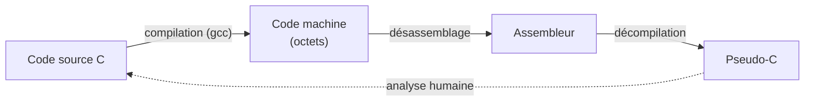

# Chapitre 1 : les bases

Objectif : comprendre ce que contient un programme compilé et manipuler les nombres comme le fait le processeur. Ce chapitre ne présente pas de difficulté particulière, mais tout le reste du cours repose sur lui.

## 1.1 Qu'est-ce qu'un programme compilé ?

À la compilation d'un programme C, `gcc` traduit le code en **instructions machine** : des suites d'octets que le processeur sait exécuter. L'**assembleur** est la version lisible par un humain de ces octets.

```
Code C           :  x = x + 1;
Assembleur       :  add eax, 0x1
Octets machine   :  83 c0 01
```

Les trois lignes expriment la même chose. Le **désassembleur** (objdump, Ghidra, IDA...) transforme les octets en assembleur. Le **décompilateur** (Ghidra, IDA, Binary Ninja) tente de remonter jusqu'au C, avec plus ou moins de succès. Le reverse engineering consiste à remonter cette chaîne.



Pourquoi apprendre l'assembleur alors que le décompilateur existe ? Parce que le décompilateur se trompe, se fait piéger par l'obfuscation et produit souvent un C peu lisible. Savoir lire l'assembleur permet toujours de vérifier.

## 1.2 Binaire et hexadécimal

Le processeur ne manipule que des bits (0 ou 1), regroupés par 8 : un **octet** (byte). Un octet peut valoir de 0 à 255.

Le binaire étant peu pratique à lire (`11010110`), on utilise l'**hexadécimal** (base 16) : les chiffres vont de 0 à 9 puis de A à F (A=10, B=11, ... F=15). Un chiffre hexadécimal correspond exactement à 4 bits ; un octet s'écrit donc toujours avec 2 chiffres hexadécimaux.

| Décimal | Binaire | Hexa |
|---|---|---|
| 0 | 0000 0000 | 0x00 |
| 10 | 0000 1010 | 0x0A |
| 15 | 0000 1111 | 0x0F |
| 16 | 0001 0000 | 0x10 |
| 65 | 0100 0001 | 0x41 |
| 255 | 1111 1111 | 0xFF |

Le préfixe `0x` signale un nombre hexadécimal. Dans les outils, presque tout est affiché en hexadécimal : adresses, constantes, octets.

Python fait une excellente calculatrice pour ces conversions, et servira en permanence :

```python
>>> hex(65)
'0x41'
>>> 0x41
65
>>> bin(0x41)
'0b1000001'
>>> chr(0x41)
'A'
>>> ord('A')
65
```

### Les tailles à connaître

| Nom | Taille | Nom en assembleur | Type C habituel |
|---|---|---|---|
| octet | 8 bits | BYTE | `char` |
| mot | 16 bits | WORD | `short` |
| double mot | 32 bits | DWORD | `int` |
| quadruple mot | 64 bits | QWORD | `long`, pointeur (en 64 bits) |

À retenir en priorité : **`DWORD` = 4 octets = un `int`**, **`QWORD` = 8 octets = un pointeur**. Un accès `DWORD PTR [...]` dans un listing manipule donc probablement un `int`.

## 1.3 Les caractères sont des nombres

Une chaîne de caractères en C n'est qu'une suite d'octets terminée par l'octet `0x00`. Chaque caractère est codé en **ASCII** :

| Caractère | Hexa | | Caractère | Hexa |
|---|---|---|---|---|
| `'0'` | 0x30 | | `'A'` | 0x41 |
| `'9'` | 0x39 | | `'Z'` | 0x5A |
| espace | 0x20 | | `'a'` | 0x61 |
| `'\n'` | 0x0A | | `'z'` | 0x7A |

Deux propriétés reviennent dans presque tous les crackmes :

- les chiffres vont de `0x30` à `0x39`, donc `c - 0x30` transforme le caractère `'7'` en nombre 7 ;
- une minuscule vaut la majuscule correspondante plus `0x20`.

Une instruction `cmp al, 0x39` dans un listing doit donc évoquer immédiatement une comparaison avec le caractère `'9'`.

## 1.4 La mémoire

La mémoire d'un programme est un immense tableau d'octets. Chaque case possède une **adresse**, un nombre (sur 8 octets en 64 bits). Un pointeur en C n'est rien d'autre qu'une adresse.

```
Adresse        Contenu
0x404010       0x48   'H'
0x404011       0x69   'i'
0x404012       0x00   fin de chaîne
```

Ici, la chaîne `"Hi"` se trouve à l'adresse `0x404010`. Un `char *s` qui pointe dessus contient simplement la valeur `0x404010`.

### Le little endian

Lorsqu'un nombre occupe plusieurs octets, dans quel ordre est-il rangé en mémoire ? Sur x86, **l'octet de poids faible vient en premier** : c'est le **little endian**.

L'entier 32 bits `0x12345678` stocké à l'adresse `0x1000` donne :

```
0x1000  0x78
0x1001  0x56
0x1002  0x34
0x1003  0x12
```

Ce rangement est contre-intuitif mais essentiel en reverse. Exemple typique : un programme compare la saisie à la constante `0x64726f77`. En lisant les octets dans l'ordre de la mémoire (`77 6f 72 64`), on obtient `"word"`. Python permet de le vérifier :

```python
>>> (0x64726f77).to_bytes(4, 'little')
b'word'
>>> int.from_bytes(b'word', 'little')
1685221239
>>> hex(_)
'0x64726f77'
```

### Les zones de la mémoire d'un processus

Sans entrer dans le détail à ce stade :

- **.text** : le code (les instructions) ;
- **.data / .bss** : les variables globales ;
- **.rodata** : les données en lecture seule, comme les chaînes littérales (`"Mot de passe : "`) ;
- **le tas (heap)** : la mémoire allouée par `malloc` ;
- **la pile (stack)** : les variables locales et les informations d'appel de fonctions (chapitre 5).

## 1.5 Signé et non signé

Avec 8 bits, on représente 256 valeurs, selon deux interprétations possibles :

- **non signé** : de 0 à 255 ;
- **signé** (complément à deux) : de -128 à 127.

En complément à deux, `-1` s'écrit `0xFF` sur 8 bits et `0xFFFFFFFF` sur 32 bits. Pour obtenir `-x`, on inverse tous les bits puis on ajoute 1.

```
 5  = 0000 0101 = 0x05
-5  = 1111 1011 = 0xFB
-1  = 1111 1111 = 0xFF
```

Point essentiel : **le processeur ne sait pas si un nombre est signé**. C'est l'instruction utilisée qui le révèle. Par exemple, `jl` (saut si plus petit) traite les nombres comme signés, et `jb` (saut si en dessous) comme non signés. C'est souvent ainsi que l'on retrouve le type d'une variable.

Une instruction `mov eax, 0xffffffff` doit faire penser à "-1", souvent une valeur de retour d'erreur.

```python
>>> 0xFFFFFFFB - 2**32     # interpréter 0xFFFFFFFB comme un entier signé 32 bits
-5
```

## 1.6 Les opérations bit à bit

Elles sont omniprésentes en reverse (chiffrement, hachage, masques).

| Opération | C | Assembleur | Exemple |
|---|---|---|---|
| ET | `a & b` | `and` | `0b1100 & 0b1010 = 0b1000` |
| OU | `a \| b` | `or` | `0b1100 \| 0b1010 = 0b1110` |
| OU exclusif | `a ^ b` | `xor` | `0b1100 ^ 0b1010 = 0b0110` |
| NON | `~a` | `not` | inverse tous les bits |
| Décalage à gauche | `a << n` | `shl` | multiplie par 2^n |
| Décalage à droite | `a >> n` | `shr` / `sar` | divise par 2^n |

Le **XOR** mérite une attention particulière : `(a ^ k) ^ k = a`. Appliquer deux fois la même clé redonne la valeur d'origine. C'est pour cette raison qu'il s'agit du "chiffrement" favori des crackmes et des malwares : la même fonction sert à chiffrer et à déchiffrer.

```python
>>> ord('A') ^ 0x2A
107
>>> 107 ^ 0x2A
65
```

## 1.7 Le format ELF en bref

Sous Linux, les exécutables sont au format **ELF** ; sous Windows, au format **PE** (chapitre 6 de la partie 3). Il n'est pas nécessaire de connaître ELF en détail, seulement de savoir qu'il contient des **sections** (.text, .data, .rodata...) et des **symboles** (les noms des fonctions, s'ils n'ont pas été supprimés).

```bash
file /bin/ls          # type du fichier
readelf -S /bin/ls    # liste des sections
```

## Exercices

**Exercice 1.1** Convertir à la main (puis vérifier avec Python) : 200 en hexadécimal, 0x7F en décimal, 0b10110011 en hexadécimal.

Méthode. Vers l'hexadécimal, on divise par 16 en notant les restes de bas en haut : 200 = 12*16 + 8, soit `0xC8` (12 = C, 8). Du binaire vers l'hexadécimal, on regroupe les bits par quatre depuis la droite, chaque groupe donnant un chiffre hexadécimal : `1011 0011` donne `0xB3`. De l'hexadécimal vers le décimal, chaque chiffre pèse une puissance de 16 : `0x7F = 7*16 + 15 = 127`.

**Exercice 1.2** Quelle est la valeur de l'octet signé `0x80` ? Et de `0xFE` ?

**Exercice 1.3** Un programme compare un entier de 8 octets à `0x2165737265766572`. Quelle chaîne de 8 caractères cela représente-t-il en mémoire ?

**Exercice 1.4** Les octets `0x55 0x7f 0x72 0x74` forment un mot de 4 lettres chiffré par un XOR avec une clé d'un seul octet. On sait que le mot commence par `'F'`. Retrouver la clé (une seule opération suffit), puis le mot entier.

**Exercice 1.5** Écrire une fonction Python `xor(data, cle)` qui applique un XOR d'un octet à tous les octets d'une chaîne `bytes`. La conserver : elle servira souvent.

## Fil rouge : préparation du terrain

1. Installer l'environnement comme indiqué dans le [guide d'installation](../environnement/INSTALLATION-MAC.md), puis ouvrir un shell avec `./environnement/lab.sh`.
2. Compiler `mystere` (sans lire le `.c`) et le lancer : `./mystere 1234`.
3. Ouvrir [mystere_O0.txt](../fil-rouge/partie1/mystere_O0.txt). Il ne s'agit pas encore de le comprendre, mais de compter : combien d'instructions compte la fonction `verifier` ? Combien de fois apparaît `cmp` ? Et `jmp` ? Relever toutes les constantes (les nombres en `0x` qui ne sont pas des adresses ; dans ce listing, les adresses sont celles de la colonne de gauche et celles citées par les sauts, et commencent par `0x40`, alors que les constantes apparaissent à droite comme opérandes), les convertir en décimal et, lorsque cela a un sens, en caractère ASCII. Consigner le tout dans un fichier `notes_mystere.md`, qui sera complété à chaque chapitre.

Solutions : [solutions/partie1.md](../solutions/partie1.md#chapitre-1)

## Suivi

- [ ] Partie 2, chapitre 1 : lecture
- [ ] Partie 2, chapitre 1 : exercices
- [ ] Partie 2, chapitre 1 : fil rouge
