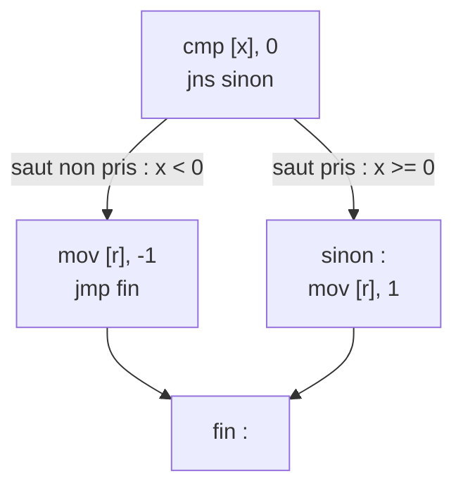

# Chapitre 3 : comparaisons et sauts

Objectif : comprendre comment un `if` est traduit en assembleur. C'est **le** chapitre le plus important pour les CTF : la quasi-totalité des crackmes se terminent par "si c'est correct, afficher le flag, sinon afficher un échec".

## 3.1 Il n'y a pas de if en assembleur

Le processeur exécute les instructions les unes après les autres. Pour faire un choix, il ne dispose que de deux outils :

1. une instruction qui **compare** et mémorise le résultat dans les flags ;
2. une instruction qui **saute** ailleurs (ou non) selon les flags.

## 3.2 Les flags

Le registre `rflags` contient des bits mis à jour par la plupart des instructions arithmétiques. Les quatre principaux :

| Flag | Nom | Mis à 1 quand... |
|---|---|---|
| ZF | Zero Flag | le résultat vaut zéro |
| SF | Sign Flag | le résultat est négatif (bit de poids fort à 1) |
| CF | Carry Flag | il y a une retenue en non signé (par exemple 3 - 5 en non signé) |
| OF | Overflow Flag | il y a un débordement en signé (par exemple 127 + 1 sur 8 bits) |

Il n'est pas nécessaire de tout mémoriser : les sauts conditionnels lisent les flags à votre place.

## 3.3 cmp et test

### cmp a, b

`cmp` effectue la soustraction `a - b`, **ignore le résultat** et ne conserve que les flags. Si `a == b`, alors `a - b = 0`, donc ZF = 1.

```
cmp eax, 5      ; compare eax à 5
```

### test a, b

`test` effectue un ET logique `a & b`, ignore le résultat et conserve les flags. Il est presque toujours utilisé avec deux fois le même registre :

```
test eax, eax   ; eax est-il nul ? (ZF=1 si oui)
test al, al     ; le caractère est-il le zéro de fin de chaîne ?
```

`test eax, eax` suivi de `je` signifie "si eax == 0". C'est l'idiome le plus courant après un appel de fonction : `if (strcmp(a, b) == 0)`.

## 3.4 Les sauts

### Le saut inconditionnel

```
jmp 401224      ; va à l'adresse 401224, toujours
```

### Les sauts conditionnels

Ils se lisent **après un cmp a, b** :

| Instruction | Saute si... | Type |
|---|---|---|
| `je` / `jz` | a == b | |
| `jne` / `jnz` | a != b | |
| `jg` | a > b | signé |
| `jge` | a >= b | signé |
| `jl` | a < b | signé |
| `jle` | a <= b | signé |
| `ja` | a > b | non signé (Above) |
| `jae` | a >= b | non signé |
| `jb` | a < b | non signé (Below) |
| `jbe` | a <= b | non signé |
| `js` | résultat négatif | |
| `jns` | résultat positif ou nul | |

Moyen mnémotechnique : **G**reater / **L**ess pour le signé, **A**bove / **B**elow pour le non signé. Comme indiqué au chapitre 1, c'est ce qui révèle si une variable est signée.

`je` et `jz` sont exactement la même instruction (le désassembleur choisit un nom). Après un `cmp`, lire "equal" ; après un `test`, lire "zero".

## 3.5 Le if devient un saut inversé

C'est le point qui déroute le plus souvent les débutants. Soit :

```c
if (x == 5) {
    y = 1;
}
z = 2;
```

Le compilateur produit :

```
cmp  DWORD PTR [x], 5
jne  suite              ; si x != 5, on SAUTE PAR-DESSUS le bloc
mov  DWORD PTR [y], 1   ; bloc du if
suite:
mov  DWORD PTR [z], 2
```

La condition est **inversée** : le C dit "si égal, exécuter", l'assembleur dit "si différent, sauter le bloc". C'est logique : le saut sert à **éviter** le code.

Pour retrouver la condition C, il faut donc **inverser le saut** : `jne` devient `==`, `jle` devient `>`, `jge` devient `<`, etc.

### if / else

```c
if (x < 0)
    r = -1;
else
    r = 1;
```

```
    cmp  DWORD PTR [x], 0
    jns  sinon            ; si x >= 0, aller au else
    mov  DWORD PTR [r], -1
    jmp  fin              ; sauter par-dessus le else
sinon:
    mov  DWORD PTR [r], 1
fin:
```

Sous forme de graphe de flot de contrôle (la représentation qu'utilise Ghidra) :



Le motif à reconnaître : **un saut conditionnel vers l'avant, puis un `jmp` vers l'avant juste avant la cible du premier saut**. Ce `jmp` qui enjambe un bloc trahit le `else`.

## 3.6 Exemple réel

```c
int signe(int x)
{
    if (x < 0)
        return -1;
    else if (x == 0)
        return 0;
    return 1;
}
```

`gcc -O0` :

```
1e: push   rbp
1f: mov    rbp,rsp
22: mov    DWORD PTR [rbp-0x4],edi      ; x
25: cmp    DWORD PTR [rbp-0x4],0x0      ; compare x à 0
29: jns    32                           ; si x >= 0, aller en 32
2b: mov    eax,0xffffffff               ; return -1
30: jmp    44                           ;   (aller à la fin)
32: cmp    DWORD PTR [rbp-0x4],0x0      ; compare x à 0
36: jne    3f                           ; si x != 0, aller en 3f
38: mov    eax,0x0                      ; return 0
3d: jmp    44
3f: mov    eax,0x1                      ; return 1
44: pop    rbp
45: ret
```

Les `jmp 44` montrent que tous les `return` sautent vers la fin de la fonction, où se trouve un unique `ret`. C'est un schéma très courant : **la valeur de retour est placée dans eax, puis le code saute vers l'épilogue**.

Le compilateur a utilisé `jns` (saut si positif) plutôt que `jge` : c'est équivalent ici, puisque la comparaison se fait avec 0.

En `-O2`, plus aucun saut :

```
xor    eax,eax            ; eax = 0
test   edi,edi            ; x == 0 ?
mov    edx,0xffffffff     ; edx = -1
setne  al                 ; al = (x != 0) ? 1 : 0
cmovs  eax,edx            ; si x < 0, eax = -1
ret
```

Deux nouvelles instructions :

- `setcc reg8` (ici `setne`) met l'octet à 1 si la condition est vraie, à 0 sinon. C'est un booléen C : `al = (x != 0)`.
- `cmovcc` (ici `cmovs`) effectue un `mov` uniquement si la condition est vraie. C'est un `x = cond ? a : b`.

Avec un peu de pratique, ces instructions se lisent aussi vite que les sauts.

## 3.7 Conditions composées

`&&` et `||` produisent plusieurs sauts successifs.

```c
if (c >= '0' && c <= '9')
    ok();
```

```
cmp  al, 0x2f        ; '0' - 1 = 0x2f
jle  pas_ok          ; si c <= 0x2f (donc c < '0'), sortir
cmp  al, 0x39        ; '9'
jg   pas_ok          ; si c > '9', sortir
call ok
pas_ok:
```

Le compilateur a exprimé `c >= 0x30` sous la forme `!(c <= 0x2f)`. Ce genre de décalage d'une unité est fréquent et ne doit pas surprendre.

Pour un `||`, le premier test qui réussit saute directement **dans** le bloc, sans évaluer la suite.

Le compilateur peut aussi produire la forme **inverse**, où chaque test saute vers le bloc valide et où l'on tombe sinon dans le rejet. C'est le cas de `mystere` (fil rouge), qui enchaîne `jle refus` puis `jle suite` :

```
cmp  ...             ; première condition
jle  refus           ; si elle échoue, aller au rejet
cmp  ...             ; seconde condition
jle  suite           ; si elle réussit, aller au bloc valide
...                  ; (chute dans le rejet sinon)
```

Les deux formes expriment la même logique ; il faut reconnaître l'une comme l'autre.

## 3.8 Trouver "le" saut dans un crackme

Dans un crackme, cherchez la chaîne de succès ("Bravo", "Correct", "flag") et remontez : juste avant se trouve presque toujours un `test eax, eax` / `je` ou un `cmp` / `jne` qui décide si elle est atteinte. Ce saut est la **décision**. Comprendre ce qui est comparé, c'est résoudre le challenge ; modifier ce saut (chapitre 11), c'est le contourner.

## Exercices

**Exercice 3.1** Pour chaque cas, le saut est-il pris ?

```
a) mov eax, 5   ; cmp eax, 5   ; je  cible
b) mov eax, 3   ; cmp eax, 7   ; jg  cible
c) mov eax, -1  ; cmp eax, 1   ; jl  cible
d) mov eax, -1  ; cmp eax, 1   ; jb  cible      (attention)
e) mov eax, 0   ; test eax, eax; jne cible
```

**Exercice 3.2** Traduire en C :

```
    mov  eax, DWORD PTR [rbp-0x4]
    cmp  eax, DWORD PTR [rbp-0x8]
    jle  L1
    mov  eax, DWORD PTR [rbp-0x4]
    jmp  L2
L1:
    mov  eax, DWORD PTR [rbp-0x8]
L2:
```

Que calcule ce fragment si `[rbp-0x4]` est `a` et `[rbp-0x8]` est `b` ?

**Exercice 3.3** Traduire en C (une seule ligne, avec un opérateur ternaire ou un booléen) :

```
cmp   edi, 0x41
setg  al
movzx eax, al
```

**Exercice 3.4** Écrire en C une fonction `int categorie(int age)` qui renvoie 0 si `age < 12`, 1 si `age < 18`, 2 sinon. Compiler en `-O0`, désassembler et annoter chaque instruction. Recompiler ensuite en `-O2` et expliquer les différences.

## Exercices de lecture

Fonction `classer`, compilée sans optimisation (`gcc -O0 -fno-stack-protector -no-pie`) :

```text
<classer>:
  ...
  cmpl   $0x0,-0x4(%rbp)
  jns    L1
  mov    $0xffffffff,%eax
  jmp    FIN
L1:
  cmpl   $0x0,-0x4(%rbp)
  jne    L2
  mov    $0x0,%eax
  jmp    FIN
L2:
  mov    $0x1,%eax
FIN:
  pop    %rbp
  ret
```

**Exercice 3.L1 (N1)** Quelles instructions sont les comparaisons, lesquelles sont les sauts ? Que teste `jns` (rappel : le saut est pris quand le résultat n'est pas négatif) ?

**Exercice 3.L2 (N2)** Dérouler l'exécution pour `n = -5`, `n = 0`, puis `n = 7` : quelle valeur se retrouve dans `eax` à la fin dans chaque cas ? Rappel : `0xffffffff` est l'écriture non signée de `-1`.

**Exercice 3.L3 (N3)** Reconstituer la fonction `classer` en C.

Solutions : [solutions/partie1.md](../solutions/partie1.md#lecture-03)

## Fil rouge : la première condition

Dans [mystere_O0.txt](../fil-rouge/partie1/mystere_O0.txt) :

1. À l'adresse `401183`, `cmp DWORD PTR [rbp-0x4],0x8` puis `je 401193`. Que se passe-t-il si la condition n'est pas remplie (lire les deux instructions suivantes) ? Écrire ce bloc sous forme d'un `if` en C, avec la condition dans le bon sens.
2. Entre `4011b3` et `4011d0` se trouvent deux comparaisons, avec `0x2f` et `0x39`. À l'aide de la section 3.7, écrire la condition en C.
3. À `4011f5`, que compare-t-on ? Convertir la constante en décimal.
4. Entre `401202` et `40121f`, deux octets sont comparés. Lesquels ? (Le chapitre 6 le précisera ; proposer une hypothèse.)
5. Compter les chemins qui mènent à `mov eax,0x0` et ceux qui mènent à `mov eax,0x1`. Qu'en déduire sur la logique de la fonction ?

Solutions : [solutions/partie1.md](../solutions/partie1.md#chapitre-3)

## Suivi

- [ ] Chapitre 3 : lecture
- [ ] Chapitre 3 : exercices
- [ ] Chapitre 3 : fil rouge
