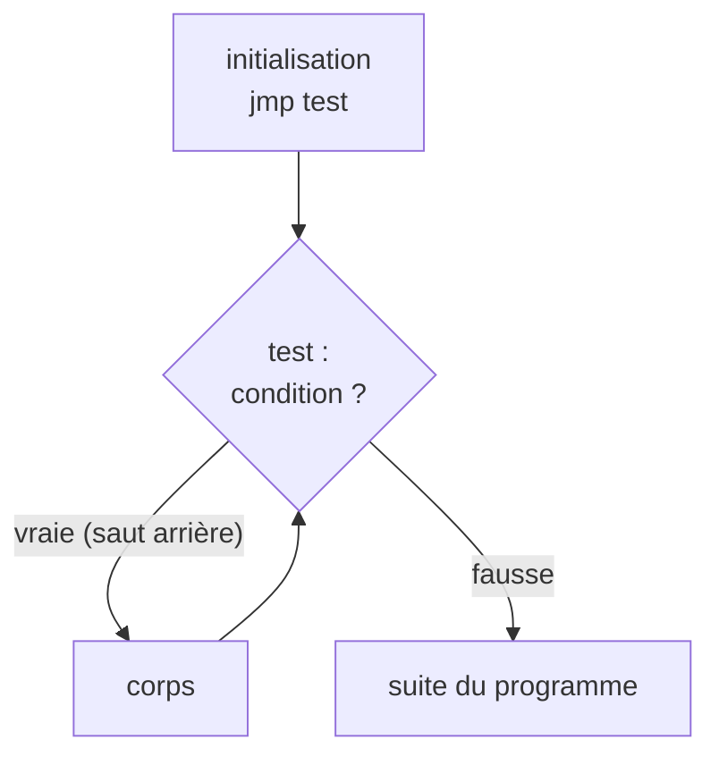

# Chapitre 4 : les boucles

Objectif : reconnaître une boucle au premier coup d'œil et identifier ses quatre composantes : initialisation, condition, corps, incrément.

## 4.1 Une boucle est un saut vers l'arrière

Au chapitre 3, tous les sauts allaient **vers l'avant** (vers des adresses plus grandes) pour éviter du code. Une boucle fait l'inverse : un saut **vers l'arrière**, pour réexécuter du code.

**Règle de lecture n°1 : un saut vers une adresse plus petite signale une boucle.**

Dans Ghidra ou avec GEF, les sauts arrière sont souvent représentés par une flèche qui remonte. Dans un listing objdump, il suffit de comparer l'adresse cible avec l'adresse du saut.

## 4.2 La boucle while

```c
while (condition) {
    corps;
}
```

En `-O0`, gcc produit généralement ce schéma :

```
    jmp  test          ; 1. saut direct vers le test
corps:
    ...                ; 3. corps de la boucle
test:
    ...                ; 2. calcul de la condition
    jcc  corps         ; 4. si la condition est vraie, on remonte
```



Un premier `jmp` vers l'avant, suivi plus bas d'un saut conditionnel vers l'arrière : c'est la signature d'une boucle chez gcc. Avantage pour l'analyse : **la condition de la boucle se trouve juste avant le saut arrière**, et cette fois elle n'est pas inversée (le saut remonte quand la condition est vraie).

## 4.3 La boucle for

Un `for` n'est qu'un `while` doté d'une initialisation et d'un incrément :

```c
for (init; condition; increment) { corps; }
/* équivaut à */
init;
while (condition) { corps; increment; }
```

Exemple :

```c
int somme(int n)
{
    int s = 0;
    for (int i = 1; i <= n; i++)
        s += i;
    return s;
}
```

`gcc -O0` :

```
46: push   rbp
47: mov    rbp,rsp
4a: mov    DWORD PTR [rbp-0x14],edi     ; n
4d: mov    DWORD PTR [rbp-0x4],0x0      ; s = 0               (init)
54: mov    DWORD PTR [rbp-0x8],0x1      ; i = 1               (init)
5b: jmp    67                           ; aller au test
5d: mov    eax,DWORD PTR [rbp-0x8]      ; eax = i             (corps)
60: add    DWORD PTR [rbp-0x4],eax      ; s += i
63: add    DWORD PTR [rbp-0x8],0x1      ; i++                 (incrément)
67: mov    eax,DWORD PTR [rbp-0x8]      ; eax = i             (test)
6a: cmp    eax,DWORD PTR [rbp-0x14]     ; i comparé à n
6d: jle    5d                           ; si i <= n, recommencer
6f: mov    eax,DWORD PTR [rbp-0x4]      ; return s
72: pop    rbp
73: ret
```

Méthode de lecture d'une boucle :

1. Repérer le saut arrière (`6d: jle 5d`). Le corps s'étend de `5d` jusqu'au test.
2. Lire la condition juste avant : `i <= n` (le saut n'est pas inversé).
3. La variable modifiée régulièrement juste avant le test (`add [rbp-0x8], 1`) est le **compteur**.
4. Les instructions qui précèdent le `jmp` initial constituent l'**initialisation**.

## 4.4 La boucle do / while

```c
do { corps; } while (condition);
```

Pas de `jmp` initial : le corps est exécuté au moins une fois, puis viennent le test et le saut arrière. À partir de `-O1`, les compilateurs transforment souvent les `while` en `do / while` précédés d'un test "la boucle s'exécute-t-elle au moins une fois ?". Il est donc normal de voir le test **deux fois** : une fois avant la boucle, une fois à la fin.

## 4.5 Boucles et chaînes de caractères

Un schéma présent dans presque tous les crackmes : parcourir une chaîne jusqu'au `0` final.

```c
int len = 0;
while (s[len] != 0)
    len++;
```

Il s'agit d'un `strlen` écrit à la main. Signe distinctif : lecture d'un octet (`movzx eax, BYTE PTR [...]`), `test al, al`, et saut arrière si ce n'est pas zéro.

## 4.6 Boucles optimisées

En `-O2`, gcc transforme profondément les boucles. Pour la fonction `somme` ci-dessus :

```
20: test   edi,edi              ; si n <= 0
22: jle    60                   ;   renvoyer directement 0
24: lea    ecx,[rdi+0x1]        ; ecx = n + 1 (borne de fin)
27: xor    edx,edx              ; s = 0
29: and    edi,0x1              ; n est-il impair ?
2c: mov    eax,0x1              ; i = 1
31: je     48
33: mov    eax,0x2              ; (cas impair : un premier tour est fait d'avance)
38: mov    edx,0x1
3d: cmp    eax,ecx
3f: je     53
41: nop    DWORD PTR [rax+0x0]
48: lea    edx,[rdx+rax*2+0x1]  ; s += i + (i+1) : deux tours à la fois
4c: add    eax,0x2              ; i += 2
4f: cmp    eax,ecx
51: jne    48                   ; boucle
53: mov    eax,edx
55: ret
```

Le compilateur a **déroulé** la boucle : il effectue deux itérations par tour. Il n'est pas indispensable de tout suivre ici. À retenir :

- le saut arrière (`51: jne 48`) indique toujours où se trouve la boucle ;
- dans une boucle optimisée, chercher d'abord **ce qui change à chaque tour** (ici `eax += 2`) et **ce qui est accumulé** (`edx`) ;
- les variables ne sont plus en mémoire mais dans des registres.

## 4.7 Boucles imbriquées et sorties anticipées

- Deux sauts arrière dont les zones se chevauchent indiquent deux boucles imbriquées. Le saut qui couvre la plus petite zone correspond à la boucle interne.
- Un `break` ou un `return` dans une boucle apparaît comme un saut conditionnel **vers l'avant** qui sort de la zone de la boucle.

## Exercices

**Exercice 4.1** Traduire en C. Que calcule cette fonction pour `edi = 5` ?

```
    mov  DWORD PTR [rbp-0x14],edi
    mov  DWORD PTR [rbp-0x4],0x1
    jmp  L2
L1:
    mov  eax,DWORD PTR [rbp-0x4]
    imul eax,DWORD PTR [rbp-0x14]
    mov  DWORD PTR [rbp-0x4],eax
    sub  DWORD PTR [rbp-0x14],0x1
L2:
    cmp  DWORD PTR [rbp-0x14],0x1
    jg   L1
    mov  eax,DWORD PTR [rbp-0x4]
```

**Exercice 4.2** Écrire une fonction C qui compte les voyelles d'une chaîne. Compiler en `-O0`, puis repérer dans le listing : la boucle, le test de fin de chaîne, chaque comparaison avec une voyelle.

**Exercice 4.3** Que fait ce code ? Quelle est la valeur finale de `eax` si `rdi` pointe sur la chaîne `"abc"` ?

```
    xor  eax, eax
L1:
    movzx edx, BYTE PTR [rdi]
    test dl, dl
    je   fin
    add  eax, edx
    add  rdi, 1
    jmp  L1
fin:
    ret
```

## Fil rouge : les deux boucles

Dans [mystere_O0.txt](../fil-rouge/partie1/mystere_O0.txt) :

1. Trouver tous les sauts vers l'arrière. Combien y a-t-il de boucles ?
2. **Première boucle** (de `401169` à `401181`) : quelle variable sert de compteur ? Quelle est la condition d'arrêt ? À l'aide de la section 4.5, que calcule cette boucle ? Quel nom donner à `[rbp-0x4]` ?
3. Avec la réponse du chapitre 3, écrire en C les lignes de la fonction jusqu'à `401193`.
4. **Deuxième boucle** (de `40119a` à `4011f3`) : identifier l'initialisation, la condition (`cmp ... 0x7` / `jle`), l'incrément. Combien de tours effectue-t-elle ? Quel nom donner à `[rbp-0xc]` ?
5. Cette deuxième boucle comporte une sortie anticipée. Où ? Que renvoie alors la fonction ?

Solutions : [solutions/partie1.md](../solutions/partie1.md#chapitre-4)

## Suivi

- [ ] Chapitre 4 : lecture
- [ ] Chapitre 4 : exercices
- [ ] Chapitre 4 : fil rouge
