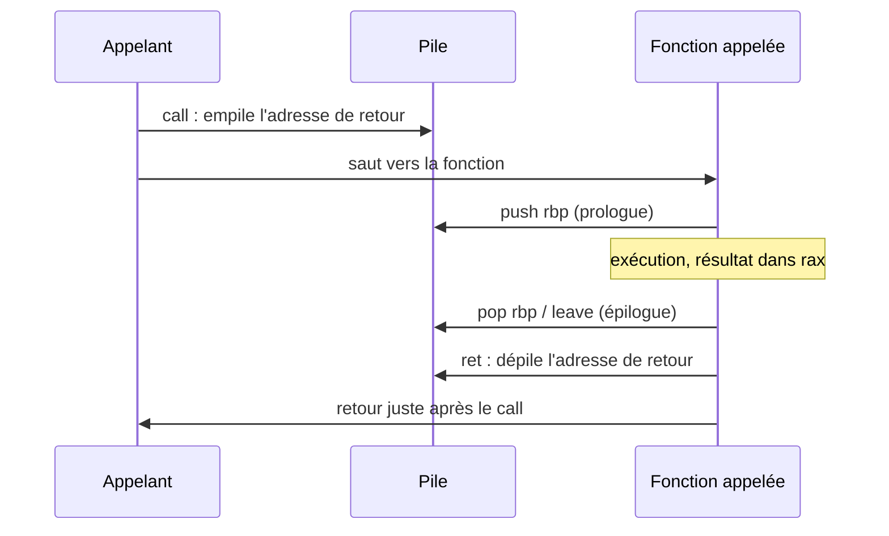
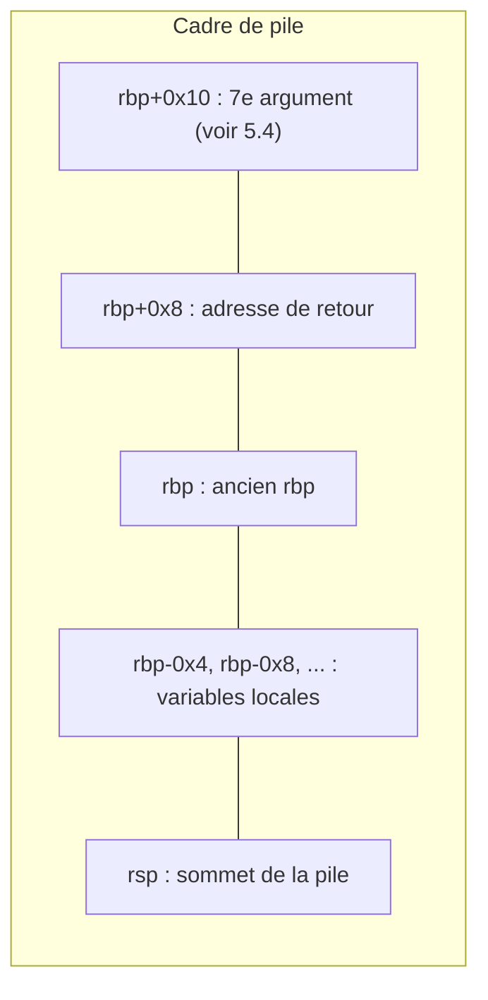

# Chapitre 5 : la pile et les fonctions

Objectif : comprendre comment une fonction est appelée, où se trouvent ses arguments et ses variables locales, et comment retrouver son prototype. C'est ce qui permet de lire un programme fonction par fonction plutôt que comme un listing monolithique.

## 5.1 La pile

La **pile** (stack) est une zone de mémoire gérée comme une pile d'assiettes : on dépose en haut, on reprend en haut. Deux particularités sur x86 :

- `rsp` pointe toujours sur le **sommet** de la pile ;
- la pile **grandit vers les adresses basses** : empiler fait **diminuer** `rsp`.

```
adresses hautes
    |  ...          |
    |  valeur A     |  <- empilée en premier
    |  valeur B     |  <- rsp (sommet) après avoir empilé B
    |  (libre)      |
adresses basses
```

### push et pop

```
push rax     ; rsp = rsp - 8, puis [rsp] = rax
pop  rbx     ; rbx = [rsp], puis rsp = rsp + 8
```

## 5.2 call et ret

```
call fonction
```

effectue deux opérations :

1. empiler l'adresse de l'instruction **suivante** (l'**adresse de retour**) ;
2. sauter à `fonction`.

```
ret
```

dépile l'adresse de retour et y saute. C'est ainsi que la fonction "revient" à l'endroit de l'appel.



Pour la culture : en exploitation de binaires (pwn), écraser cette adresse de retour sur la pile par un débordement de tampon permet de détourner l'exécution du programme. Le mécanisme ci-dessus explique pourquoi.

## 5.3 Le prologue et l'épilogue

Presque toutes les fonctions compilées en `-O0` commencent et se terminent de la même façon :

```
push rbp           ; sauvegarde le rbp de la fonction appelante
mov  rbp, rsp      ; rbp = base du cadre de la fonction
sub  rsp, 0x20     ; réserve 0x20 octets pour les variables locales (si besoin)
...
leave              ; équivaut à : mov rsp, rbp ; pop rbp
ret
```

Une fois le prologue exécuté, `rbp` constitue un repère fixe :

```
        |  ...                      |
rbp+0x10|  7e argument (voir 5.4)      |
rbp+0x8 |  adresse de retour        |
rbp     |  ancien rbp               |
rbp-0x4 |  variable locale 1        |
rbp-0x8 |  variable locale 2        |
        |  ...                      |
rsp     |  sommet                   |
```



**Règle de lecture : `[rbp-X]` désigne une variable locale, `[rbp+X]` (avec X >= 0x10) un argument passé par la pile.**

À partir de `-O1`, le compilateur supprime souvent `rbp` et adresse les variables par rapport à `rsp` : `[rsp+0x8]`. Le principe reste identique, seul le repère change.

La taille réservée par `sub rsp, ...` donne une idée du volume des variables locales. Un `sub rsp, 0x110` annonce probablement un tableau de 256 octets, typiquement un tampon de saisie.

## 5.4 Les conventions d'appel

Une **convention d'appel** définit où l'appelant place les arguments et où l'appelé place la valeur de retour. Il en existe plusieurs ; seule System V (Linux et macOS en 64 bits) est à retenir pour l'instant, les autres servent de référence le moment venu. C'est elle qui explique pourquoi un 7e argument se retrouve sur la pile, en `rbp+0x10` : les six premiers tiennent dans des registres.

### Linux et macOS en 64 bits (System V AMD64)

| Argument | 1 | 2 | 3 | 4 | 5 | 6 | 7 et suivants |
|---|---|---|---|---|---|---|---|
| Registre | `rdi` | `rsi` | `rdx` | `rcx` | `r8` | `r9` | pile |

Valeur de retour : `rax`. Moyen mnémotechnique : "**D**iane **S**e **D**épêche **C**ar **8** **9**" pour rdi, rsi, rdx, rcx, r8, r9.

### Windows en 64 bits

| Argument | 1 | 2 | 3 | 4 | 5 et suivants |
|---|---|---|---|---|---|
| Registre | `rcx` | `rdx` | `r8` | `r9` | pile |

Valeur de retour : `rax`. L'appelant réserve en outre 32 octets sur la pile (le "shadow space"), d'où le `sub rsp, 0x28` fréquent dans les binaires Windows. Cette convention est indispensable pour lire des malwares Windows dans Ghidra (chapitre 13).

### x86 32 bits (cdecl, stdcall)

En 32 bits, tous les arguments passent par la **pile**, empilés **de droite à gauche**, et le retour se fait dans `eax`. Le chapitre 7 y revient en détail, car de nombreux crackmes anciens et malwares sont en 32 bits.

### Les registres conservés

Une fonction peut écraser `rax`, `rcx`, `rdx`, `rsi`, `rdi` et `r8` à `r11`. Elle doit en revanche restaurer `rbx`, `rbp` et `r12` à `r15` si elle les utilise. D'où les `push rbx` en début et `pop rbx` en fin de fonctions optimisées : le compilateur s'en sert pour conserver une valeur à travers un `call`.

Conséquence pratique : **après un call, seule la valeur de `rax` a un sens** (c'est la valeur de retour).

## 5.5 Exemple : appel d'une fonction à 8 arguments

```c
int huit(int a, int b, int c, int d, int e, int f, int g, int h)
{
    return a + h;
}

int appelant(void)
{
    return huit(1, 2, 3, 4, 5, 6, 7, 8);
}
```

`appelant` en `-O0` :

```
push   rbp
mov    rbp,rsp
push   0x8             ; 8e argument, sur la pile
push   0x7             ; 7e argument, sur la pile
mov    r9d,0x6         ; 6e
mov    r8d,0x5         ; 5e
mov    ecx,0x4         ; 4e
mov    edx,0x3         ; 3e
mov    esi,0x2         ; 2e
mov    edi,0x1         ; 1er
call   huit
add    rsp,0x10        ; nettoie les deux arguments empilés
leave
ret
```

`huit` en `-O0` :

```
push   rbp
mov    rbp,rsp
mov    DWORD PTR [rbp-0x4],edi      ; a
mov    DWORD PTR [rbp-0x8],esi      ; b
mov    DWORD PTR [rbp-0xc],edx      ; c
mov    DWORD PTR [rbp-0x10],ecx     ; d
mov    DWORD PTR [rbp-0x14],r8d     ; e
mov    DWORD PTR [rbp-0x18],r9d     ; f
mov    edx,DWORD PTR [rbp-0x4]      ; edx = a
mov    eax,DWORD PTR [rbp+0x18]     ; eax = h (sur la pile, au-dessus de l'adresse de retour)
add    eax,edx                      ; return a + h
pop    rbp
ret
```

Pourquoi `h` se trouve-t-il en `[rbp+0x18]` ? `[rbp]` contient l'ancien rbp, `[rbp+0x8]` l'adresse de retour, `[rbp+0x10]` le 7e argument `g`, `[rbp+0x18]` le 8e argument `h`.

En `-O0`, gcc recopie tous les arguments reçus en registre dans des variables locales au début de la fonction. C'est très pratique pour l'analyse : **les premières instructions d'une fonction `-O0` donnent la liste de ses arguments**.

## 5.6 Retrouver le prototype d'une fonction

Méthode :

1. **Nombre d'arguments** : quels registres parmi `rdi`, `rsi`, `rdx`, `rcx`, `r8`, `r9` sont **lus avant d'être écrits** au début de la fonction ? (En `-O0`, ce sont ceux qui sont rangés dans la pile au début.)
2. **Type de chaque argument** : la taille (`edi` = 32 bits, `rdi` = 64 bits) et l'usage. Un argument 64 bits utilisé ensuite entre crochets (`[rax]` après `mov rax, [rbp-0x18]`) est un **pointeur**.
3. **Valeur de retour** : que contient `eax` / `rax` avant le `ret` ? Si rien de cohérent, la fonction est probablement `void`.
4. **Côté appelant** : examiner ce qui est placé dans les registres juste avant le `call`. Si `rdi` reçoit l'adresse d'une chaîne, le premier argument est un `char *`.

## 5.7 Les appels de bibliothèque

On rencontre des appels du type `call 401070 <strcmp@plt>`. Le suffixe `@plt` indique une fonction d'une bibliothèque partagée (la libc). C'est une très bonne nouvelle : ces fonctions sont connues, ainsi que leurs arguments.

```
lea    rsi,[rip+0xe8c]        # 402010   ; 2e argument : adresse d'une chaîne
mov    rdi,rax                           ; 1er argument
call   strcmp@plt
test   eax,eax
jne    echec
```

Se lit immédiatement : `if (strcmp(x, "chaîne en 0x402010") != 0) goto echec;`

Quelques fonctions à connaître avec leurs arguments : `strcmp(a, b)`, `strncmp(a, b, n)`, `memcmp(a, b, n)`, `strlen(s)`, `strcpy(dst, src)`, `memcpy(dst, src, n)`, `printf(fmt, ...)`, `puts(s)`, `fgets(buf, taille, flux)`, `scanf(fmt, ...)`, `atoi(s)`, `strtol(s, fin, base)`, `malloc(taille)`. En cas de doute : `man 3 strcmp`.

Remarque sur `printf` : la convention System V demande de placer dans `al` le nombre de registres vectoriels utilisés (les registres `xmm`, réservés aux nombres à virgule ; voir section 16.2). D'où le `mov eax, 0x0` juste avant un `call printf`, qui n'est pas un argument du programme.

## 5.8 Le canari de pile

Les binaires compilés avec les options par défaut contiennent souvent :

```
mov    rax,QWORD PTR fs:0x28
mov    QWORD PTR [rbp-0x8],rax
xor    eax,eax
...
mov    rdx,QWORD PTR [rbp-0x8]
sub    rdx,QWORD PTR fs:0x28
jne    ... <__stack_chk_fail@plt>
```

Il s'agit du **canari** (stack protector) : une valeur secrète placée sur la pile et vérifiée à la fin pour détecter un débordement. Pour le reverse, **il peut être ignoré** : il n'a aucun lien avec la logique du programme.

## Exercices

**Exercice 5.1** Donner le prototype C probable de cette fonction :

```
push   rbp
mov    rbp,rsp
mov    QWORD PTR [rbp-0x18],rdi
mov    DWORD PTR [rbp-0x1c],esi
mov    rax,QWORD PTR [rbp-0x18]
mov    eax,DWORD PTR [rax]
add    eax,DWORD PTR [rbp-0x1c]
pop    rbp
ret
```

**Exercice 5.2** Que fait ce code avant l'appel ? Écrire l'appel en C.

```
mov    edx,0x10
lea    rsi,[rip+0xe9a]        # 402004 <"S3cr3t_K3y_2026!">
lea    rdi,[rbp-0x30]
call   memcmp@plt
test   eax,eax
je     ok
```

**Exercice 5.3** Écrire en C un programme comportant une fonction `int carre(int x)` et une fonction `main` qui appelle `printf("%d\n", carre(7))`. Compiler en `-O0`, désassembler `main`, et retrouver : le prologue, l'appel à `carre` avec son argument, la récupération du résultat, la préparation des deux arguments de `printf`.

**Exercice 5.4** En 64 bits, après `push rbp` dans une fonction qui vient d'être appelée, à quelle adresse (par rapport à `rsp`) se trouve l'adresse de retour ?

## Fil rouge : le prototype de verifier

Dans [mystere_O0.txt](../fil-rouge/partie1/mystere_O0.txt) :

1. Combien d'arguments la fonction `verifier` reçoit-elle ? Lesquels ? Justifier avec les instructions du début.
2. L'argument est rangé en `[rbp-0x18]` avec `QWORD PTR`. Par la suite, le code exécute systématiquement `mov rax, QWORD PTR [rbp-0x18]` puis lit `BYTE PTR [rax]` (après un `add`). Qu'en déduire sur son type ?
3. Lister toutes les variables locales (`[rbp-0x4]`, `[rbp-0x8]`, `[rbp-0xc]`), leur taille et leur rôle d'après les notes des chapitres précédents.
4. Que renvoie la fonction, et de quel type ?
5. Écrire le prototype complet de `verifier`.
6. Bonus (à traiter après le chapitre 6, sections 6.6 et 6.7) : la fonction `main` figure à la fin de `mystere_O0.txt`. Retrouver l'appel à `verifier`. Que lui passe-t-on en argument ? (Indice : `main` reçoit `argc` dans `edi` et `argv` dans `rsi` ; l'accès à `argv[1]` et les `lea rax,[rip+...]` sont vus en 6.6 et 6.7.)

Solutions : [solutions/partie1.md](../solutions/partie1.md#chapitre-5)

## Suivi

- [ ] Chapitre 5 : lecture
- [ ] Chapitre 5 : exercices
- [ ] Chapitre 5 : fil rouge
