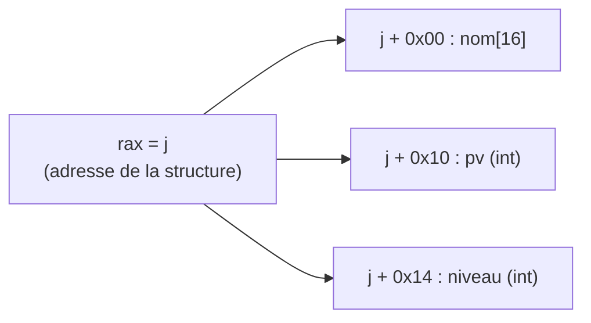

# Chapitre 6 : mémoire, tableaux, chaînes et structures

Objectif : reconnaître les accès aux données. Un crackme manipule presque toujours un tableau d'octets (la saisie, une clé) : lire `s[i]` en assembleur est indispensable.

## 6.1 Forme générale d'un accès mémoire

Entre crochets, x86 accepte une expression de la forme :

```
[ base + index * échelle + déplacement ]
```

- **base** : un registre (souvent l'adresse de début d'un tableau ou d'une structure) ;
- **index** : un registre (souvent un compteur de boucle) ;
- **échelle** : 1, 2, 4 ou 8 (la taille d'un élément) ;
- **déplacement** : une constante.

Exemples :

| Assembleur | C probable |
|---|---|
| `[rax]` | `*p` |
| `[rax+0x10]` | `p->champ` (champ à l'offset 0x10) ou `p[2]` (éléments de 8 octets) |
| `[rax+rcx*4]` | `t[i]`, `t` étant un tableau d'`int` |
| `[rax+rcx*1]` ou `[rax+rcx]` | `s[i]`, `s` étant un tableau de `char` |
| `[rbp-0x20]` | une variable locale |
| `[rip+0x2e5a]` | une variable globale ou une constante (voir 6.6) |

**L'échelle donne la taille des éléments du tableau**, et donc leur type : `*1` pour des `char`, `*4` pour des `int`, `*8` pour des pointeurs ou des `long`.

## 6.2 Tableaux

```c
int lire_tab(int *t, int i) { return t[i]; }
```

`-O0` :

```
mov    QWORD PTR [rbp-0x8],rdi      ; t
mov    DWORD PTR [rbp-0xc],esi      ; i
mov    eax,DWORD PTR [rbp-0xc]      ; eax = i
cdqe                                ; rax = (long) eax  (extension de signe)
lea    rdx,[rax*4+0x0]              ; rdx = i * 4
mov    rax,QWORD PTR [rbp-0x8]      ; rax = t
add    rax,rdx                      ; rax = t + i*4  =  &t[i]
mov    eax,DWORD PTR [rax]          ; eax = t[i]
```

Le compilateur calcule l'adresse `t + i * sizeof(int)` puis lit 4 octets. En C, `t[i]` est exactement `*(t + i)`, et l'assembleur le montre sans détour.

`cdqe` (et sa variante `movsxd rdx, eax`) convertit un `int` 32 bits signé en 64 bits. L'instruction apparaît dès qu'un `int` sert d'indice, les adresses étant sur 64 bits. Indice : **l'index est un `int` signé**.

## 6.3 Lire des octets : movzx et movsx

Pour charger un `char` dans un registre 32 bits, il faut préciser comment remplir les 24 bits restants :

```
movzx eax, BYTE PTR [rax]    ; zero extend : complète avec des 0     (unsigned char)
movsx eax, BYTE PTR [rax]    ; sign extend : recopie le bit de signe (char signé)
```

`movzx eax, BYTE PTR [...]` est l'instruction la plus caractéristique des crackmes : c'est la lecture d'un caractère de la saisie.

Exemple : si l'octet vaut `0xE9` (le "é" en Latin-1) :

- `movzx` donne `eax = 0x000000E9` (233) ;
- `movsx` donne `eax = 0xFFFFFFE9` (-23).

## 6.4 Les chaînes de caractères

Une chaîne est un tableau de `char` terminé par 0. Opérations typiques :

- **parcours** : `movzx eax, BYTE PTR [rdx+rax]`, `rax` augmentant de 1 à chaque tour ;
- **fin de chaîne** : `test al, al` / `je` ;
- **comparaison caractère par caractère** : deux `movzx` puis `cmp dl, al`.

Les chaînes littérales du programme (`"Mot de passe : "`) se trouvent dans la section `.rodata`. objdump et Ghidra les affichent souvent en commentaire à côté du `lea` qui les charge.

### Les chaînes construites sur la pile

Un procédé classique pour masquer une chaîne aux outils comme `strings` consiste à la construire sur la pile à partir de constantes :

```
movabs rax,0x775f746572636573     ; mov avec une constante de 64 bits, 8 octets d'un coup
mov    QWORD PTR [rbp-0x20],rax
mov    DWORD PTR [rbp-0x18],0x64726f     ; 4 octets (dont le 0 final)
```

Face à de grandes constantes copiées les unes à côté des autres sur la pile, il faut les convertir en octets little endian (chapitre 1). Ghidra les affiche parfois directement comme une chaîne.

```python
>>> (0x775f746572636573).to_bytes(8, 'little')
b'secret_w'
>>> (0x64726f).to_bytes(4, 'little')
b'ord\x00'
```

La chaîne cachée est donc `"secret_word"`.

## 6.5 Les structures

```c
struct joueur {
    char nom[16];   /* offset 0x00, 16 octets */
    int  pv;        /* offset 0x10 */
    int  niveau;    /* offset 0x14 */
};

int bonus(struct joueur *j)
{
    return j->pv + j->niveau * 10;
}
```

`-O0` :

```
mov    QWORD PTR [rbp-0x8],rdi      ; j
mov    rax,QWORD PTR [rbp-0x8]
mov    ecx,DWORD PTR [rax+0x10]     ; ecx = j->pv       (offset 0x10)
mov    rax,QWORD PTR [rbp-0x8]
mov    edx,DWORD PTR [rax+0x14]     ; edx = j->niveau   (offset 0x14)
mov    eax,edx
shl    eax,0x2                      ; eax = niveau * 4
add    eax,edx                      ; eax = niveau * 5
add    eax,eax                      ; eax = niveau * 10
add    eax,ecx                      ; + pv
```



**Signature d'une structure : un même pointeur de base et des déplacements constants différents.** `[rax+0x10]`, `[rax+0x14]` : deux champs d'une structure pointée par `rax`.

Différence avec un tableau : dans un tableau, l'index est un **registre** qui varie (`[rax+rcx*4]`) ; dans une structure, le déplacement est une **constante** (`[rax+0x14]`).

On remarque au passage le calcul `niveau * 10` réalisé avec `shl` et des `add` au lieu d'un `imul`. Les compilateurs utilisent volontiers ce type d'astuce ; le chapitre 7 en dresse la liste.

## 6.6 Variables globales et adressage relatif à rip

Dans un binaire 64 bits moderne (PIE), les données globales sont accédées par rapport à `rip` :

```
lea    rdi,[rip+0xe8c]        # 402010
mov    eax,DWORD PTR [rip+0x2edb]        # 404018 <compteur>
```

L'adresse réelle vaut `adresse de l'instruction suivante + déplacement`. Il n'est jamais nécessaire de la calculer : objdump et Ghidra l'affichent en commentaire (`# 402010`). À retenir : **`[rip+...]` désigne une donnée globale ou une constante du programme**.

## 6.7 Pointeurs de pointeurs

`argv` dans `main` est un `char **` : un tableau de pointeurs vers des chaînes. Pour lire `argv[1]` :

```
mov    rax,QWORD PTR [rbp-0x10]     ; rax = argv
add    rax,0x8                      ; rax = &argv[1]   (un pointeur fait 8 octets)
mov    rax,QWORD PTR [rax]          ; rax = argv[1]    (adresse de la chaîne)
```

Deux lectures mémoire successives (`mov rax, [rax]`) correspondent à deux niveaux de pointeurs.

## Exercices

**Exercice 6.1** Pour chaque accès, proposer le type des données et une expression C :

```
a) movzx eax, BYTE PTR [rdi+rcx]
b) mov   eax, DWORD PTR [rdi+rcx*4]
c) mov   rax, QWORD PTR [rdi+0x8]
d) mov   eax, DWORD PTR [rdi+0x20]   (rdi pointe sur une structure)
e) movsx eax, WORD PTR [rdi+rcx*2]
```

**Exercice 6.2** Traduire en C. Quel est le type de `[rbp-0x18]` ? Que calcule la boucle ?

```
    mov    QWORD PTR [rbp-0x18],rdi
    mov    DWORD PTR [rbp-0x4],0x0
    mov    DWORD PTR [rbp-0x8],0x0
    jmp    L2
L1:
    mov    eax,DWORD PTR [rbp-0x8]
    cdqe
    lea    rdx,[rax*4+0x0]
    mov    rax,QWORD PTR [rbp-0x18]
    add    rax,rdx
    mov    eax,DWORD PTR [rax]
    add    DWORD PTR [rbp-0x4],eax
    add    DWORD PTR [rbp-0x8],0x1
L2:
    cmp    DWORD PTR [rbp-0x8],0x9
    jle    L1
    mov    eax,DWORD PTR [rbp-0x4]
```

**Exercice 6.3** Écrire en C une structure `struct point { int x; int y; char nom[8]; long id; };` et une fonction qui renvoie `p->id + p->y`. Avant de compiler, prédire l'offset de chaque champ, puis vérifier en désassemblant. (Indice : un `long` doit être aligné sur 8 octets.)

**Exercice 6.4** Décoder cette chaîne construite sur la pile :

```
movabs rax,0x5f67616c665f6e75
mov    QWORD PTR [rbp-0x20],rax
mov    DWORD PTR [rbp-0x18],0x6e696d61
mov    BYTE  PTR [rbp-0x14],0x0
```

## Fil rouge : les accès à s[i]

Dans [mystere_O0.txt](../fil-rouge/partie1/mystere_O0.txt) :

1. Dans la première boucle (`40116f` à `40117f`), décrire précisément l'effet de la séquence `mov eax,[rbp-0x4]` / `movsxd rdx,eax` / `mov rax,[rbp-0x18]` / `add rax,rdx` / `movzx eax, BYTE PTR [rax]`. Écrire l'expression C équivalente.
2. Dans la deuxième boucle, le même motif apparaît trois fois. Avec quel indice ? Écrire les trois expressions.
3. À `4011e2`, on trouve `movsx eax,al`. Pourquoi ce `movsx` ? Qu'indique-t-il sur le type des caractères ?
4. Entre `401202` et `401214`, quels sont exactement les deux caractères comparés ?
5. Tous les éléments sont désormais réunis. Écrire en C une première version complète de `verifier`. Elle n'a pas besoin d'être élégante, seulement exacte ; elle sera vérifiée au chapitre 7.

Solutions : [solutions/partie1.md](../solutions/partie1.md#chapitre-6)

## Suivi

- [ ] Chapitre 6 : lecture
- [ ] Chapitre 6 : exercices
- [ ] Chapitre 6 : fil rouge
