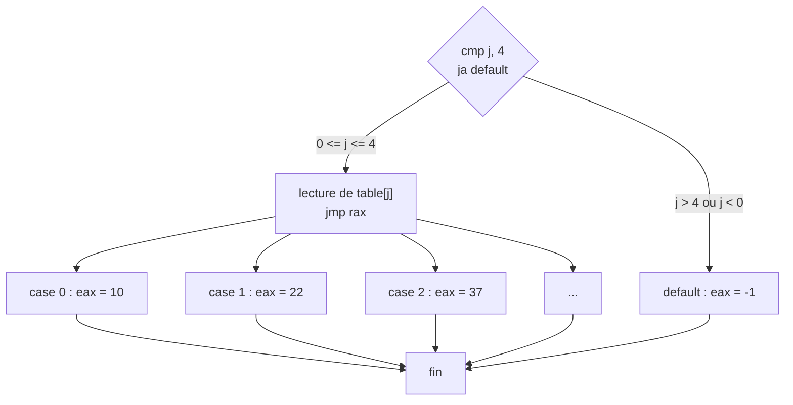
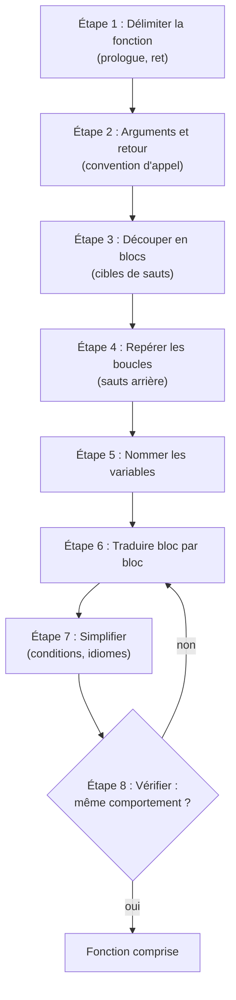

# Chapitre 7 : du C à l'assembleur, et retour

Objectif : connaître les habitudes des compilateurs, pour ne plus être surpris par du code optimisé, et savoir lire du code 32 bits. À la fin de ce chapitre, la fonction du fil rouge est entièrement réécrite.

## 7.1 Le switch et les tables de sauts

```c
int jour(int j)
{
    switch (j) {
    case 0: return 10;
    case 1: return 22;
    case 2: return 37;
    case 3: return 41;
    case 4: return 59;
    default: return -1;
    }
}
```

Avec peu de cas, gcc produit une suite de `cmp` / `je`. Avec des cas nombreux et rapprochés, il construit une **table de sauts** (jump table) :

```
cmp    DWORD PTR [rbp-0x4],0x4
ja     default                      ; j > 4 en NON SIGNÉ : couvre aussi j < 0
mov    eax,DWORD PTR [rbp-0x4]
lea    rdx,[rax*4+0x0]
lea    rax,[rip+...]                ; adresse de la table
mov    eax,DWORD PTR [rdx+rax*1]    ; lire l'entrée n° j de la table
cdqe
lea    rdx,[rip+...]
add    rax,rdx
jmp    rax                          ; saut indirect vers le bon "case"
case0: mov eax,0xa
       jmp fin
case1: mov eax,0x16
       jmp fin
...
default: mov eax,0xffffffff
fin:
```



Signature : **un `cmp` + `ja` (borne), puis un `jmp registre`**. Le `ja` non signé est une astuce : un nombre négatif interprété comme non signé est très grand, si bien qu'un seul test élimine à la fois `j < 0` et `j > 4`. Ghidra reconstruit très bien ces tables et affiche un véritable `switch`.

En `-O2`, comme chaque cas renvoie simplement une constante, gcc remplace le tout par une table de **valeurs** :

```
mov    eax,0xffffffff
cmp    edi,0x4
ja     fin
mov    eax,DWORD PTR [rax+rdi*4]    ; eax = table[j]
fin: ret
```

Les machines virtuelles des challenges "VM" (un classique des CTF de niveau intermédiaire) sont presque toujours un grand `switch` dans une boucle : lire un opcode, sauter au cas correspondant, recommencer.

## 7.2 Les idiomes du compilateur

Le compilateur remplace les opérations coûteuses par des équivalents rapides. Les plus fréquents :

| Code observé | Signification |
|---|---|
| `xor eax, eax` | `eax = 0` |
| `test eax, eax` / `je` | `if (eax == 0)` |
| `lea eax, [rdi+rdi*2]` | `eax = rdi * 3` |
| `lea eax, [rdi*4+5]` | `eax = rdi * 4 + 5` |
| `shl eax, 3` | `eax * 8` |
| `shl ecx, 5` puis `sub ecx, eax` | `ecx = eax * 32 - eax = eax * 31` |
| `shr eax, 3` (non signé) | `eax / 8` |
| `sar eax, 2` (signé, avec une correction avant) | `eax / 4` |
| `and eax, 0x7` | `eax % 8` (non signé) |
| `imul rdx, rdx, 0x66666667` puis `shr`, `sar` | division par 10 (voir ci-dessous) |
| `sub eax, 0x30` puis `cmp eax, 9` / `ja` | `if (c < '0' \|\| c > '9')` en un seul test |
| `setcc al` | un booléen `(condition)` |
| `cmovcc` | un `? :` |
| `neg eax` / `sbb eax, eax` | astuce pour obtenir 0 ou -1 selon une condition (`sbb` : soustraction avec retenue) |
| `rep stosq` / `rep stosd` | un `memset` (souvent la mise à zéro d'un tableau local) ; voir la sous-section sur les instructions de chaînes plus bas |
| `rep movsb` | un `memcpy` |

### La division par une constante

La division étant lente, gcc calcule `x / 10` en multipliant par un "nombre magique" :

```
movsxd rdx,eax
imul   rdx,rdx,0x66666667
shr    rdx,0x20
sar    edx,0x2
sar    eax,0x1f
sub    edx,eax              ; edx = x / 10
```

Inutile de comprendre les mathématiques sous-jacentes. À retenir : **une multiplication par une grande constante inhabituelle suivie de décalages correspond à une division par une constante**. Ghidra l'affiche d'ailleurs sous la forme `x / 10`. En cas de doute, tester quelques valeurs en Python ou dans GDB.

### Les fonctions inlinées

En `-O2`, les petites fonctions disparaissent : leur code est recopié directement dans l'appelant. Le compilateur reconnaît également certaines boucles et les remplace par des appels à la libc : une boucle "tant que `s[len] != 0`" peut devenir un `call strlen`. C'est ce qui se produit dans le fil rouge (voir plus bas).

### Les instructions de chaînes et autres instructions moins courantes

Quelques instructions apparaissent rarement dans le code de gcc récent, mais souvent dans du code ancien, écrit à la main, dans les shellcodes et dans les malwares. Elles méritent d'être reconnues.

**Les instructions de chaînes** travaillent sur des zones mémoire désignées par des registres fixes : `rsi` pour la source, `rdi` pour la destination, et `al` (ou `eax`, `rax`) pour la valeur. Après chaque exécution, `rsi` et `rdi` avancent automatiquement de la taille traitée (1 octet pour le suffixe `b`, 4 pour `d`, 8 pour `q`).

| Instruction | Effet d'une exécution |
|---|---|
| `stosb` | `[rdi] = al`, puis `rdi` avance |
| `movsb` | `[rdi] = [rsi]`, puis `rsi` et `rdi` avancent |
| `scasb` | compare `al` à `[rdi]` (modifie les flags comme `cmp`), puis `rdi` avance |
| `lodsb` | `al = [rsi]`, puis `rsi` avance |

Seules, elles traitent un élément. Précédées d'un **préfixe de répétition**, elles deviennent des boucles complètes dont le compteur est `rcx` :

| Forme | Répète tant que | Équivalent C |
|---|---|---|
| `rep stosb` | `rcx != 0` | `memset(rdi, al, rcx)` |
| `rep movsb` | `rcx != 0` | `memcpy(rdi, rsi, rcx)` |
| `repne scasb` | `rcx != 0` et l'octet lu est différent de `al` | recherche de `al`, donc `strlen` si `al = 0` |
| `repe cmpsb` | `rcx != 0` et les octets sont égaux | `memcmp(rsi, rdi, rcx)` |

Le `strlen` "à l'ancienne" est un motif à connaître par cœur, car il est déroutant à la première lecture :

```
xor eax, eax        ; al = 0 : on cherche la fin de chaîne
mov rcx, -1         ; compteur très grand
repne scasb         ; avance jusqu'au 0 ; rcx est décrémenté à chaque octet
not rcx             ; rcx = longueur + 1
dec rcx             ; rcx = longueur
```

Le sens de parcours dépend du flag de direction `DF` : `cld` le met à 0 (les adresses croissent, cas normal) et `std` à 1. Un `cld` juste avant une instruction de chaîne n'a pas d'autre signification.

**`loop etiquette`** décrémente `rcx`, puis saute si `rcx` n'est pas nul. C'est une boucle `for` à rebours en une instruction ; gcc ne l'émet plus (elle est lente), mais elle reste courante dans le code écrit à la main, par exemple une boucle de déchiffrement XOR dans un shellcode (chapitre 3 de la partie 4).

**`xchg a, b`** échange les deux opérandes. `xchg eax, eax` (octet `90`) est d'ailleurs l'encodage historique de `nop`.

Le fichier [exemples/chaines.asm](../exemples/chaines.asm) contient un exemple de chacune de ces instructions, à exécuter dans GDB comme à la section 2.6. Pour une instruction préfixée par `rep`, la commande `si` n'exécute qu'**un tour** de la répétition : il est plus pratique de poser un point d'arrêt sur la ligne suivante (`break 20` pour la ligne 20 du fichier source, puis `run`, puis `continue` pour aller au point d'arrêt suivant).

## 7.3 Le code x86 32 bits

De nombreux crackmes anciens et malwares Windows sont en 32 bits. Les différences :

- registres : `eax`, `ebx`, `ecx`, `edx`, `esi`, `edi`, `ebp`, `esp`, `eip` (pas de `r8` à `r15`) ;
- **tous les arguments passent par la pile**, empilés de droite à gauche ;
- valeur de retour dans `eax`.

La même fonction `appelant` qu'au chapitre 5, compilée en 32 bits (`gcc -m32 -O0`, disponible dans le conteneur du cours) :

```
push   ebp
mov    ebp,esp
push   0x8           ; dernier argument en premier
push   0x7
push   0x6
push   0x5
push   0x4
push   0x3
push   0x2
push   0x1           ; premier argument en dernier
call   huit
add    esp,0x20      ; l'appelant nettoie : 8 arguments x 4 octets
leave
ret
```

Et dans `huit` :

```
push   ebp
mov    ebp,esp
mov    edx,DWORD PTR [ebp+0x8]      ; a : premier argument
mov    eax,DWORD PTR [ebp+0x24]     ; h : huitième argument
add    eax,edx
pop    ebp
ret
```

**En 32 bits : `[ebp+0x8]` = 1er argument, `[ebp+0xc]` = 2e, `[ebp+0x10]` = 3e, etc.** (`[ebp]` = ancien ebp, `[ebp+4]` = adresse de retour.)

Les conventions 32 bits à connaître :

| Convention | Arguments | Nettoyage de la pile | Usage |
|---|---|---|---|
| `cdecl` | pile, de droite à gauche | l'appelant (`add esp, N` après le call) | C sous Linux et Windows |
| `stdcall` | pile, de droite à gauche | l'appelé (`ret N`) | API Windows (`MessageBoxA`, `CreateFileA`...) |
| `fastcall` | `ecx`, `edx`, puis pile | l'appelé | plus rare |

Repère simple : un `ret 0x10` en fin de fonction indique une fonction stdcall à 4 arguments.

## 7.4 Méthode générale de décompilation manuelle

Méthode à appliquer désormais à toute fonction :



1. **Délimiter** la fonction (prologue, `ret`).
2. **Arguments et retour** : convention d'appel (chapitre 5).
3. **Découper en blocs** : un bloc commence à une cible de saut et se termine par un saut. Dessiner les flèches, ou utiliser la vue graphe de Ghidra.
4. **Repérer les boucles** : sauts arrière (chapitre 4).
5. **Nommer les variables** au fur et à mesure.
6. **Traduire bloc par bloc** en pseudo-C.
7. **Simplifier** : regrouper, remettre les conditions dans le bon sens, reconnaître les idiomes.
8. **Vérifier** : recompiler le C obtenu et comparer, ou tester avec des entrées.

L'étape 8 est souvent négligée. Elle est pourtant précieuse : si le C recompilé reproduit le même comportement, la fonction est comprise.

## Exercices

Donnez votre réponse par écrit, puis vérifiez-la en désassemblant, dans GDB ou en Python. Solutions à part, dans [solutions/partie1.md](../solutions/partie1.md#chapitre-7).

### Exercice 7.1 - une division cachée (N2)

- **À produire :** ce que calcule la fonction

```
mov    eax, edi
shr    eax, 0x1f
add    eax, edi
sar    eax, 1
ret
```

### Exercice 7.2 - un appel Windows (N2)

- **À produire :** ce que fait le code, l'appel écrit en C, et la convention d'appel

```
push   0x0
push   0x403010         ; "Bravo"
push   0x403000         ; "Bravo, le mot de passe est correct"
push   0x0
call   DWORD PTR [MessageBoxA]
```

Rappel : `int MessageBoxA(HWND hWnd, LPCSTR lpText, LPCSTR lpCaption, UINT uType)`. `HWND` est un identifiant de fenêtre, et `LPCSTR` un simple pointeur de chaîne : ce sont des noms de types Windows détaillés au chapitre 6 de la partie 3. `call DWORD PTR [MessageBoxA]` est un **appel indirect** : l'adresse de la fonction n'est pas écrite dans l'instruction mais lue en mémoire, à l'emplacement `MessageBoxA` de la table des imports, puisqu'une fonction de DLL n'est connue qu'au chargement.

### Exercice 7.3 - une table de sauts (N3)

- **Fichier à rendre :** `switch6.c`
- **Outils autorisés :** `gcc`, `objdump`

Écrire un programme avec un `switch` de 6 cas sur un caractère (`'a'` à `'f'`) qui appelle 6 fonctions différentes. Compiler en `-O0` et `-O2`, et retrouver la table de sauts. Comment le compilateur fait-il commencer la table à l'indice 0 alors que `'a'` vaut `0x61` ?

### Exercice 7.4 - division par 10 sans diviser (N2)

- **Fichier à rendre :** `div10.c`
- **Outils autorisés :** `gcc`, `objdump`, `python3`

Compiler `int div10(int x) { return x / 10; }` en `-O2` et vérifier en Python que la suite d'instructions donne bien `x / 10` pour `x = 1234` et pour `x = -1234`.

### Exercice 7.5 - une boucle de shellcode (N3)

- **À produire :** ce que fait la boucle, et son équivalent en C (`rsi` pointe sur un tableau `buf`)

```
    mov rdi, rsi
    mov ecx, 0x40
.b: lodsb
    xor al, 0x5a
    stosb
    loop .b
```

## Exercices de lecture

Fonction `op`, compilée sans optimisation. Elle choisit une opération selon un troisième argument `k` (rangé en `-0xc(%rbp)`) :

```text
<op>:
  mov    %edi,-0x4(%rbp)      ; a
  mov    %esi,-0x8(%rbp)      ; b
  mov    %edx,-0xc(%rbp)      ; k
  cmpl   $0x2,-0xc(%rbp)
  je     CAS2
  cmpl   $0x2,-0xc(%rbp)
  jg     DEFAUT
  cmpl   $0x0,-0xc(%rbp)
  je     CAS0
  cmpl   $0x1,-0xc(%rbp)
  je     CAS1
  jmp    DEFAUT
CAS0:
  mov    -0x4(%rbp),%edx
  mov    -0x8(%rbp),%eax
  add    %edx,%eax
  jmp    FIN
CAS1:
  mov    -0x4(%rbp),%eax
  sub    -0x8(%rbp),%eax
  jmp    FIN
CAS2:
  mov    -0x4(%rbp),%eax
  imul   -0x8(%rbp),%eax
  jmp    FIN
DEFAUT:
  mov    $0x0,%eax
FIN:
  ret
```

### Exercice 7.L1 - l'aiguillage (N1)

- **À analyser :** le listing de `op` ci-dessus

Comment le code aiguille-t-il selon la valeur de `k` ? Repérer les comparaisons à 0, 1, 2 et le saut vers `DEFAUT`.

### Exercice 7.L2 - associer cas et opération (N2)

- **À produire :** l'opération de chaque étiquette `CAS0`, `CAS1`, `CAS2`, `DEFAUT` (`add`, `sub`, `imul`, renvoyer 0)

### Exercice 7.L3 - reconstituer la fonction (N3)

- **À produire :** `op` en C, sous forme d'un `switch` sur `k`

Réponses : [solutions/partie1.md](../solutions/partie1.md#lecture-07)

## Fil rouge : réécrire verifier

C'est l'aboutissement de la partie 2.

1. Reprendre la première version écrite à la question 5 du chapitre 6 et la mettre au propre dans un fichier `ma_version.c`, avec des noms de variables explicites. (Le chapitre 6 en demandait un brouillon exact ; ici, la version propre qui sera comparée au binaire.)
2. Décrire en une phrase ce qu'est un code valide.
3. Trouver un code valide, puis le tester : `./mystere CODE` doit afficher "Code accepte".
4. Combien existe-t-il de codes valides commençant par `9` ? (Bonus, en Python.)
5. Compiler sa version et le vrai `mystere.c` en `-O0`, et comparer les deux désassemblages de `verifier`. S'ils sont identiques (ou presque), la décompilation manuelle est réussie. Le fichier `mystere.c` peut alors être ouvert.
6. Ouvrir [mystere_O2.txt](../fil-rouge/partie1/mystere_O2.txt), la même fonction compilée en `-O2`. Elle est beaucoup plus courte. Répondre aux questions suivantes :
   - où est passée la première boucle ? (chercher un `call`)
   - pourquoi le résultat de cette fonction est-il comparé à `7` et non à `8` ? (examiner l'argument passé)
   - comment le test "chiffre entre `'0'` et `'9'`" est-il réalisé avec une seule comparaison ? (voir le tableau de la section 7.2)
   - à quoi sert `sete al` à la fin ?

Solutions : [solutions/partie1.md](../solutions/partie1.md#chapitre-7)

La partie 2 est terminée : la lecture de code compilé, compétence de base du reverse, est acquise. La partie 3 montre comment l'exercer efficacement sur de vrais programmes, avec des outils.

## Suivi

- [ ] Partie 2, chapitre 7 : lecture
- [ ] Partie 2, chapitre 7 : exercices
- [ ] Partie 2, chapitre 7 : fil rouge
