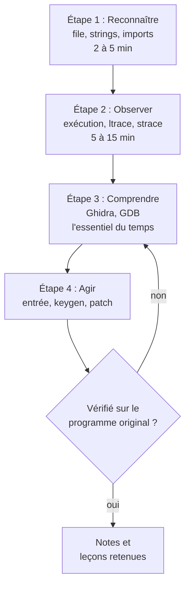

# Chapitre 8 : la méthode et les premiers outils

Objectif : disposer d'une méthode fixe, identique pour chaque challenge, et maîtriser les outils de première reconnaissance, qui suffisent à résoudre de nombreux challenges faciles.

## 8.1 Pourquoi chaque challenge semble différent

En surface, chaque crackme est différent. En profondeur, tous posent la même question : **qu'est-ce que le programme compare, et à quoi ?** Seule change la manière dont la réponse est dissimulée.

Disposer d'une méthode, c'est se poser toujours les mêmes questions, dans le même ordre. Après une dizaine de challenges abordés avec la même méthode, les schémas récurrents deviennent visibles.

## 8.2 La méthode en quatre étapes



### Étape 1 : reconnaître (2 à 5 minutes)

Rien d'intéressant n'est exécuté : on examine.

- Quel type de fichier ? Quelle architecture ? Strippé ou non ?
- Quelles chaînes de caractères contient-il ?
- Quelles fonctions de bibliothèque importe-t-il ?

**But** : formuler une première hypothèse. Par exemple : "il lit une saisie avec `fgets`, appelle `strcmp` et contient la chaîne `Bravo` : il s'agit probablement d'une comparaison directe."

### Étape 2 : observer (5 à 15 minutes)

Le programme est lancé et observé de l'extérieur.

- Que demande-t-il ? Que répond-il ?
- Quels appels de bibliothèque effectue-t-il (`ltrace`) ? Quels appels système (`strace`) ?

**But** : confirmer ou infirmer l'hypothèse, et trouver un point d'entrée pour l'analyse.

### Étape 3 : comprendre (l'essentiel du travail)

On ouvre le désassembleur et le débogueur.

- Partir de la **chaîne de succès** et remonter jusqu'à la **décision** (chapitre 3).
- Comprendre ce qui est comparé.
- Alterner analyse statique (lecture du code, chapitre 9) et dynamique (exécution pas à pas, chapitre 10).

**But** : savoir ce que le programme attend.

### Étape 4 : agir

Selon le challenge : fournir l'entrée attendue, écrire un script qui la calcule (keygen) ou modifier le programme (patch). Puis **vérifier** sur le programme original.

Une habitude à prendre dès maintenant : **prendre des notes** à chaque étape, dans un fichier par challenge (hypothèses, adresses intéressantes, noms donnés aux fonctions). Les notes de vingt challenges valent davantage que n'importe quel cours.

## 8.3 Les outils de reconnaissance

### file

```bash
$ file coffre_v1
coffre_v1: ELF 64-bit LSB pie executable, x86-64, version 1 (SYSV), dynamically linked,
interpreter /lib64/ld-linux-x86-64.so.2, ..., for GNU/Linux 3.2.0, not stripped
```

À lire :

- **ELF 64-bit x86-64** : Linux, 64 bits, conventions du chapitre 5 ;
- **pie** : les adresses changent à chaque exécution (le chapitre 10 explique comment le gérer dans GDB) ;
- **dynamically linked** : le programme utilise la libc, les appels à `strcmp`, `printf`... seront donc visibles ;
- **not stripped** : les noms des fonctions sont encore présents. Un binaire `stripped` n'en a plus (chapitre 12).

### strings

Affiche toutes les suites de caractères imprimables (4 au minimum par défaut).

```bash
strings coffre_v1
strings -n 8 coffre_v1          # au moins 8 caractères
strings -e l programme.exe      # chaînes UTF-16 (fréquentes sous Windows)
strings coffre_v1 | grep -i flag
```

C'est le premier réflexe, systématiquement. Dans les challenges très faciles, le mot de passe ou le flag y figure directement. Sinon, les chaînes livrent les messages du programme ("Bravo", "Wrong"), que l'on recherchera ensuite dans le désassembleur.

### nm, objdump, readelf

```bash
nm coffre_v1                    # liste des symboles (fonctions, globales)
nm -D coffre_v1                 # symboles dynamiques (fonctions importées)
objdump -d -M intel coffre_v1   # désassemblage complet
objdump -d -M intel coffre_v1 | grep -A40 "<main>:"   # uniquement main
readelf -h coffre_v1            # en-tête (dont le point d'entrée)
```

La liste des fonctions importées (`nm -D`) est très parlante : `strcmp`, `memcmp`, `strncmp` annoncent une comparaison ; `ptrace` de l'anti-debug ; `rand`, `srand`, `time` de l'aléatoire ; `socket`, `connect` du réseau.

## 8.4 Les outils d'observation

### ltrace : espionner les appels de bibliothèque

`ltrace` affiche chaque appel à une fonction de bibliothèque, **avec ses arguments**. Sortie obtenue dans le conteneur du cours :

```bash
$ echo test | ltrace ./coffre_v1
puts("=== Coffre v1 ===")                          = 18
printf("Mot de passe : ")                           = 15
fgets("test\n", 64, 0x7f...)                        = 0x7ffd...
strcspn("test\n", "\n")                             = 4   # longueur avant le premier \n : sert à retirer le retour à la ligne de fgets
strcmp("test", "Sesame_ouvre_toi")                  = 33
puts("Acces refuse.")                               = 14
```

La ligne `strcmp` montre que le programme compare la saisie à la bonne réponse, et ltrace l'affiche. C'est la technique la plus rentable du reverse débutant.

Limites : sur certaines distributions, ltrace n'affiche rien pour les binaires compilés avec certaines protections (liaison immédiate des symboles). Essayer alors `ltrace -x 'str*'` ou passer à GDB (chapitre 10). Par ailleurs, ltrace ne voit rien si le programme effectue la comparaison lui-même dans une boucle, ce qui sera le cas dès le coffre v2.

### strace : espionner les appels système

`strace` affiche les appels au noyau : ouverture de fichiers, lectures, écritures, réseau, création de processus.

```bash
$ echo test | strace ./coffre_v1
...
read(0, "test\n", 4096)                 = 5
write(1, "=== Coffre v1 ===\nMot de passe :"..., 47) = 47
exit_group(0)                           = ?
```

Pour un crackme simple, strace apporte peu. Pour un malware, c'est un outil majeur : quels fichiers il ouvre, à quoi il se connecte (chapitre 13).

```bash
strace -f -e trace=file,network,process ./programme   # filtrer par catégorie
strace -o trace.txt ./programme                       # enregistrer dans un fichier
```

**Attention : ltrace et strace exécutent le programme.** Sur un crackme compilé soi-même, aucun risque. Sur un fichier inconnu ou un malware, jamais en dehors d'un environnement isolé (chapitre 13).

## 8.5 Le désassemblage rapide

Pour un petit programme, objdump suffit :

```bash
objdump -d -M intel --no-show-raw-insn coffre_v1 | grep -B5 -A30 "<main>:"
```

Repérer dans `main` :

1. les appels de bibliothèque (`call ... <fgets@plt>`, `call ... <strcmp@plt>`) ;
2. les `lea rsi, [rip+...]` juste avant le `strcmp` : l'adresse de la chaîne comparée ;
3. le `test eax, eax` / `jne` qui suit : la décision.

Pour afficher le contenu de `.rodata` :

```bash
objdump -s -j .rodata coffre_v1
```

## Exercices

**Exercice 8.1** Lancer `file`, `strings` et `nm -D` sur `/bin/ls`. Que peut-on dire de ce programme sans l'exécuter ? Est-il strippé ?

**Exercice 8.2** Écrire un petit programme C qui demande un nombre avec `scanf("%d", &n)` et affiche "Gagne" si `n == 1337`. Le compiler. La réponse est-elle trouvable avec `strings` ? Avec `ltrace` ? Avec `objdump` ? Pourquoi ?

**Exercice 8.3** Sur https://crackmes.one, filtrer par difficulté 1.0 et plateforme Unix/Linux, puis télécharger deux crackmes. N'appliquer que les étapes 1 et 2 de la méthode. Combien sont résolus sans ouvrir de désassembleur ?

Pratique : les archives sont souvent des `.zip` protégés par le mot de passe `crackmes.one`. Pour transférer le fichier téléchargé sur le Mac vers le conteneur, le déposer dans le dossier du cours (partagé dans `/cours`, voir le guide d'installation), puis le décompresser côté conteneur. La difficulté affichée sur le site est donnée par l'auteur et reste approximative : un "1.0" peut bloquer, ce n'est pas anormal. Les crackmes de ce site sont censés être sûrs, mais par principe ils s'analysent dans le conteneur.

## Exercice de pont : votre propre coffre0

Avant d'attaquer des binaires inconnus, commencez par le plus familier : le `coffre0` que vous avez écrit en [partie 0](../partie0-c/13-projet.md). Vous connaissez son code, donc vous pouvez vérifier que votre lecture du désassemblage est correcte. C'est le meilleur pont entre écrire du C et le lire en assembleur.

Compilez-le, puis analysez-le **sans rouvrir le source** :

```bash
gcc -O1 -o coffre0 coffre0.c libmy.c
objdump -d coffre0 | less        # ou dans Ghidra
strings coffre0 | less
```

**Exercice 8.0 (N1 à N3)**

1. (N1) Avec `strings`, retrouvez les messages (`Coffre ouvert`, `Refuse`, `Usage ...`). Dans quelle fonction sont-ils utilisés ?
2. (N2) Dans le désassemblage de `main`, retrouvez le tableau `cible` : huit octets `43 6d 67 70 69 73 69 6c`. Comment sont-ils chargés (en données, immédiats, ...) ?
3. (N2) Repérez la boucle de vérification et la comparaison `(cle[i] + i) == cible[i]`. Où est le `+ i` ?
4. (N3) Sans utiliser votre mémoire de la clé, **déduisez la clé** à partir des octets `cible` : pour chaque position, calculez `cible[i] - i`. Vous devez retrouver `Clemence`. Vous venez d'écrire votre premier keygen, sur votre propre programme.

Solution : [solutions/partie2.md](../solutions/partie2.md#pont-coffre0)

## Fil rouge : coffre v1

Compiler `coffre_v1` sans lire le source (voir le [README](../README.md)).

1. **Reconnaître** : `file`, `strings`, `nm -D`. Formuler l'hypothèse en une phrase dans les notes.
2. **Observer** : lancer le programme avec une mauvaise réponse sous `ltrace`.
3. **Comprendre** : désassembler `main` avec objdump et retrouver l'appel à `strcmp`, ses deux arguments et le saut qui décide.
4. **Agir** : ouvrir le coffre.
5. Trouver **trois façons différentes** d'obtenir le mot de passe. Laquelle aurait fonctionné si le mot de passe n'avait pas figuré en clair dans le binaire ?

Solutions : [solutions/partie2.md](../solutions/partie2.md#coffre-v1)

## Suivi

- [ ] Chapitre 8 : lecture
- [ ] Chapitre 8 : exercices
- [ ] Chapitre 8 : fil rouge (coffre v1)
