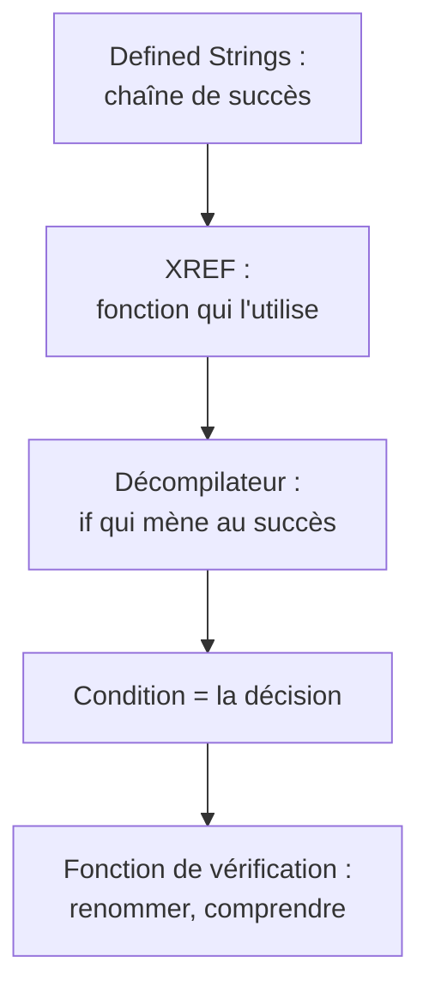

# Chapitre 2 : analyse statique avec Ghidra

Objectif : utiliser un désassembleur et décompilateur pour comprendre un programme sans l'exécuter. Ghidra est gratuit, développé par la NSA et largement suffisant pour les CTF comme pour l'analyse de malware. Il s'installe directement sur macOS (voir le [guide d'installation](../environnement/INSTALLATION-MAC.md#6-ghidra-sur-macos)).

**Analyse statique** : lire le programme sans l'exécuter. **Analyse dynamique** : l'exécuter et l'observer (chapitre 3). Les deux se complètent et s'alternent en permanence.

!!! note "Binary Ninja comme alternative"
    Ghidra sert de référence dans ce cours, car il est gratuit et complet. **Binary Ninja** est un autre désassembleur et décompilateur, réputé pour son confort et la qualité de sa vue décompilée. Une version **Free** existe : c'est une application à télécharger (macOS, Windows, Linux) depuis [binary.ninja/free](https://binary.ninja/free), aux fonctions limitées mais suffisantes pour débuter. Pour travailler directement dans le navigateur, sans rien installer, il existe **Binary Ninja Cloud** sur [cloud.binary.ninja](https://cloud.binary.ninja). Voir aussi le [guide d'installation](../environnement/INSTALLATION-MAC.md#7-binary-ninja-optionnel).

    Les notions sont les mêmes ; seuls changent les noms et les raccourcis. Correspondance des actions les plus utilisées :

    | Action | Ghidra | Binary Ninja |
    |---|---|---|
    | Renommer | `L` | `N` |
    | Changer le type | `Ctrl+L` | `Y` |
    | Références croisées | clic droit, `References to` | `X` |
    | Vue décompilée | fenêtre Decompiler | vue **HLIL** (High Level IL) |
    | Désassemblage | fenêtre Listing | vue **Disassembly** |

    Les exercices et les captures du cours sont rédigés pour Ghidra. Un lecteur équipé de Binary Ninja peut les suivre en transposant ces raccourcis.

## 2.1 Premier projet

1. Lancer Ghidra.
2. `File > New Project > Non-Shared Project`, choisir un dossier et un nom (par exemple `cours-reverse`).
3. `File > Import File`, sélectionner le binaire (dans le dossier du cours, partagé avec le conteneur). Ghidra détecte le format (ELF, x86 64 bits). Valider.
4. Double-cliquer sur le fichier importé : la fenêtre **CodeBrowser** s'ouvre et propose d'analyser le programme. Répondre **Yes** puis **Analyze** avec les options par défaut.

## 2.2 Les fenêtres à connaître

- **Symbol Tree** (à gauche) : la liste des fonctions (`Functions`), des imports, des exports. Commencer par y chercher `main`.
- **Listing** (au centre) : le désassemblage, avec adresses, octets et instructions. Les références (qui appelle quoi) figurent en commentaire (`XREF`).
- **Decompiler** (à droite) : le pseudo-C. Un clic sur une ligne du décompilateur surligne les instructions correspondantes dans le listing, et inversement. C'est l'outil idéal pour relier C et assembleur.
- **Defined Strings** (`Window > Defined Strings`) : toutes les chaînes trouvées, avec leur adresse.
- **Function Graph** (`Window > Function Graph`) : la fonction sous forme de blocs reliés par des flèches. Très utile pour visualiser d'un coup d'œil les `if` et les boucles.

## 2.3 Les actions essentielles

| Action | Raccourci | Usage |
|---|---|---|
| Renommer (fonction, variable, label) | `L` | Transformer `FUN_001011e9` en `verifier`, `local_10` en `i` |
| Changer le type | `Ctrl+L` (`Cmd+L` sur Mac selon la configuration) | Indiquer que `param_1` est un `char *`, ou qu'une variable est une structure |
| Ajouter un commentaire | `;` | Conserver ses notes dans le projet |
| Aller à une adresse ou un symbole | `G` | Accéder directement à `main` ou à `0x101250` |
| Références vers l'élément | clic droit `References > Show References to` | Qui appelle cette fonction ? Qui utilise cette chaîne ? |
| Revenir en arrière | `Alt+Gauche` | Après avoir suivi un appel |
| Changer l'affichage d'une constante | clic droit, `Convert` | Afficher `0x2a` comme `'*'` ou en décimal |

Le renommage est **la** compétence clé dans Ghidra. Le décompilateur produit d'abord des noms comme `param_1`, `local_10`, `uVar2`, `FUN_00101189`. Chaque fois que le rôle d'une variable ou d'une fonction est compris, il faut la renommer. Le code devient progressivement lisible, exactement comme lors de l'annotation du fil rouge de la partie 2.

## 2.4 La technique de base : partir des chaînes



1. Ouvrir **Defined Strings**.
2. Trouver la chaîne de succès ("Bravo", "Correct", "Coffre ouvert").
3. Double-cliquer dessus : le listing se positionne à son adresse dans `.rodata`.
4. Examiner le `XREF` à côté (ou `Show References to`) : il indique la fonction qui l'utilise. Double-cliquer.
5. Dans cette fonction, chercher dans le décompilateur le `if` qui mène à l'affichage du succès : c'est la décision.

Cette technique fonctionne sur la grande majorité des crackmes.

## 2.5 Lire le décompilateur avec un regard critique

Le pseudo-C de Ghidra est une **reconstruction**. Il est souvent juste, mais peut induire en erreur :

- les types sont devinés (`undefined4`, `undefined8` signifient "4 ou 8 octets, type inconnu") ;
- les tableaux apparaissent souvent sous forme d'arithmétique de pointeurs : `*(byte *)(param_1 + local_10)` est simplement `param_1[local_10]` ;
- les opérations optimisées peuvent apparaître telles quelles (`(x >> 0x1f) + x >> 1`) ;
- certains appels ont de mauvais arguments si Ghidra s'est trompé de convention.

Exemple typique de sortie de Ghidra sur une fonction de vérification (noms par défaut) :

```c
undefined8 FUN_001011e9(char *param_1)
{
  size_t sVar1;
  undefined8 uVar2;
  ulong local_10;

  sVar1 = strlen(param_1);
  if (sVar1 == 0x13) {
    for (local_10 = 0; local_10 < 0x13; local_10 = local_10 + 1) {
      if ((byte)(param_1[local_10] ^ 0x2aU) != (&DAT_00102010)[local_10]) {
        return 0;
      }
    }
    uVar2 = 1;
  }
  else {
    uVar2 = 0;
  }
  return uVar2;
}
```

Après deux minutes de renommage (`L`) et de retypage (`Ctrl+L`) :

```c
int verifier(char *saisie)
{
  size_t longueur;
  ulong i;

  longueur = strlen(saisie);
  if (longueur != 19) return 0;
  for (i = 0; i < 19; i++) {
    if ((byte)(saisie[i] ^ 0x2a) != cle[i]) return 0;
  }
  return 1;
}
```

Lorsque le décompilateur produit un résultat étrange, il faut **consulter l'assembleur** à côté. C'est précisément l'intérêt de la partie 2.

## 2.6 Extraire des données

La clé ou le texte chiffré est souvent un tableau situé dans `.data` ou `.rodata` (`DAT_00102010` ci-dessus). Pour le récupérer :

1. double-cliquer sur `DAT_00102010` pour aller à l'adresse ;
2. sélectionner les octets dans le listing (clic sur la première ligne, Maj+clic sur la dernière) ;
3. clic droit `Copy Special > Python List` (ou `Byte String`).

On peut aussi définir le bon type : se placer sur l'adresse, clic droit `Data > Create Array`, nombre d'éléments 19. Le listing affiche alors un tableau propre.

La résolution se fait ensuite en Python. Pour un XOR, elle est immédiate :

```python
cle = [0x12, 0x34, ...]                 # copié depuis Ghidra
print(bytes(b ^ 0x2a for b in cle))
```

C'est le schéma le plus courant des crackmes "easy" : **lire l'algorithme dans Ghidra, copier les données, inverser l'algorithme en Python**.

## 2.7 Structures et types

Si une fonction accède à `param_1 + 0x10`, `param_1 + 0x14`, etc., il s'agit d'une structure (chapitre 6). Dans Ghidra :

1. `Window > Data Type Manager`, clic droit sur le nom du programme, `New > Structure` ;
2. ajouter les champs avec leurs tailles et offsets ;
3. dans le décompilateur, `Ctrl+L` sur `param_1`, et lui donner le type `ma_structure *`.

Le code affiche alors `param_1->pv` au lieu de `*(int *)(param_1 + 0x10)`. C'est rarement nécessaire pour des CTF faciles, mais très fréquent en analyse de malware (structures de configuration, en-têtes de protocole).

## Exercices

**Exercice 2.1** Ouvrir `mystere` (partie 2) dans Ghidra. Comparer le décompilé de `verifier` avec la version écrite au chapitre 7. Qu'est-ce que Ghidra a mieux restitué ? Moins bien ?

**Exercice 2.2** Compiler `mystere` en `-O2` (`gcc -O2 -no-pie -fno-stack-protector mystere.c -o mystere_O2`), l'ouvrir dans Ghidra. Le décompilateur s'en sort-il ? Comment a-t-il traduit la séquence `sub eax, 0x30` / `cmp sil, 0x9` / `ja` ?

**Exercice 2.3** Compiler un programme C de son choix contenant une structure, la retrouver dans Ghidra et la recréer avec le Data Type Manager.

## Fil rouge : coffre v2, en statique

Compiler `coffre_v2`.

1. **Reconnaître** : `strings coffre_v2`. Le mot de passe est-il visible ? `nm -D` : quelles fonctions de comparaison sont importées ? Qu'en déduire ?
2. **Observer** : `ltrace ./coffre_v2`. La comparaison est-elle visible ?
3. **Comprendre** : ouvrir le binaire dans Ghidra, trouver `main` puis la fonction de vérification à partir de la chaîne de succès. Renommer tout ce qui peut l'être. Décrire l'algorithme en une phrase.
4. Récupérer le tableau de données utilisé dans la comparaison (section 2.6).
5. **Agir** : écrire un script Python qui calcule le mot de passe, puis le vérifier sur le programme.
6. Conserver le projet Ghidra : au chapitre 3, le même coffre sera résolu **sans** lire l'algorithme, uniquement avec le débogueur.

Solutions : [solutions/partie2.md](../solutions/partie2.md#coffre-v2)

## Suivi

- [ ] Partie 3, chapitre 2 : lecture
- [ ] Partie 3, chapitre 2 : exercices
- [ ] Partie 3, chapitre 2 : fil rouge (coffre v2 en statique)
