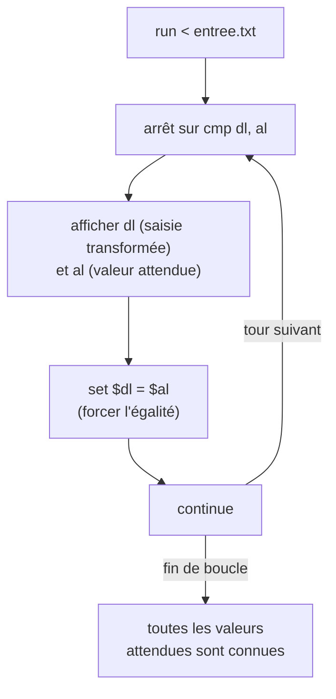

# Chapitre 10 : analyse dynamique avec GDB

Objectif : exécuter un programme pas à pas, examiner ses registres et sa mémoire, et le modifier en cours d'exécution. Le débogueur offre souvent le chemin le plus court : au lieu de comprendre un algorithme complexe, on laisse le programme calculer la réponse et on la lit.

Rappel pour les Mac Apple Silicon : GDB ne fonctionne que si le conteneur tourne dans une machine virtuelle x86-64 (Colima avec `--arch x86_64`), voir le [guide d'installation](../environnement/INSTALLATION-MAC.md).

## 10.1 GDB et GEF

GDB seul est austère. Le conteneur du cours inclut **GEF** : à chaque arrêt, il affiche automatiquement les registres, la pile, le code autour de `rip` et les arguments des appels. Toutes les commandes ci-dessous sont des commandes GDB standard, utilisables avec ou sans GEF (et avec pwndbg, son équivalent).

## 10.2 Lancer et arrêter

```
gdb ./coffre_v2               # charge le programme sans le lancer
(gdb) run                     # lance (raccourci : r)
(gdb) run < entree.txt        # lance avec un fichier en entrée standard
(gdb) run arg1 arg2           # lance avec des arguments
(gdb) starti                  # lance et s'arrête sur la toute première instruction
(gdb) quit                    # (q)
```

Astuce : pour un programme qui lit au clavier, préparer un fichier `entree.txt` contenant la saisie. C'est plus pratique que de la taper à chaque exécution.

## 10.3 Les points d'arrêt

Un **point d'arrêt** (breakpoint) interrompt le programme lorsqu'il atteint une adresse.

```
break main                   # sur une fonction (si le binaire a des symboles)
break *0x401183              # sur une adresse précise (noter l'étoile)
break *verifier+87           # sur une instruction à l'intérieur d'une fonction
break strcmp                 # sur une fonction de bibliothèque
info breakpoints             # liste
delete 2                     # supprime le point d'arrêt n°2
```

### Le cas des binaires PIE

Un binaire PIE (chapitre 8) est chargé à une adresse différente à chaque exécution : les adresses affichées par Ghidra (`0x101240`) ne sont pas celles de l'exécution. Solutions :

- GDB désactive la randomisation par défaut : sous GDB, le programme est presque toujours chargé à la base `0x555555554000`. Le calcul pas à pas, pour une instruction vue à `0x101240` dans Ghidra :
    1. retirer la base de Ghidra (par défaut `0x100000`) pour obtenir l'offset dans le fichier : `0x101240 - 0x100000 = 0x1240` ;
    2. ajouter la base réelle sous GDB : `0x555555554000 + 0x1240 = 0x555555555240`.
  C'est donc à `0x555555555240` qu'il faut poser le point d'arrêt. Autre méthode, sans calcul : poser le point d'arrêt sur un symbole (`break main`) quand il existe.
- Plus simple : utiliser les symboles lorsqu'ils existent (`break *verifier+87`).
- Avec GEF : `pie break *0x1240` puis `pie run`.
- Ou encore : `starti`, puis `info proc mappings` pour lire l'adresse de base.

Pour ses propres exercices, on peut aussi compiler avec `-no-pie` : les adresses d'objdump sont alors exactement celles de l'exécution.

## 10.4 Avancer

| Commande | Effet |
|---|---|
| `continue` (`c`) | reprend jusqu'au prochain point d'arrêt |
| `nexti` (`ni`) | exécute une instruction, **sans entrer** dans les `call` |
| `stepi` (`si`) | exécute une instruction, **en entrant** dans les `call` |
| `finish` | termine la fonction en cours et s'arrête au retour |
| `until *ADRESSE` | continue jusqu'à cette adresse |

`ni` est la commande la plus utilisée. `si` sert uniquement à entrer dans une fonction du programme qui présente un intérêt (jamais dans `printf`, où l'on se perdrait).

## 10.5 Examiner

```
info registers               # tous les registres (i r)
info registers rax rdi       # certains registres
print $rax                   # p $rax
print/x $rax                 # en hexadécimal
print/c $al                  # comme caractère
x/s $rdi                     # la chaîne pointée par rdi
x/20xb $rsp                  # 20 octets en hexadécimal à partir de rsp
x/4xg $rsp                   # 4 valeurs de 8 octets
x/10i $rip                   # 10 instructions à partir de rip
disassemble                  # la fonction courante
```

La commande `x` (examine) se lit `x/NFT adresse` : N = nombre, F = format (`x` hexadécimal, `d` décimal, `s` chaîne, `i` instruction, `c` caractère), T = taille (`b` 1 octet, `h` 2, `w` 4, `g` 8).

### La technique principale : s'arrêter sur la comparaison

Si un programme compare la saisie à la bonne réponse, cette réponse se trouve forcément, à un moment donné, en mémoire ou dans un registre. Il suffit de placer un point d'arrêt **sur la comparaison** et de la lire.

Pour un `strcmp` :

```
(gdb) break strcmp
(gdb) run
...
(gdb) x/s $rdi       # 1er argument : la saisie
(gdb) x/s $rsi       # 2e argument : la bonne réponse
```

Pour une comparaison écrite à la main (`cmp dl, al`), s'arrêter sur le `cmp` et lire les deux registres.

## 10.6 Modifier

```
set $rax = 0                         # changer un registre
set $eflags ^= 0x40                  # inverser le Zero Flag (bit 6)
set {char}0x555555556010 = 0x41      # écrire un octet en mémoire
set {int}($rbp-0x4) = 8              # écrire un int
jump *0x555555555257                 # sauter directement ailleurs
```

Cette possibilité est très puissante. Face à un `test eax, eax` / `je echec`, il suffit de s'arrêter sur le `test`, d'exécuter `set $eax = 1` puis de continuer : la vérification est contournée sans rien comprendre à l'algorithme. Cela ne donne pas toujours le flag (s'il dépend de la saisie), mais permet souvent d'atteindre du code intéressant.

Inverser le Zero Flag juste après un `cmp` produit le même effet : le `je` suivant prend la décision inverse.

## 10.7 Automatiser

Un script GDB est une simple liste de commandes :

```
# fichier sol.gdb
set pagination off
break *verifier+87
run < entree.txt
info registers dl al
```

```bash
gdb -batch -x sol.gdb ./coffre_v2
```

On peut associer des commandes à un point d'arrêt, exécutées à chaque passage :

```
break *verifier+87
commands
  silent
  printf "dl=%02x al=%02x\n", $dl, $al
  set $dl = $al          # forcer l'égalité pour que la boucle continue
  continue
end
run < entree.txt
```

Ce script affiche toutes les valeurs attendues par une boucle de comparaison, en forçant l'égalité à chaque tour pour que la boucle se poursuive. Ce schéma sert très souvent.



Pour aller plus loin, GDB s'automatise en Python (`gdb.execute`, `gdb.parse_and_eval`), ce qui n'est pas nécessaire à ce stade.

## 10.8 L'approche boîte noire

Il est parfois plus rapide d'observer comment le programme transforme une entrée connue que de lire son code :

1. fournir une entrée facile à repérer (`AAAAAAAA`) ;
2. s'arrêter juste avant la comparaison ;
3. observer en quoi `A` (0x41) a été transformé. Si l'on obtient `0x6b`, ce peut être `0x41 ^ 0x2a = 0x6b` ou `0x41 + 0x2a`. Un essai avec `B` permet de trancher.

Combiner cette observation avec une lecture rapide du code dans Ghidra est la manière de travailler la plus efficace.

## Exercices

**Exercice 10.1** Lancer `mystere` dans GDB avec l'argument `12345678`. Placer un point d'arrêt sur `verifier`, puis avancer avec `ni` jusqu'à la première comparaison. Que vaut `[rbp-0x4]` à ce moment ? (`x/dw $rbp-4`)

**Exercice 10.2** Toujours sur `mystere`, avec un code invalide, faire afficher "Code accepte" en modifiant uniquement la valeur de retour de `verifier` (indice : `finish`, puis `set`).

**Exercice 10.3** Écrire un script GDB qui, pour `mystere` lancé avec `12345678`, affiche à chaque tour de la deuxième boucle la valeur de `i` et de `somme`.

## Fil rouge : coffre v2, en dynamique

Cette fois, le décompilateur est interdit. Seuls GDB (et le listing, pour trouver les adresses) sont autorisés.

1. Trouver l'adresse de l'instruction qui compare un caractère transformé de la saisie avec un caractère attendu (indice : `disassemble verifier`, chercher `cmp dl, al`).
2. Préparer un fichier d'entrée de la bonne longueur (testée au début de `verifier` avec `strlen`). Placer un point d'arrêt sur la comparaison et lancer.
3. Au premier arrêt, lire `dl` et `al`. La saisie commençait par `A` (0x41) : quelle transformation a été appliquée ?
4. Écrire le script GDB de la section 10.7 pour récupérer **tous** les caractères attendus en une seule exécution.
5. Retrouver le mot de passe à partir de ces valeurs et le vérifier.
6. Comparer avec la solution du chapitre 9. Quelle approche a été la plus rapide ? Dans quels cas l'une serait-elle préférable à l'autre ?

Solutions : [solutions/partie2.md](../solutions/partie2.md#coffre-v2)

## Suivi

- [ ] Chapitre 10 : lecture
- [ ] Chapitre 10 : exercices
- [ ] Chapitre 10 : fil rouge (coffre v2 en dynamique)
