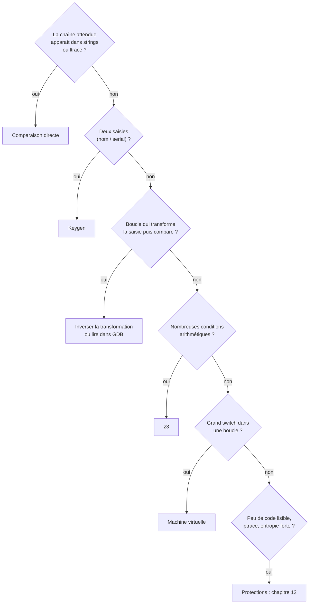

# Chapitre 11 : les grands classiques des crackmes

Objectif : connaître les schémas récurrents, afin d'identifier en quelques minutes le type de challenge rencontré. Ce chapitre répond directement à l'impression que "chaque challenge est différent" : en pratique, presque tous sont des variations de ce qui suit.

## 11.1 Le catalogue

| Schéma | Indices | Résolution |
|---|---|---|
| **Comparaison directe** | `strcmp`, `memcmp`, `strncmp` avec une chaîne fixe | `strings`, `ltrace`, point d'arrêt sur la comparaison |
| **Chaîne cachée** | grandes constantes `movabs` copiées sur la pile | conversion en little endian, ou lecture de la pile dans GDB |
| **Transformation puis comparaison** | boucle sur la saisie avec `xor`, `add`, `sub`, `rol`, puis comparaison à un tableau | inverser la transformation en Python, ou lire les valeurs attendues dans GDB |
| **Comparaison d'empreinte** | constantes de MD5, SHA, CRC32 (voir 11.4) | empreinte sur toute la saisie : force brute ou dictionnaire ; sinon caractère par caractère |
| **Keygen (nom / serial)** | deux saisies, une fonction de calcul sur la première, comparaison avec la seconde | réimplémenter le calcul en Python |
| **Contraintes** | nombreuses conditions arithmétiques sur les caractères (`s[0]+s[3]==0x9a`, `s[1]*s[2]==...`) | écrire les contraintes et les résoudre avec z3 (voir 11.5) |
| **Machine virtuelle** | boucle avec un grand `switch` qui lit un tableau d'"opcodes" | écrire un désassembleur du bytecode, puis analyser le bytecode |
| **Flag déchiffré en mémoire** | le flag n'est jamais affiché, mais il est calculé | point d'arrêt après le déchiffrement, lecture de la mémoire |
| **Anti-debug / anti-analyse** | `ptrace`, mesure du temps, lecture de `/proc/self/status` | chapitre 12 |
| **Programme packé** | presque aucune fonction, entropie élevée, chaînes illisibles | chapitre 12 |

Devant un nouveau challenge, après les étapes "reconnaître" et "observer" du chapitre 8, la question à se poser est : **à quelle ligne de ce tableau correspond-il ?** La résolution correspondante s'applique ensuite.



Plusieurs termes de ce catalogue (empreinte et fonction de hachage, MD5, entropie, programme packé, opcode et bytecode) sont définis plus loin : empreinte et hachage en 11.4, entropie et packing au chapitre 12. Une **fonction de hachage** transforme une donnée de taille quelconque en une empreinte de taille fixe, impossible à inverser directement.

## 11.2 Inverser une transformation

Si le programme vérifie `transforme(saisie) == attendu`, il faut calculer `transforme⁻¹(attendu)`.

| Opération dans le programme | Opération inverse |
|---|---|
| `c ^ k` | `c ^ k` (le XOR est son propre inverse) |
| `c + k` | `c - k` (modulo 256 pour un octet) |
| `c - k` | `c + k` |
| `rol c, n` | `ror c, n` |
| `c * k` (modulo 256, k impair) | `c * inverse(k)` modulo 256 (`pow(k, -1, 256)` en Python ; notion avancée, l'inverse modulaire n'est pas indispensable à la première lecture) |
| permutation des positions `out[p[i]] = in[i]` | `in[i] = out[p[i]]` |
| plusieurs opérations successives | les inverses **dans l'ordre inverse** |

Attention aux transformations qui dépendent de la position (`c ^ (k + i)`) ou du caractère précédent (`c ^ prev`) : il faut alors reproduire exactement l'état à chaque tour.

Lorsque l'inversion est trop complexe, il reste la **force brute caractère par caractère** : si chaque caractère de sortie ne dépend que d'un caractère d'entrée, on essaie les valeurs possibles pour chaque position.

```python
attendu = [...]
def transforme(c, i):            # recopiée du programme
    return ((c ^ 0x37) + i) & 0xff
mdp = ''
for i, a in enumerate(attendu):
    for c in range(32, 127):
        if transforme(c, i) == a:
            mdp += chr(c)
            break
print(mdp)
```

## 11.3 Le keygen

Un **keygen** est un programme qui génère un serial valide pour n'importe quel nom. Méthode :

1. trouver la fonction qui calcule une valeur à partir du nom ;
2. trouver où le résultat est comparé au serial, et sous quelle forme le serial est lu (`atoi` = décimal, `strtoul(s, NULL, 16)` = hexadécimal, `sscanf` avec quel format ?) ;
3. réimplémenter le calcul **exactement** en Python ;
4. tester sur plusieurs noms.

Piège principal en Python : les entiers n'ont pas de taille limite. En C, un `unsigned int` fait 32 bits et "reboucle" à 2^32. Il faut donc ajouter `& 0xFFFFFFFF` après chaque opération susceptible de déborder (multiplication, addition, décalage à gauche).

```python
h = (h * 31 + c) & 0xFFFFFFFF                 # comme un unsigned int
rol3 = ((h << 3) | (h >> 29)) & 0xFFFFFFFF    # rotation à gauche de 3 bits sur 32 bits
```

Autre piège : le signe. Si la variable C est un `int` signé et que l'algorithme utilise un décalage à droite (`sar`), le signe doit être géré. En cas de doute, vérifier si l'assembleur utilise `sar` (signé) ou `shr` (non signé).

**Un keygen se vérifie toujours dans GDB** : point d'arrêt juste avant la comparaison finale, puis comparaison de la valeur calculée par le programme avec celle du script, pour le même nom.

## 11.4 Reconnaître les algorithmes connus par leurs constantes

De nombreux algorithmes utilisent des constantes caractéristiques. Une recherche sur internet permet alors de les identifier immédiatement, sans avoir à les reverser.

| Constante | Algorithme |
|---|---|
| `0x67452301`, `0xefcdab89`, `0x98badcfe`, `0x10325476` | MD5 (et SHA-1 avec `0xc3d2e1f0`) |
| `0x6a09e667`, `0xbb67ae85` | SHA-256 |
| `0xedb88320` | CRC32 |
| `0x9e3779b9` | TEA / XTEA (chiffrement), ou hachage |
| `0x63, 0x7c, 0x77, 0x7b...` (table de 256 octets) | S-box de l'AES |
| `"ABCDEFGHIJKLMNOPQRSTUVWXYZabcdefghijklmnopqrstuvwxyz0123456789+/"` | Base64 |
| `0x811c9dc5` et `0x01000193` | hachage FNV-1a |
| boucle de 256 tours qui permute un tableau de 0 à 255, puis XOR | RC4 |

Des outils le font automatiquement : le plugin **FindCrypt** pour Ghidra, ou **capa** (chapitre 13), repèrent ces constantes.

## 11.5 Résoudre des contraintes avec z3

Lorsqu'un programme vérifie des dizaines de conditions sur les caractères, il ne faut pas les résoudre à la main. **z3** est un solveur : on décrit les contraintes, il trouve une solution. Il est installé dans le conteneur du cours.

```python
from z3 import *

s = [BitVec(f's{i}', 8) for i in range(4)]   # 4 caractères de 8 bits
solveur = Solver()
for c in s:
    solveur.add(UGE(c, 0x20), ULE(c, 0x7e))    # caractères imprimables (comparaison non signée)
solveur.add(s[0] + s[1] == 0xad)
solveur.add(s[1] ^ s[2] == 0x5c)
solveur.add(s[2] - s[3] == 0x04)
solveur.add(s[3] == ord('k'))

if solveur.check() == sat:
    m = solveur.model()
    print(''.join(chr(m[c].as_long()) for c in s))
```

Attention : sur des `BitVec`, les opérateurs `<`, `<=`, `>`, `>=` de z3 sont **signés**. Pour une comparaison non signée (l'équivalent de `jb`, `ja`), il faut utiliser `ULT`, `ULE`, `UGT`, `UGE`. C'est exactement la distinction signé / non signé du chapitre 3.

Le travail du reverseur consiste à **traduire fidèlement** les conditions du programme ; z3 fait le reste. Ce cas est très fréquent dans les CTF de niveau intermédiaire.

Pour information : **angr** va plus loin et explore automatiquement le programme pour trouver une entrée qui atteint une adresse donnée ("une saisie qui mène à `puts("Bravo")`"). Puissant mais délicat à maîtriser, il est à réserver pour plus tard.

## 11.6 Le patching

L'objectif est parfois de **modifier** le programme : supprimer une vérification, une limite de temps, une protection. On modifie alors directement les octets du fichier.

### Comment un saut est encodé

Pour patcher un saut, il faut savoir le reconnaître dans les octets du listing (section 2.2). Un saut conditionnel court tient sur **2 octets** : un code d'opération, puis un déplacement relatif.

```
1180:   74 06       je     1188
             |
   déplacement : +6 octets après la fin de l'instruction (0x1182 + 6 = 0x1188)
```

Chaque condition a son octet : `74` pour `je`/`jz`, `75` pour `jne`/`jnz`, `7e` pour `jle`, `7f` pour `jg`, et ainsi de suite. Le saut inconditionnel court `jmp` est `EB`, et `90` est `nop` (ne rien faire). Quand la cible est trop loin pour tenir dans un octet signé, le compilateur émet un saut **long** de 6 octets : `0F 84 XX XX XX XX` pour `je`, `0F 85 ...` pour `jne`. Patcher consiste à changer ces octets.

Modifications classiques :

| Avant | Après | Effet |
|---|---|---|
| `74 XX` (`je` court) | `75 XX` (`jne`) | inverse la condition |
| `74 XX` (`je` court) | `EB XX` (`jmp`) | le saut est toujours pris |
| `74 XX` (`je` court) | `90 90` (deux `nop`) | le saut n'est jamais pris |
| `0F 84 XX XX XX XX` (`je` long) | `0F 85 ...` (`jne`) ou six `90` | idem pour les sauts longs |
| `call verif` (5 octets) | `B8 01 00 00 00` (`mov eax, 1`) | remplace l'appel par "la fonction a renvoyé 1" |

### Adresse en mémoire ou position dans le fichier

Une distinction est indispensable pour patcher, et elle resservira au chapitre 17. Le désassembleur affiche l'**adresse virtuelle** : la position de l'instruction une fois le programme chargé en mémoire (par exemple `0x401180`). Mais pour modifier un octet du fichier sur le disque, il faut sa **position dans le fichier** (son *offset*), qui est en général différente.

La correspondance se lit avec `readelf -S` (colonnes `Address` et `Offset` de chaque section) ou directement dans Ghidra. Pour une section donnée : `offset_fichier = adresse_virtuelle - Address + Offset`. Pour les petits exécutables Linux non PIE, les deux coïncident souvent, mais il faut toujours le vérifier, car ce n'est pas garanti.

### Avec Ghidra

1. Se placer sur l'instruction dans le listing.
2. Clic droit `Patch Instruction` (ou `Ctrl+Shift+G`), saisir la nouvelle instruction (par exemple `JNZ 0x101308`).
3. `File > Export Program`, format **Original File**, pour produire un nouvel exécutable.
4. `chmod +x` sur le fichier exporté, puis tester dans le conteneur.

### À la main

1. Trouver l'**offset dans le fichier** de l'instruction : `objdump -d -F` affiche `File Offset` en tête de chaque fonction. Pour les petits binaires Linux, l'offset dans le fichier est souvent égal à l'adresse virtuelle sans la base, mais il faut toujours le vérifier.
2. Modifier l'octet, par exemple en Python :

```python
data = bytearray(open('coffre_v1', 'rb').read())
off = 0x127e                    # offset de l'octet à modifier
print(hex(data[off]))           # vérifier l'emplacement : 0x75 (jne) attendu
data[off] = 0x74                # jne devient je
open('coffre_v1_patch', 'wb').write(data)
```

Dans `coffre_v1` compilé avec gcc 13, on trouve `127c: test eax,eax` puis `127e: 75 11  jne 1291`. Après le patch, toute saisie **fausse** ouvre le coffre (et la bonne le referme). Avec un autre compilateur, l'offset peut différer : le retrouver avec `objdump -d coffre_v1`.

Le patching a peu d'intérêt lorsque le flag dépend de la saisie (le programme affichera "Bravo" et un flag faux). Il est en revanche indispensable pour contourner des protections (chapitre 12) et pour les challenges du type "faire afficher le message caché".

## Exercices

**Exercice 11.1** Pour chaque description, indiquer le schéma du tableau 11.1 correspondant et l'approche à adopter :

- a) Ghidra montre une boucle de 32 tours sur la saisie qui calcule `out[i] = in[i] ^ in[(i+1) % 32]`, puis un `memcmp` avec un tableau global.
- b) Le programme importe `MD5_Init`, `MD5_Update`, `MD5_Final` et compare le résultat à une chaîne de 32 caractères hexadécimaux.
- c) `main` contient 40 `if` du type `if (s[7] * 3 - s[12] != 0x95) fail();`.
- d) Le programme lit un fichier `prog.bin`, puis entre dans une boucle contenant un `switch` de 16 cas.

**Exercice 11.2** Résoudre l'exemple z3 de la section 11.5, puis le modifier pour déterminer s'il existe une autre solution (indice : ajouter une contrainte qui exclut la première et relancer `check()`).

**Exercice 11.3** Patcher `mystere` (partie 1) pour qu'il accepte n'importe quel code, de deux façons : en modifiant un saut dans `main`, puis en modifiant `verifier` pour qu'elle renvoie toujours 1.

**Exercice 11.4** Sur crackmes.one, chercher des crackmes Linux de difficulté 1.0 à 2.0 dont le titre ou la description mentionne "keygen", et en résoudre un.

## Fil rouge : coffre v3, le keygen

Compiler `coffre_v3` (en `-O1`, donc légèrement optimisé, comme indiqué dans le README).

1. **Reconnaître et observer** : que demande le programme ? Le nom est-il soumis à une condition ? Avec `nm -D`, quelle fonction convertit le serial en nombre ? Dans quelle base (examiner l'argument dans le désassemblage) ?
2. **Comprendre** : ouvrir le programme dans Ghidra. La fonction de calcul a été **inlinée** dans `main` (chapitre 7). Trouver la boucle sur le nom et décrire le calcul. On y rencontre l'idiome `shl ecx, 5` / `sub ecx, eax` et une instruction `rol` : que font-ils ?
3. Quelle est la valeur initiale du calcul ? Quelle opération est effectuée à la fin, après la boucle ?
4. **Agir** : écrire `keygen.py`, qui prend un nom en argument et affiche le serial. Attention au format attendu par le programme (hexadécimal).
5. **Vérifier** : tester le keygen avec trois noms différents. En cas d'échec, placer un point d'arrêt sur le `cmp` qui suit l'appel à `strtoul` et comparer les deux valeurs avec celle du script.
6. Bonus : est-il possible d'ouvrir le coffre **sans** keygen, avec un simple patch ? Que vaut alors le flag affiché ?

Solutions : [solutions/partie2.md](../solutions/partie2.md#coffre-v3)

## Suivi

- [ ] Chapitre 11 : lecture
- [ ] Chapitre 11 : exercices
- [ ] Chapitre 11 : fil rouge (coffre v3)
