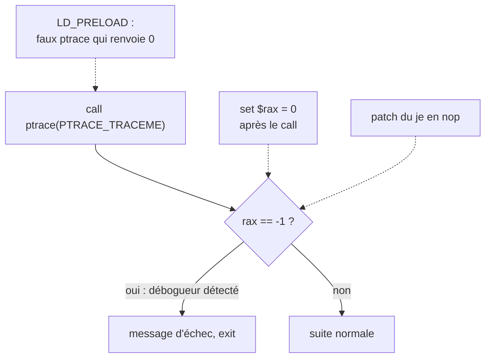
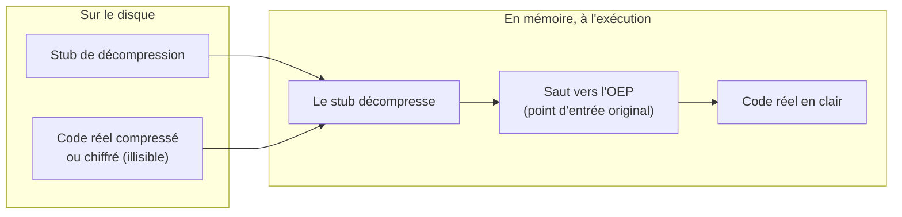

# Chapitre 5 : protections et anti-analyse

Objectif : reconnaître et contourner les protections les plus courantes. Elles sont fréquentes dans les CTF de niveau intermédiaire et quasi systématiques dans les malwares. Elles sont toutefois peu nombreuses, et leurs contournements suivent toujours les mêmes principes.

## 5.1 Le binaire strippé

`strip programme` supprime les noms des fonctions. Conséquences :

- `nm` n'affiche plus rien (sauf les imports dynamiques, toujours présents : `nm -D`) ;
- Ghidra nomme les fonctions `FUN_00101189` ;
- dans GDB, `break main` ne fonctionne plus.

### Retrouver main

Le point d'entrée (`readelf -h`, champ `Entry point address`) n'est pas `main` mais `_start`, une courte fonction qui appelle `__libc_start_main(main, argc, argv, ...)`. **Le premier argument de `__libc_start_main` est l'adresse de `main`.**

```
_start:
  xor    ebp,ebp
  ...
  lea    rdi,[rip+0xea]        # 11c9    <- adresse de main
  call   QWORD PTR [rip+...]   # __libc_start_main
  hlt
```

Ghidra le fait souvent automatiquement : dans la fonction `entry`, le premier paramètre de `__libc_start_main` est `main`. Il faut la renommer immédiatement.

Dans GDB, sur un binaire strippé et PIE :

```
(gdb) starti
(gdb) info proc mappings          # trouver l'adresse de base
(gdb) break *0x5555555551c9       # base + offset de main
(gdb) continue
```

Autre technique très efficace : partir des **chaînes** et des **imports**, comme d'habitude. Les noms des fonctions de la libc restent visibles, de même que les chaînes.

## 5.2 L'anti-debug par ptrace

Sous Linux, un processus ne peut être tracé que par un seul débogueur. Le programme appelle `ptrace(PTRACE_TRACEME, 0, 0, 0)` : s'il est déjà sous GDB, l'appel échoue et renvoie -1.

```c
if (ptrace(PTRACE_TRACEME, 0, 0, 0) == -1) {
    puts("Débogueur détecté");
    exit(1);
}
```

Indice : `ptrace` figure dans les imports (`nm -D`). En assembleur :

```
mov    ecx,0x0
mov    edx,0x0
mov    esi,0x0
mov    edi,0x0          ; PTRACE_TRACEME = 0
call   ptrace@plt
cmp    rax,0xffffffffffffffff     ; == -1 ?
je     detecte
```

Contournements, du plus simple au plus propre :

1. **Modifier le retour dans GDB** : point d'arrêt juste après le `call ptrace`, puis `set $rax = 0`.
2. **Intercepter l'appel** : `catch syscall ptrace` arrête GDB deux fois, à l'entrée puis à la sortie de l'appel système ; au second arrêt, `set $rax = 0` neutralise le résultat. La procédure pas à pas est détaillée à la section 1.6 de la partie 4.
3. **Patcher** le saut `je detecte` en `nop` (chapitre 4), ou remplacer le `call ptrace` par `xor eax, eax` suivi de `nop`.
4. **LD_PRELOAD** : créer une bibliothèque qui définit une fausse fonction `ptrace` renvoyant toujours 0, et la charger avant la libc. Cela ne fonctionne que si le programme appelle bien la fonction de la libc (et non directement l'appel système avec `syscall`).

```c
/* fake_ptrace.c : gcc -shared -fPIC -o fake_ptrace.so fake_ptrace.c */
long ptrace(int req, int pid, void *addr, void *data) { return 0; }
```

```
(gdb) set environment LD_PRELOAD=./fake_ptrace.so
(gdb) run
```



## 5.3 Autres détections de débogueur

| Technique | Principe | Contournement |
|---|---|---|
| `/proc/self/status` | lit la ligne `TracerPid:`, non nulle sous débogueur | point d'arrêt après la lecture et modification du résultat, ou patch |
| Mesure du temps | `clock_gettime`, `rdtsc`, `time` avant et après un bloc : trop lent signifie pas à pas | ne pas exécuter en pas à pas la zone mesurée ; modifier le résultat de la comparaison |
| Détection de points d'arrêt | recherche de l'octet `0xCC` (`int3`, écrit en mémoire par GDB pour un point d'arrêt) dans son propre code | points d'arrêt matériels (`hbreak` dans GDB) |
| Vérification d'intégrité | somme de contrôle de son propre code, modifiée par un patch ou un point d'arrêt | trouver la comparaison de la somme et la contourner |
| Signaux | installe un gestionnaire de `SIGTRAP` puis déclenche `int3` : sans débogueur, le gestionnaire s'exécute ; avec, GDB l'intercepte | `handle SIGTRAP nostop pass` dans GDB |

Les malwares Windows utilisent les mêmes idées avec d'autres fonctions, qu'il faut savoir reconnaître dans Ghidra (chapitre 6) : `IsDebuggerPresent`, `CheckRemoteDebuggerPresent`, `NtQueryInformationProcess`, lecture du champ `BeingDebugged` du PEB, `GetTickCount`.

**Règle générale : une protection est une condition. Il faut trouver le test et forcer son résultat.**

## 5.4 Les packers

Un **packer** compresse ou chiffre le programme réel et y ajoute un court code qui le décompresse en mémoire au lancement. Sur le disque, le code réel est illisible.



Indices d'un binaire packé :

- très peu de fonctions et d'imports, très peu de chaînes lisibles ;
- sections aux noms inhabituels (`UPX0`, `UPX1`, `.vmp0`...) ;
- **entropie** élevée (proche de 8 bits par octet) : des données compressées ou chiffrées ressemblent à du bruit ;
- outils de détection : **Detect It Easy** (DIE) identifie le packer utilisé.

Le plus courant en CTF est **UPX**, qui sait se dépacker lui-même (installé dans le conteneur) :

```bash
upx -d programme_packe -o programme
```

Si UPX a été modifié pour empêcher `upx -d` (fréquent dans les malwares), ou face à un packer inconnu, la méthode générale est le **dépackage dynamique** : laisser le programme se décompresser en mémoire, l'arrêter au moment où il saute dans le code réel (l'OEP, Original Entry Point) et copier la mémoire. C'est une compétence de niveau intermédiaire, à garder en tête pour la suite.

Méthode simple pour les CTF : il suffit souvent d'exécuter le programme packé dans GDB, de l'interrompre au moment où il attend la saisie (`Ctrl+C`) et de lire la mémoire, où tout est déjà décompressé.

## 5.5 L'obfuscation

L'obfuscation rend le code difficile à lire, sans le cacher.

- **Chaînes chiffrées** : les chaînes ne sont déchiffrées qu'au moment de leur utilisation. Il faut trouver la fonction de déchiffrement (une petite boucle appelée depuis de nombreux endroits, souvent un XOR), puis la réimplémenter en Python ou placer un point d'arrêt à sa sortie dans GDB pour lire chaque chaîne en clair.
- **Code mort et faux sauts** : conditions toujours vraies ou toujours fausses (prédicats opaques), blocs jamais exécutés. L'analyse dynamique révèle le chemin réel.
- **Aplatissement du flot de contrôle** (control flow flattening) : toute la fonction devient un grand `switch` dans une boucle, piloté par une variable d'état. Il faut suivre cette variable, au besoin avec des outils dédiés.
- **Appels indirects** : `call rax` au lieu de `call fonction`, avec une adresse calculée. Un point d'arrêt sur le `call rax` permet de lire `rax`.

Face à l'obfuscation, l'analyse dynamique est le meilleur allié : **le programme finit toujours par faire ce qu'il doit faire**, et à ce moment les données sont en clair.

## Exercices

**Exercice 5.1 (N2)** Écrire un petit programme qui appelle `ptrace(PTRACE_TRACEME, ...)` et affiche "OK" ou "Débogueur". Le compiler, le stripper, puis contourner la protection avec les quatre techniques de la section 5.2.

**Exercice 5.2 (N1)** Compiler un "hello world", puis le packer avec UPX (`upx -o hello_packe hello`). Comparer `strings`, `nm -D` et la taille des deux fichiers. Le dépacker.

**Exercice 5.3 (N1)** Compiler `mystere` puis le stripper (`strip mystere -o mystere_s`). Comparer `file` et `nm` sur les deux versions. Sur la version strippée, retrouver l'adresse de `main` à partir du point d'entrée (`readelf -h`, puis `objdump -d` à cette adresse), comme à la section 5.1, et vérifier en posant un point d'arrêt dessus dans GDB.

**Exercice 5.4 (N2)** Écrire un programme qui lit `/proc/self/status` et cherche une ligne `TracerPid:` non nulle. Le lancer normalement, puis sous GDB, et observer la différence. Comment le contourner ?

**Exercice 5.5 (N3)** Écrire un programme qui mesure, avec `clock_gettime`, la durée d'une petite boucle de calcul, et affiche `Trop lent : débogueur ?` si elle dépasse 100 millisecondes. Le lancer normalement, puis dans GDB en avançant pas à pas dans la boucle. Proposer deux façons de neutraliser ce test dans GDB, sans recompiler.

## Fil rouge : coffre v4

Compiler `coffre_v4` (il est strippé).

1. **Reconnaître** : `file`, `strings`, `nm -D`. Quelles fonctions importées évoquent une protection ? Lesquelles une mesure du temps ?
2. **Observer** : le lancer normalement, puis dans GDB. Que se passe-t-il ?
3. **Trouver main** : en partant de `entry` dans Ghidra (ou de `_start` avec objdump), trouver `main` et la renommer.
4. **Comprendre** : le programme comporte deux protections. Les identifier et, pour chacune, trouver la condition qui déclenche le message d'échec. La deuxième protection est-elle gênante en l'absence de pas à pas ?
5. Le message final indique que le flag est passé en mémoire. Trouver la fonction qui le déchiffre (indice : une boucle avec un XOR et une clé qui change à chaque tour) et décrire l'algorithme.
6. **Agir, méthode dynamique** : contourner l'anti-debug dans GDB, placer un point d'arrêt juste après le déchiffrement (avant l'effacement du flag) et lire le flag en mémoire.
7. **Agir, méthode statique** : récupérer les octets chiffrés dans Ghidra (attention, ils sont copiés sur la pile avec des `movabs` : voir le chapitre 6 de la partie 2) et réimplémenter le déchiffrement en Python.
8. Bonus : patcher le binaire pour qu'il affiche le flag au lieu de l'effacer. Indices : en `-O1`, le `memset` n'est plus un appel mais une instruction `rep stos` (chapitre 7 de la partie 2), neutralisable avec des `nop` ; et le `puts` qui suit pourrait recevoir l'adresse du flag au lieu de celle du message.

Solutions : [solutions/partie2.md](../solutions/partie2.md#coffre-v4)

## Suivi

- [ ] Partie 3, chapitre 5 : lecture
- [ ] Partie 3, chapitre 5 : exercices
- [ ] Partie 3, chapitre 5 : fil rouge (coffre v4)
