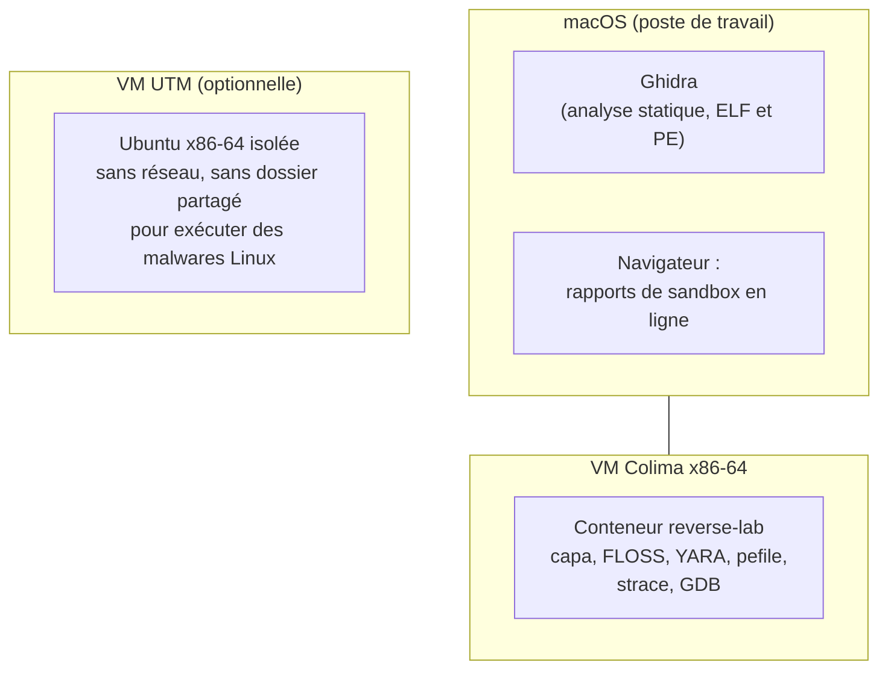
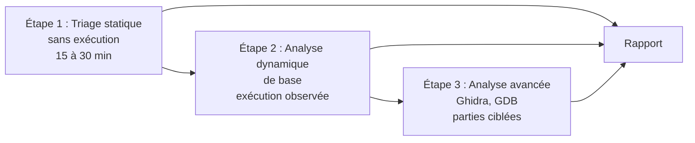

# Chapitre 6 : initiation à l'analyse de malware

Objectif : comprendre la démarche de l'analyse de malware, mettre en place un environnement sûr, réaliser le triage d'un échantillon et en extraire les indicateurs de compromission. Tout ce qui précède s'applique ; ce qui change, c'est **la question posée** et **les précautions**.

Ce chapitre suppose un poste macOS, sans machine Windows. C'est une situation courante et tout à fait viable : une grande partie de l'analyse de malwares Windows est statique et se fait très bien depuis Linux ou macOS.

## 6.1 Ce qui change par rapport aux CTF

En CTF, la question est "quel est le flag ?". En analyse de malware, les questions sont :

- **Que fait le programme ?** (vol de données, chiffrement de fichiers, porte dérobée, minage...)
- **Comment le détecter ?** (sur une machine, sur le réseau)
- **Comment savoir si une machine est compromise ?** Ce sont les **IOC** (Indicators of Compromise) : empreintes de fichiers, domaines, adresses IP, chemins, clés de registre, noms de mutex.
- **Comment s'en débarrasser ?** (persistance, fichiers déposés)

L'objectif n'est presque jamais de tout comprendre, mais de répondre à ces questions **le plus rapidement possible**. Le reverse complet ne porte que sur les parties qui l'exigent (déchiffrement de la configuration, protocole réseau).

Autre différence : la majorité des malwares visent **Windows**. Il faut donc connaître le format PE et les API Windows, même sans disposer de Windows. Les principes de la partie 2 restent valables ; seule la convention d'appel change (chapitre 5 de la partie 2).

### Notions Windows en bref

Ce chapitre emploie un vocabulaire système propre à Windows, rarement défini dans les cours de reverse sous Linux. Voici l'essentiel, une à deux lignes par notion ; il n'est pas nécessaire de tout retenir, mais de reconnaître ces mots quand ils apparaissent.

- **Processus** : un programme en cours d'exécution, avec sa propre mémoire. Un malware crée souvent de nouveaux processus ou s'injecte dans un processus existant.
- **Thread** (fil d'exécution) : une unité d'exécution au sein d'un processus ; un processus en a au moins un et peut en créer d'autres.
- **DLL** (*Dynamic Link Library*) : une bibliothèque de code partagée, l'équivalent Windows du `.so` de Linux. `kernel32.dll`, `ntdll.dll`, `ws2_32.dll` (réseau) reviennent constamment.
- **API Windows / Win32** : l'ensemble des fonctions fournies par le système via ces DLL (créer un fichier, ouvrir une connexion, écrire dans le registre). Leurs noms sont très parlants : `CreateFileA`, `WriteProcessMemory`, `InternetOpenA`.
- **Registre Windows** : une base de données de configuration du système, organisée en clés et valeurs. Les malwares y écrivent souvent pour se lancer au démarrage (persistance).
- **Service** : un programme qui tourne en arrière-plan, lancé par le système, souvent sans interface. Un moyen fréquent de persistance.
- **Mutex** : un objet nommé servant à la synchronisation ; les malwares l'emploient pour s'assurer qu'une seule instance tourne. Un nom de mutex est un bon IOC.
- **Handle** : un identifiant numérique que le système donne à un programme pour manipuler une ressource (fichier, clé de registre, processus), comme un descripteur de fichier sous Linux.

## 6.2 L'environnement d'analyse

**Un véritable malware ne s'exécute jamais sur la machine personnelle, ni sur une machine reliée au réseau domestique.** Même l'analyse statique se fait dans un environnement dédié : un double-clic malencontreux est vite arrivé.

### Ce que permet un Mac sans Windows



| Type d'échantillon | Analyse statique | Analyse dynamique |
|---|---|---|
| Exercices du cours (coffre v5) | conteneur et Ghidra | conteneur (`--sans-reseau`) |
| Malware Linux réel | conteneur et Ghidra | VM UTM dédiée, isolée |
| Malware Windows réel | conteneur et Ghidra : un `.exe` ne peut pas s'exécuter sous Linux ou macOS, ce qui limite fortement le risque | rapports de sandbox en ligne (section 6.6) |

Remarque importante sur Docker : un conteneur n'est **pas** une frontière de sécurité suffisante pour exécuter un vrai malware. Il partage le noyau de la machine virtuelle, et Colima partage en général le dossier personnel de macOS avec sa VM. Le conteneur du cours convient aux exercices et à l'analyse statique ; l'exécution d'échantillons réels se fait dans une VM dédiée, sans dossier partagé ni accès réseau.

### Règles d'hygiène

1. **Snapshot** de la VM propre avant toute analyse, et retour au snapshot après. Systématiquement.
2. Aucun **dossier partagé** ni **copier-coller** entre la VM et le Mac pendant l'analyse d'un échantillon réel.
3. Les échantillons circulent dans des **archives ZIP chiffrées**, par convention avec le mot de passe `infected`, afin que l'antivirus ne les supprime pas et qu'ils ne soient pas ouverts par erreur.
4. Renommer les échantillons avec une extension inoffensive (`.bin`, `.malware`) pour éviter une exécution accidentelle.
5. Certains malwares détectent les machines virtuelles. Ce n'est pas un problème pour débuter, mais c'est une raison pour laquelle un échantillon peut sembler "ne rien faire".

Le fil rouge de ce chapitre (coffre v5) est un **faux malware inoffensif** compilé à partir des sources du cours : il s'analyse dans le conteneur habituel. Les bonnes habitudes (notes, méthode, `--sans-reseau`) sont toutefois à prendre dès maintenant.

## 6.3 La démarche en trois temps



1. **Triage statique** (sans exécution) : identifier le fichier, son type et ses capacités probables. 15 à 30 minutes.
2. **Analyse dynamique de base** (exécution observée dans un environnement isolé) : fichiers créés, configuration modifiée, connexions réseau, processus lancés. Pour un échantillon Windows, cette étape passe par les rapports de sandbox.
3. **Analyse avancée** (reverse avec Ghidra et un débogueur) : uniquement sur les parties qui le justifient (déchiffrement de chaînes ou de configuration, protocole, algorithme de chiffrement d'un rançongiciel).

Tout est consigné au fil de l'eau. Le livrable final est un **rapport**.

## 6.4 Le triage statique

### Identifier

```bash
sha256sum echantillon.bin      # l'empreinte identifie l'échantillon de façon unique
file echantillon.bin
```

À partir de l'empreinte SHA-256, rechercher l'échantillon sur **VirusTotal** ou **MalwareBazaar** : s'il est connu, d'autres l'ont peut-être déjà analysé. Il faut rechercher **l'empreinte** et ne pas envoyer le fichier : un fichier soumis à VirusTotal devient accessible à d'autres utilisateurs, ce qui pose problème pour un échantillon issu d'un incident réel.

### Les chaînes

`strings` reste utile (URL, chemins, messages, noms de fichiers), mais les malwares chiffrent souvent leurs chaînes. **FLOSS** (Mandiant, installé dans le conteneur) va plus loin sur les exécutables **Windows** : il émule le programme pour retrouver les chaînes construites sur la pile ou déchiffrées par une petite fonction. Sur un ELF, FLOSS se limite aux chaînes statiques ; le déchiffrement se fait alors à la main, comme aux chapitres 6 et 12.

```bash
floss echantillon.exe
```

### Les imports : que sait faire le programme ?

Les fonctions importées constituent le meilleur résumé des capacités d'un programme. Familles à reconnaître sous Windows :

| Famille | API typiques |
|---|---|
| Injection dans un autre processus | `OpenProcess`, `VirtualAllocEx`, `WriteProcessMemory`, `CreateRemoteThread`, `NtUnmapViewOfSection`, `QueueUserAPC` |
| Persistance | `RegSetValueExA/W` (clé `...\CurrentVersion\Run`), `CreateServiceA`, tâches planifiées, copie dans `%APPDATA%` |
| Réseau | `InternetOpenA`, `InternetConnectA`, `HttpSendRequestA`, `WinHttpOpen`, `URLDownloadToFileA`, `socket`, `connect`, `send`, `recv` |
| Exécution | `CreateProcessA`, `ShellExecuteA`, `WinExec` |
| Espionnage | `SetWindowsHookExA`, `GetAsyncKeyState` (keylogger), `GetClipboardData`, `BitBlt` (captures d'écran) |
| Fichiers | `CreateFileA`, `WriteFile`, `FindFirstFileA` / `FindNextFileA` (parcours de disque : rançongiciel ?) |
| Chiffrement | `CryptEncrypt`, `CryptAcquireContextA`, `BCryptEncrypt` |
| Anti-analyse | `IsDebuggerPresent`, `CheckRemoteDebuggerPresent`, `GetTickCount`, `Sleep` (long), `NtQueryInformationProcess` |
| Mutex (instance unique) | `CreateMutexA`, `OpenMutexA` |
| Chargement dynamique | `LoadLibraryA`, `GetProcAddress` |

Sous Linux, les équivalents sont les fonctions de la libc vues dans les chapitres précédents (`socket`, `connect`, `fork`, `execve`, `ptrace`, `open`...), ainsi que les fichiers de persistance (`crontab`, `~/.bashrc`, `~/.config/autostart`, services systemd).

Point important : un programme comportant **très peu d'imports**, dont `LoadLibraryA` et `GetProcAddress`, résout probablement ses vraies fonctions à l'exécution pour les masquer. Associé à une entropie élevée, c'est le signe d'un binaire packé (chapitre 5).

### Les outils de triage disponibles sans Windows

- **capa** (Mandiant, dans le conteneur) : analyse un binaire PE ou ELF et liste ses capacités en langage clair ("encode data using XOR", "get hostname", "persist via Run registry key"), avec les techniques MITRE ATT&CK et les adresses correspondantes. Excellent point de départ pour savoir où regarder dans Ghidra.
- **pefile** (bibliothèque Python, dans le conteneur) : lecture de la structure d'un PE, de ses imports et de ses sections.
- **YARA** (dans le conteneur) : détection par motifs (section 6.8).
- **Ghidra** (sur macOS) : désassemble et décompile les PE comme les ELF.
- **Detect It Easy** existe aussi en version Linux et macOS, pour identifier compilateurs et packers.

```bash
capa echantillon.bin
```

Exemple : quelques lignes de la sortie de capa sur le coffre v5 :

```
encode data using XOR (2 matches)        data-manipulation/encoding/xor
write file on Linux                      host-interaction/file-system/write
get hostname                             host-interaction/os/hostname
get system information on Linux          host-interaction/os/info
```

### Lire les imports d'un PE avec pefile

```python
import pefile
pe = pefile.PE('echantillon.exe')
print(hex(pe.OPTIONAL_HEADER.AddressOfEntryPoint))
for section in pe.sections:
    print(section.Name.rstrip(b'\0'), hex(section.SizeOfRawData), round(section.get_entropy(), 2))
for dll in pe.DIRECTORY_ENTRY_IMPORT:
    print(dll.dll.decode())
    for imp in dll.imports:
        print('   ', imp.name.decode() if imp.name else imp.ordinal)
```

## 6.5 Le format PE en bref

Un exécutable Windows (`.exe`, `.dll`) commence toujours par les octets `MZ` (`4D 5A`).

```
+-----------------------+
| En-tête DOS ("MZ")    |  contient l'offset de l'en-tête PE (champ e_lfanew)
+-----------------------+
| En-tête PE ("PE\0\0") |  machine (32 ou 64 bits), date de compilation, nombre de sections
| En-tête optionnel     |  point d'entrée, adresse de base préférée (ImageBase), répertoires (imports, exports, ressources)
+-----------------------+
| Table des sections    |
+-----------------------+
| .text                 |  le code
| .rdata                |  données en lecture seule, table des imports
| .data                 |  variables globales
| .rsrc                 |  ressources (icônes, mais aussi souvent une charge utile cachée)
| .reloc                |  relocations
+-----------------------+
```

Éléments intéressants lors du triage :

- la **date de compilation** (falsifiable, mais parfois révélatrice) ;
- les **noms et tailles des sections** : une section `.text` minuscule sur disque mais énorme en mémoire indique un binaire packé ;
- la **table des imports** (section 6.4) ;
- les **ressources** : un volumineux bloc dans `.rsrc` peut être un second exécutable chiffré ;
- l'**entropie** de chaque section.

Dans Ghidra, un PE 64 bits utilise la convention Windows (`rcx`, `rdx`, `r8`, `r9`) : Ghidra le sait et nomme correctement les arguments des API.

## 6.6 L'analyse dynamique de base

### Pour un échantillon Linux

Dans la VM dédiée (ou dans le conteneur lancé avec `--sans-reseau` pour les exercices) :

- `strace -f -o trace.txt ./echantillon` : fichiers, réseau, processus ;
- `ltrace` : appels de bibliothèque ;
- `tcpdump` ou Wireshark sur l'interface de la VM : requêtes DNS et connexions ;
- inspection des emplacements de persistance après exécution : `/tmp`, `~/.config/autostart`, `crontab -l`, `~/.bashrc`, `/etc/systemd/system`.

### Pour un échantillon Windows

Sans machine Windows, l'analyse dynamique repose sur les **sandboxes en ligne**, qui exécutent l'échantillon dans leurs propres machines et publient un rapport : processus créés, fichiers écrits, clés de registre modifiées, trafic réseau, captures d'écran. Les principales : **ANY.RUN**, **Triage** (tria.ge), **Hybrid Analysis**, et l'onglet "Behavior" de **VirusTotal**.

Pour un échantillon déjà connu, ces rapports existent souvent : il suffit de rechercher son empreinte. Pour un échantillon issu d'un incident réel, la même précaution que pour VirusTotal s'applique : une soumission rend l'échantillon visible par d'autres.

Apprendre à **lire** ces rapports de façon critique est une compétence à part entière : distinguer le comportement propre au malware du bruit de fond du système, relier un comportement observé à la fonction responsable dans Ghidra.

## 6.7 L'analyse avancée : ce qui mérite d'être reversé

Avec Ghidra (et GDB pour les échantillons Linux), l'effort porte sur :

- **la fonction de déchiffrement des chaînes** : une petite fonction appelée des dizaines de fois avec un pointeur vers des octets illisibles. La reverser (souvent un XOR, parfois RC4) puis écrire un script qui déchiffre toutes les chaînes révèle l'essentiel du comportement ;
- **la configuration** : adresse du serveur de commande (C2), clés, identifiant de campagne, souvent dans un bloc chiffré de `.data` ou `.rsrc` ;
- **le protocole réseau** : comment les données envoyées sont encodées ;
- **les techniques d'évasion**, lorsqu'elles empêchent l'analyse dynamique.

Méthode efficace : partir des **résultats de capa** et des **imports intéressants** (`InternetConnectA`, `RegSetValueExA`, `connect`), puis remonter les références dans Ghidra pour voir d'où proviennent leurs arguments. Comme pour les crackmes, on part d'un point connu et on remonte.

## 6.8 Les IOC et la pyramide de la douleur

Les indicateurs n'ont pas tous la même valeur. La "pyramide de la douleur" (David Bianco) les classe selon la difficulté, pour l'attaquant, de les modifier :

```
            /\        TTP (techniques et procédures)    <- très difficile à changer
           /  \       Outils
          /    \      Artefacts (mutex, chemins, user-agent, clés de registre)
         /      \     Domaines
        /        \    Adresses IP
       /__________\   Empreintes (hash)                 <- trivial à changer
```

Un hash change dès qu'un octet est modifié ; un domaine se remplace facilement. En revanche, un **comportement** (créer tel mutex, utiliser tel user-agent, chiffrer ses chaînes d'une certaine façon) se retrouve d'une version à l'autre : c'est ce qui permet d'écrire des règles de détection durables.

### Les règles YARA

**YARA** décrit un malware par des motifs (chaînes, octets) et une condition. C'est le format standard de partage des détections.

```
rule Exemple
{
    meta:
        auteur = "Nom de l'analyste"
        description = "Exemple de règle"
    strings:
        $s1 = "id=%s&host=%s" ascii
        $hex = { 83 F? 37 }             // motif d'octets, ? = un chiffre hexadécimal quelconque
    condition:
        uint32(0) == 0x464c457f and     // fichier ELF ("\x7fELF")
        all of them
}
```

```bash
yara regle.yar echantillon.bin
```

Une bonne règle s'appuie sur ce qui est **spécifique et stable** : la routine de déchiffrement, une constante, une chaîne de format, plutôt qu'une URL appelée à changer.

## 6.9 Le rapport

Un rapport d'analyse, même court, suit généralement ce plan :

1. **Résumé** (5 lignes) : nature de l'échantillon, comportement, niveau de risque.
2. **Identification** : nom, taille, empreintes (MD5, SHA-1, SHA-256), type de fichier, packer.
3. **Comportement** : actions, dans l'ordre (installation, persistance, communication, charge utile).
4. **Indicateurs (IOC)** : tableau des empreintes, domaines, IP, URL, chemins, clés de registre, mutex, user-agent.
5. **Détection** : règle YARA, suggestions de règles réseau.
6. **Détails techniques** : analyse des fonctions importantes, algorithme de chiffrement, scripts de déchiffrement.

## 6.10 Où s'entraîner

- **Practical Malware Analysis** (Sikorski et Honig) : l'ouvrage de référence pour débuter. Ses exemples (malwares Windows 32 bits) sont anciens mais la méthode reste valable, et ses laboratoires se travaillent en grande partie en statique avec Ghidra.
- **Flare-On** : le concours annuel de reverse de Mandiant. Les challenges des éditions passées et leurs solutions officielles sont en ligne. Les premiers challenges de chaque édition sont accessibles après ce cours ; beaucoup se résolvent en statique.
- **Hack The Box** : les Sherlocks et les challenges des catégories "Reversing" et "Forensics", ainsi que le module de l'Academy.
- **MalwareBazaar** (abuse.ch) : de vrais échantillons récents, classés par famille, avec liens vers les rapports de sandbox. À manipuler **uniquement dans l'environnement dédié**, en commençant par des familles bien documentées pour comparer son analyse avec des analyses publiées.
- Les blogs d'analyse (Mandiant, Elastic Security Labs, ANY.RUN) et les rapports du CERT-FR : lire des analyses professionnelles apprend beaucoup sur la manière de prioriser et de rédiger.

## Exercices

**Exercice 6.1 (N2)** Télécharger un exécutable Windows légitime, par exemple `putty.exe` depuis le site officiel de PuTTY. Dans le conteneur, à l'aide du script pefile de la section 6.4, relever : le point d'entrée, les sections et leur entropie, cinq fonctions importées et la DLL dont elles proviennent. Lancer ensuite `capa putty.exe` et commenter trois capacités détectées.

**Exercice 6.2 (N1)** Pour chaque liste d'imports, proposer ce que fait le programme :

- a) `FindFirstFileW`, `FindNextFileW`, `CreateFileW`, `ReadFile`, `WriteFile`, `CryptEncrypt`, `DeleteFileW`
- b) `OpenProcess`, `VirtualAllocEx`, `WriteProcessMemory`, `CreateRemoteThread`
- c) `SetWindowsHookExA`, `GetKeyboardState`, `InternetOpenA`, `InternetConnectA`, `HttpSendRequestA`
- d) `LoadLibraryA`, `GetProcAddress`, `VirtualAlloc`, `VirtualProtect` (et rien d'autre)

**Exercice 6.3 (N2)** Écrire une règle YARA qui détecte les binaires `coffre_v1` et `coffre_v2` mais pas `coffre_v3`. La tester sur les trois et sur `/bin/ls`.

**Exercice 6.4 (N3)** Sur MalwareBazaar, choisir un échantillon récent d'une famille connue et, **sans le télécharger**, lire ses rapports de sandbox (liens depuis la fiche de l'échantillon). Lister ses IOC et les techniques observées, puis comparer avec une analyse publiée de la même famille.

## Fil rouge : coffre v5, un faux malware

Le coffre v5 imite un petit implant malveillant. **Il est inoffensif** : aucune connexion réseau, il n'écrit que des fichiers `/tmp/.coffre_v5*` à l'intérieur du conteneur. L'objectif est de produire un **rapport d'analyse** comme s'il s'agissait d'un véritable échantillon. Le source ne doit être lu qu'à la fin.

Le compiler, puis procéder comme s'il venait d'être découvert sur un serveur. Lancer le conteneur avec `./environnement/lab.sh --sans-reseau`.

1. **Identification** : empreinte SHA-256, `file`. Est-il strippé ?
2. **Triage statique** : `strings`, `nm -D`, `capa`. Lister les fonctions importées et les classer par famille (réseau, fichiers, système...). Certaines chaînes sont étranges, illisibles mais composées de caractères imprimables : pourquoi, selon vous ?
3. **Analyse dynamique de base** : le lancer sous `strace -f -o trace.txt`. Combien de temps met-il à s'exécuter, et pourquoi ? Quels fichiers crée-t-il ? Le relancer une seconde fois : son comportement change-t-il ? Qu'est-ce que cela suggère ? Si au contraire il ne crée aucun fichier dès la première exécution, ne pas conclure qu'il est inoffensif : chercher pourquoi dans le code (situation très fréquente avec de vrais échantillons).
4. **Analyse avancée** : dans Ghidra, trouver la fonction de déchiffrement des chaînes (appelée plusieurs fois, avec une adresse de données différente à chaque appel). Quel est l'algorithme ? Quelle est la clé ?
5. Écrire `decode_v5.py`, qui déchiffre **toutes** les chaînes de la configuration en une fois, à partir des octets copiés depuis Ghidra.
6. Le programme écrit un fichier "cache" contenant des données encodées. Trouver la fonction d'encodage et écrire un script qui décode ce fichier. Que contient-il ? À qui serait-il destiné ?
7. Identifier les **techniques** employées : anti-sandbox (deux vérifications distinctes, plus une troisième astuce au tout début de `main`), instance unique (l'équivalent Linux d'un mutex), reconnaissance, préparation de l'exfiltration, persistance (où un vrai malware écrirait-il ce fichier `.desktop` ?).
8. **Rapport** : le rédiger selon le plan de la section 6.9, avec un tableau d'IOC complet et une règle YARA capable de détecter d'autres versions du même "malware", même si l'URL du serveur change.
9. Nettoyage : `rm -f /tmp/.coffre_v5*` (ou simplement quitter le conteneur). Comparer ensuite le rapport avec le source et avec la solution.

Solutions : [solutions/partie2.md](../solutions/partie2.md#coffre-v5)

## Suivi

- [ ] Partie 3, chapitre 6 : lecture
- [ ] Partie 3, chapitre 6 : exercices
- [ ] Partie 3, chapitre 6 : fil rouge (coffre v5)
