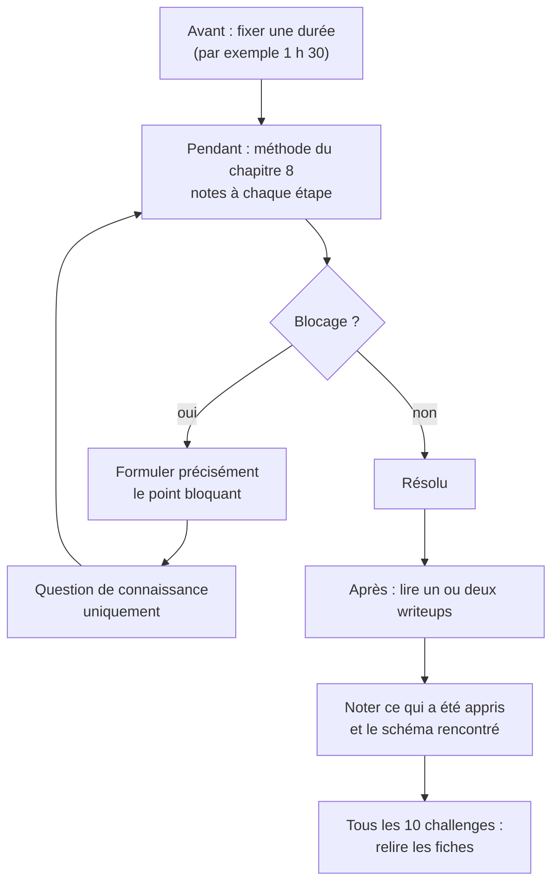

# Chapitre 14 : et après ?

Les bases sont désormais en place : lecture de l'assembleur, méthode, outils et schémas classiques. La suite relève de la pratique, mais d'une pratique **structurée**, afin que chaque challenge apporte quelque chose.

## 14.1 Faire un challenge de façon utile

Le sentiment de ne rien apprendre en se faisant guider, et de voir chaque challenge comme un cas nouveau, tient souvent à la façon de travailler plutôt qu'au niveau. La routine suivante y remédie.



**Avant** : fixer une durée (par exemple 1 h 30 pour un challenge "easy").

**Pendant** : appliquer la méthode du chapitre 8, dans l'ordre, en consignant chaque étape dans un fichier :

```markdown
# Nom du challenge

## Reconnaître
- file : ...
- chaînes intéressantes : ...
- imports : ...
- hypothèse : ...

## Observer
- ...

## Comprendre
- main en 0x..., appelle FUN_... (renommée check)
- check : boucle sur 32 caractères, XOR avec ...

## Agir
- script : ...

## Ce qui a été appris
- ...

## Schéma (tableau du chapitre 11)
- transformation puis comparaison
```

**En cas de blocage** : avant de chercher de l'aide, formuler précisément **où** se situe le blocage ("d'où vient la valeur de `rdx` à l'adresse 0x1234 ?"). Très souvent, la formulation suffit à trouver la réponse. Si une aide est sollicitée (auprès d'une personne, d'un forum ou d'une IA), elle doit porter sur **ce point précis**, et non sur la solution du challenge. Par exemple : "que fait l'instruction `sbb eax, eax` ?" plutôt que "résoudre ce crackme".

**Après** : lire une ou deux solutions publiées (writeups) et les comparer à sa propre démarche. Qu'ont-elles identifié plus rapidement ? Reporter la réponse dans la section "Ce qui a été appris". **C'est cette étape qui fait progresser**, et c'est la plus souvent négligée.

Tous les dix challenges, relire les fiches "Ce qui a été appris" : les schémas récurrents deviennent évidents.

## 14.2 Plan d'entraînement

### Semaines 1 à 4 : consolider

- Refaire les fils rouges **sans** consulter ses notes.
- picoCTF, catégorie "Reverse Engineering" : les challenges anciens sont faciles, très progressifs, et les writeups abondent.
- crackmes.one, difficulté 1.0 à 2.0, Linux.
- Chaque semaine, écrire un petit programme C, le compiler en `-O0` et `-O2`, et lire les deux désassemblages. Dix minutes suffisent ; c'est le meilleur exercice qui soit pour apprendre à lire l'assembleur.

### Mois 2 et 3 : élargir

- Hack The Box, challenges "Reversing" de difficulté "Very Easy" puis "Easy".
- crackmes.one, difficulté 2.0 à 3.0, y compris quelques crackmes **Windows** analysés en statique dans Ghidra (sans exécution, faute de Windows : c'est un excellent entraînement à la lecture pure).
- Approfondir z3 (section 11.5) : de nombreux challenges de niveau intermédiaire en dépendent.
- Commencer Practical Malware Analysis, chapitres 1 à 3 (analyse de base) et leurs laboratoires.

### Ensuite

- Les premiers challenges de Flare-On des éditions passées.
- Les challenges "VM" (bytecode et machine virtuelle maison).
- L'analyse d'échantillons réels de familles documentées (MalwareBazaar), dans l'environnement dédié, en comparant son rapport avec des analyses publiées.
- D'autres langages compilés, qui produisent des binaires très différents : C++ (classes et vtables), Go, Rust, .NET (qui se décompile presque parfaitement avec ILSpy, disponible sur macOS via `ilspycmd` ou AvaloniaILSpy), Python empaqueté avec PyInstaller.

## 14.3 Ressources

### Assembleur et reverse

- *Reverse Engineering for Beginners* (Dennis Yurichev), gratuit en ligne, très complet, disponible en français : une excellente référence pour comprendre un idiome du compilateur.
- **Compiler Explorer** (https://godbolt.org) : saisir du C et voir l'assembleur en direct, avec une coloration qui relie chaque ligne C à ses instructions. Idéal pour les exercices "compiler et comparer".
- Le cours du LACL (lacl.fr) et le module Hack The Box Academy : à relire après ce cours, ils paraîtront beaucoup plus clairs.
- La documentation Intel, ou https://www.felixcloutier.com/x86/, pour la définition exacte de chaque instruction.

### Analyse de malware

- *Practical Malware Analysis* (Sikorski et Honig).
- *Mastering Malware Analysis* (Kleymenov et Thabet), plus récent.
- La documentation de capa, FLOSS et YARA.
- Les blogs de Mandiant et d'Elastic Security Labs, et les rapports publics du CERT-FR (ANSSI), en français.

### Plateformes d'entraînement

| Plateforme | Usage |
|---|---|
| picoCTF | débuter, progression très douce |
| crackmes.one | crackmes classés par difficulté et plateforme |
| Hack The Box | challenges Reversing, Sherlocks (forensics et malware) |
| Root-Me | plateforme française, catégories "Cracking" et "Forensic" |
| Flare-On | reverse avancé, archives avec solutions officielles |
| MalwareBazaar | échantillons réels, à manipuler uniquement dans un environnement dédié |

## 14.4 Conclusion

Le reverse s'apprend comme une langue : on traduit d'abord mot à mot (comme pour `verifier`), puis on reconnaît des expressions entières, et l'on finit par lire couramment. Les débuts sont lents, c'est normal. Chaque fonction décompilée soi-même, même lentement, apporte davantage que dix challenges résolus par quelqu'un d'autre.

## Suivi

- [ ] Chapitre 14 : lecture
- [ ] Chapitre 14 : premier challenge fait avec la routine de la section 14.1
