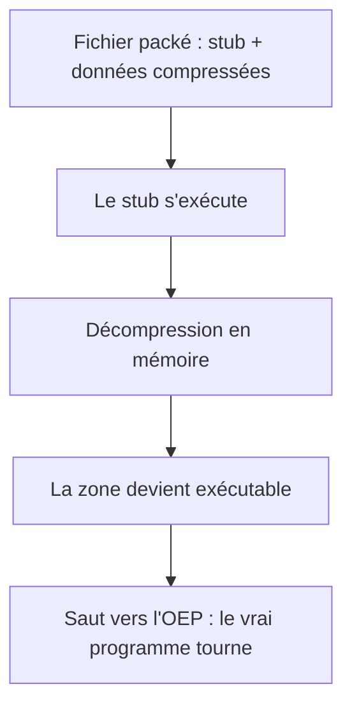

# Packing et UPX

!!! info "Chapitre d'approfondissement"
    Approfondissement de la partie 3. Un binaire *packé* est un binaire dont le vrai code n'apparaît pas tel quel dans le fichier : il est compressé ou chiffré, et n'est reconstitué en mémoire qu'au moment de l'exécution. C'est extrêmement courant dans les malwares (pour échapper à l'analyse et aux antivirus) et fréquent en CTF. Savoir reconnaître et défaire un packer est indispensable.

!!! note "Note sur l'environnement"
    Ce chapitre illustre le **principe** du packing avec un petit packer pédagogique maison (compression zlib), tout à fait représentatif du mécanisme réel : les exemples zlib ci-dessous ont été produits et testés tels quels. L'outil `upx` est fourni dans l'image du laboratoire (`reverse-lab`, voir l'installation sur Mac), vous pouvez donc y rejouer directement un vrai packing (`upx --best monprog`) et comparer. Les sources du packer de démonstration sont dans `packing/`.

## 9.1 Ce qu'est un packer

Un packer transforme un exécutable en un autre exécutable, plus petit et illisible, qui contient :

- un petit **stub** de décompression (le seul code visible en clair) ;
- une grosse zone de **données** : le programme d'origine, compressé ou chiffré.

À l'exécution, le stub décompresse les données dans une zone mémoire, la rend exécutable, puis saute dessus, au **point d'entrée original** (*OEP*, *Original Entry Point*). Le programme s'exécute alors normalement. Le fichier sur le disque, lui, ne révèle presque rien.



C'est exactement la structure du loader vu au capstone, appliquée à un programme entier.

## 9.2 Les signes d'un binaire packé

Plusieurs indices, repérables **sans exécuter**, trahissent un packer :

1. **Entropie élevée.** Les données compressées ou chiffrées sont presque aléatoires. L'entropie de Shannon (en bits par octet, maximum 8) le mesure. Comparaison réelle :

    | Contenu | Entropie |
    |---|---|
    | Texte source | 4.69 |
    | Binaire ELF normal | 1.47 |
    | Le même binaire compressé | 7.86 |
    | Données aléatoires / chiffrées | 7.99 |

    Au-delà d'environ **7.2 bits/octet** sur une grande section, le contenu est très probablement compressé ou chiffré.

2. **Sections anormales.** UPX renomme les sections en `UPX0`, `UPX1` (visibles avec `objdump -h` ou `readelf -S`). Plus généralement : très peu de sections, une section de données énorme, une `.text` minuscule ou vide.

3. **Peu de chaînes.** `strings` ne renvoie presque rien d'utile : ni messages, ni noms de fonctions, car tout est empaqueté.

4. **Point d'entrée déplacé.** Le point d'entrée (`readelf -h`, champ *Entry point*) pointe vers le stub, souvent hors de la `.text` habituelle.

## 9.3 Détecter en pratique

```bash
strings binaire | head              # presque rien d'utile ?
objdump -h binaire                  # sections : UPX0/UPX1 ? une grosse section data ?
readelf -h binaire | grep Entry     # point d'entrée inhabituel ?
python3 entropie.py binaire         # entropie globale élevée ?
```

Sur le binaire packé de démonstration, `strings` ne montre pas le message du programme : il n'apparaît qu'à l'exécution, après décompression.

## 9.4 Dépaqueter

Trois approches, de la plus simple à la plus générale :

**Outil dédié.** Pour UPX, `upx -d paquet -o depaque` défait le packing directement, car UPX est réversible. Cela ne marche que pour UPX non modifié (les malwares modifient souvent le format pour casser `upx -d`).

**Dépaquetage statique.** Si l'on comprend l'algorithme (comme pour notre packer zlib), on rejoue la décompression à froid, sans jamais exécuter le binaire. C'est la méthode la plus sûre. Pour le packer de démonstration :

```python
import zlib
blob = ...                       # octets relevés dans la section de données
code = zlib.decompress(blob)     # décompression hors ligne
open("depaque.bin", "wb").write(code)
```

puis `objdump -D -b binary -m i386:x86-64` révèle le code original.

**Dépaquetage dynamique (OEP dumping).** La méthode générale, valable même sans connaître l'algorithme : en bac à sable, laisser le stub décompresser, poser un point d'arrêt sur le **saut vers l'OEP** (souvent un `jmp` lointain vers une adresse fraîchement rendue exécutable), puis *dumper* la mémoire à ce moment (par exemple `dump binary memory` dans GDB). On obtient le programme dépaqueté, qu'on analyse ensuite normalement.

## 9.5 Pourquoi les malwares packent

Le packing sert surtout à **échapper à l'analyse** : signatures antivirus inopérantes (le code change à chaque packing), `strings` et désassemblage statique aveugles, taille réduite. Ce n'est pas une protection parfaite : tout binaire packé finit par se dépaqueter lui-même en mémoire pour s'exécuter, et c'est là que l'analyste le capture. Le packing ralentit l'analyse, il ne l'empêche pas.

## Exercices gradués

Outils : `packing/packer.py`, `packing/packed.c`, `packing/payload.asm`, et [solutions/scripts/entropie.py](../solutions/scripts/entropie.py).

**Exercice 9.1 (niveau 1)** Mesurer avec `entropie.py` l'entropie d'un binaire normal, puis d'une version compressée du même binaire (`python3 -c "import zlib,sys;open('c.bin','wb').write(zlib.compress(open(sys.argv[1],'rb').read()))" binaire`). Quelle valeur sépare clairement les deux ?

**Exercice 9.2 (niveau 2)** Compiler le packer de démonstration (`gcc -O2 -s packed.c -o packed -lz`), l'exécuter, puis vérifier avec `strings packed` que son message n'apparaît pas dans le fichier. Expliquer pourquoi il n'est visible qu'à l'exécution.

**Exercice 9.3 (niveau 2)** Comparer, avec `objdump -h` et `readelf -h`, un binaire normal et le binaire packé : sections, taille de la zone de données, point d'entrée. Quels éléments mettraient la puce à l'oreille sur un échantillon inconnu ?

**Exercice 9.4 (niveau 3)** Dépaqueter le binaire de démonstration **statiquement** : relever les octets compressés, les décompresser en Python (`zlib.decompress`), désassembler le résultat et retrouver le message, sans jamais exécuter le binaire.

**Exercice 9.5 (niveau 3, méthode)** Décrire, étape par étape, comment dépaqueter un binaire dont on ne connaît pas l'algorithme : où poser le point d'arrêt, quoi dumper, et pourquoi cette méthode fonctionne quel que soit le packer. En quoi diffère-t-elle de `upx -d` ?

**Exercice 9.6 (niveau 1, lecture)** On mesure l'entropie de la section de données de trois binaires : 4.9, 6.1 et 7.8 bits/octet. Lequel est le plus probablement packé, et pourquoi ?

Solutions : [solutions/partie2.md](../solutions/partie2.md#packing-upx)

## Suivi

- [ ] Partie 3, chapitre packing : lecture
- [ ] Partie 3, chapitre packing : exercices (entropie, dépaquetage statique)
