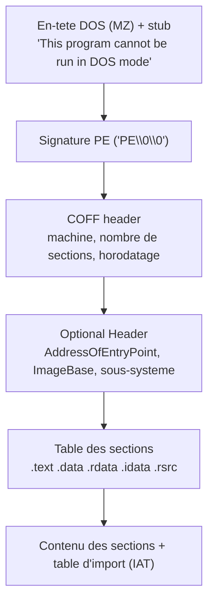

# Lire les formats : ELF puis PE

!!! info "Chapitre d'approfondissement"
    Approfondissement de la partie 3. Avant de désassembler, il faut savoir **lire l'enveloppe** d'un binaire : où commence le code, quelles bibliothèques il réclame, quelles fonctions il importe. Sous Linux c'est le format **ELF** ; sous Windows c'est le format **PE**. Les deux racontent la même histoire avec un vocabulaire différent. Savoir les lire oriente toute l'analyse, et sur un malware Windows, la table d'import à elle seule trahit souvent les intentions du programme.

!!! note "Note sur l'environnement"
    ELF est **testable** dans le conteneur du cours : tous les exemples `readelf`/`objdump` ci-dessous sont réels et reproductibles sur vos binaires. PE est le format de Windows : il n'est **pas** exécutable ni inspectable ici. La partie PE est donc présentée avec des schémas et des valeurs typiques, et c'est signalé à chaque fois. Sur votre machine, les mêmes idées se vérifient avec `readpe`, `pev`, `rabin2 -I` (radare2) ou l'onglet Imports de Ghidra/PE-bear.

## 13.1 Pourquoi lire le format avant le code

Un exécutable n'est pas qu'un bloc d'instructions : c'est un fichier structuré qui dit au système d'exploitation comment le charger en mémoire. Cette structure répond, avant tout désassemblage, à quatre questions décisives :

- **Où commence l'exécution ?** (le point d'entrée)
- **De quoi le programme a-t-il besoin ?** (bibliothèques et fonctions importées)
- **Comment la mémoire est-elle découpée ?** (code, données, données modifiables)
- **Que révèlent les symboles restants ?** (noms de fonctions non supprimés)

Pour un analyste de malware, la table des fonctions importées est souvent le premier indice, et parfois le plus parlant : un programme qui importe de quoi ouvrir une socket, chiffrer des octets et créer un processus annonce son programme avant qu'on ait lu la moindre instruction.

## 13.2 ELF : l'en-tête

Tout fichier ELF commence par un en-tête fixe. Les quatre premiers octets sont la signature magique `7f 45 4c 46`, soit `\x7f` suivi de `ELF` en ASCII. `readelf -h` le déplie :

```
$ readelf -h demo
ELF Header:
  Magic:   7f 45 4c 46 02 01 01 00 ...
  Class:                             ELF64
  Data:                              2's complement, little endian
  Type:                              EXEC (Executable file)
  Machine:                           Advanced Micro Devices X86-64
  Entry point address:               0x401070
  Number of program headers:         13
  Number of section headers:         31
```

À retenir :

- **Class** : `ELF64` (64 bits) ou `ELF32` (32 bits), rejoint le chapitre sur le x86 32 bits.
- **Type** : `EXEC` (exécutable à adresse fixe, ici `-no-pie`), `DYN` (exécutable ou bibliothèque repositionnable, le cas d'un binaire PIE moderne), `REL` (fichier objet `.o` pas encore lié).
- **Entry point address** : l'adresse de la première instruction exécutée. C'est là que GDB place son premier pas, et c'est la valeur que l'on surveille sur un binaire packé (voir 13.6).

## 13.3 ELF : segments et sections, deux découpages

C'est le point qui prête le plus à confusion. ELF décrit le même fichier de **deux manières complémentaires** :

- Les **sections** (`readelf -S`) sont la vue du **lien** : un découpage fin et nommé (`.text`, `.rodata`, `.data`...), utile à l'éditeur de liens et à l'analyste.
- Les **segments** (program headers, `readelf -l`) sont la vue du **chargement** : des blocs plus gros que le noyau mappe en mémoire, chacun avec ses permissions.

```
$ readelf -l demo
Program Headers:
  Type           ...                 Flags  Align
  LOAD           ...                 R      0x1000   (en-tetes, lecture seule)
  LOAD           ...                 R E    0x1000   (code : lecture + execution)
  LOAD           ...                 R      0x1000   (constantes : lecture seule)
  LOAD           ...                 RW     0x1000   (donnees : lecture + ecriture)
  DYNAMIC        ...                 RW
  INTERP         ...   [Requesting program interpreter: /lib64/ld-linux-x86-64.so.2]
```

Les segments `PT_LOAD` sont ce qui existe réellement en mémoire à l'exécution. On y lit tout de suite la politique de sécurité : le code est `R E` (exécutable mais non modifiable), les données sont `RW` (modifiables mais non exécutables). Un segment à la fois `W` et `E` serait un signal d'alerte. Le segment `INTERP` nomme le chargeur dynamique, preuve que le binaire est lié dynamiquement.

!!! tip "Segments pour exécuter, sections pour analyser"
    Le noyau n'a besoin que des segments pour lancer le programme. Les sections peuvent être entièrement supprimées (`strip`, ou un packer qui n'en reconstruit aucune) sans empêcher l'exécution. C'est pourquoi un binaire hostile montre souvent des segments propres mais des sections absentes ou mensongères.

## 13.4 ELF : les sections importantes

```
$ readelf -S demo   (extrait)
  [15] .text     PROGBITS   ...   code executable
  [17] .rodata   PROGBITS   ...   constantes en lecture seule (chaines, tables)
  [25] .data     PROGBITS   ...   variables globales initialisees (RW)
  [26] .bss      NOBITS     ...   globales a zero (ne prend pas de place sur disque)
  [13] .plt      PROGBITS   ...   trampolines vers les fonctions externes
  [24] .got.plt  PROGBITS   ...   adresses resolues des fonctions externes
  [ 6] .dynsym   DYNSYM     ...   symboles dynamiques (toujours la)
  [28] .symtab   SYMTAB     ...   symboles complets (retires par strip)
```

Les sections à connaître :

- **`.text`** : le code. C'est ce que l'on désassemble.
- **`.rodata`** : les constantes en lecture seule, dont les chaînes de caractères. Premier endroit où `strings` trouve des indices.
- **`.data`** / **`.bss`** : les variables globales. `.bss` est une astuce : les globales mises à zéro ne sont pas stockées sur disque (`NOBITS`), le noyau se contente de réserver la place et de la mettre à zéro.
- **`.plt`** / **`.got`** / **`.got.plt`** : la mécanique de liaison dynamique vue au chapitre 7 de la partie 2. Le `.plt` contient des trampolines ; la `.got.plt` reçoit les vraies adresses des fonctions de la libc une fois résolues.
- **`.dynsym`** vs **`.symtab`** : `.dynsym` liste les symboles nécessaires à la liaison dynamique (il survit toujours). `.symtab` liste **tous** les symboles, y compris vos fonctions internes ; c'est lui que `strip` retire.

## 13.5 ELF : symboles et liaison dynamique

`readelf -s` liste les symboles. Sur le binaire non supprimé, nos fonctions apparaissent par leur nom :

```
$ readelf -s demo   (extrait)
    28: 0000000000401156    48 FUNC GLOBAL DEFAULT 15 secret
    33: 0000000000401186    92 FUNC GLOBAL DEFAULT 15 main
```

On lit l'adresse (`0x401156`), la taille (48 octets), le type (`FUNC`) et le nom. C'est un cadeau pour l'analyste : on sait exactement où commence `secret` et combien il pèse. Après `strip`, ces lignes disparaissent :

```
$ strip demo -o demo_stripped
$ readelf -s demo_stripped | grep secret
(aucun resultat : .symtab a ete retire)
```

Seul `.dynsym` reste, c'est-à-dire les symboles **externes** (ceux de la libc : `strcmp`, `puts`...), car ils sont indispensables à la liaison. La dépendance aux bibliothèques se lit avec `readelf -d` :

```
$ readelf -d demo
 0x0000000000000001 (NEEDED)  Shared library: [libc.so.6]
```

Ce binaire ne réclame que la libc. Un échantillon qui réclamerait en plus une bibliothèque de chiffrement ou de réseau en dirait déjà long. C'est l'équivalent ELF de la table d'import PE, qu'on aborde maintenant.

## 13.6 ELF : le point d'entrée trahit le packing

Le point d'entrée et la visibilité du code se recoupent avec le chapitre 9 (packing). Sur un binaire normal, le vrai travail est en clair ; sur un binaire packé, le point d'entrée tombe dans le **stub** de dépaquetage et le vrai code n'existe en clair nulle part sur disque. Comparaison réelle entre le binaire `demo` et sa version « packée » (dépaqueteur zlib du chapitre 9) :

```
$ readelf -h demo   | grep 'Entry point'   ->  0x401070
$ readelf -h packed | grep 'Entry point'   ->  0x4010b0   (le stub, pas le vrai main)

$ strings demo   | grep reverse42   ->  reverse42   (visible : code en clair)
$ strings packed | grep reverse42   ->  (rien : le vrai code est compresse dans un blob)
```

La leçon : lire l'en-tête et passer un coup de `strings`/`readelf` suffit souvent à **classer** un binaire (normal, strippé, packé) avant d'ouvrir le désassembleur.

## 13.7 PE : le format de Windows (conceptuel)

!!! warning "Non testable dans ce conteneur"
    Tout ce qui suit décrit le format PE (Portable Executable) de Windows. Il n'est ni exécutable ni inspectable sur le Linux du cours. Les valeurs données sont typiques ; vérifiez-les sur votre machine avec `rabin2 -I`, `pev`, PE-bear ou Ghidra. L'objectif est de savoir **quoi chercher** dans un `.exe`/`.dll` Windows.

Un fichier PE s'empile ainsi, du début du fichier vers la fin :



Les points clés :

- **En-tête DOS (`MZ`)** : tout PE commence par les octets `4D 5A` (« MZ », initiales de Mark Zbikowski). Suit un petit stub qui, lancé sous l'ancien MS-DOS, affiche « This program cannot be run in DOS mode ». C'est l'équivalent du magic `7f ELF`.
- **Signature PE** : à un décalage indiqué par l'en-tête DOS, les octets `50 45 00 00` (`PE\0\0`) marquent le vrai début du format moderne.
- **COFF header** : machine cible (x86, x64), nombre de sections, horodatage de compilation (parfois révélateur, parfois falsifié).
- **Optional Header** (malgré son nom, il est obligatoire pour un exécutable) : contient `AddressOfEntryPoint` (le point d'entrée, en adresse relative à l'image) et `ImageBase` (l'adresse de chargement souhaitée). L'adresse absolue du point d'entrée est `ImageBase + AddressOfEntryPoint`.
- **Sections** : mêmes idées qu'en ELF, autres noms. `.text` (code), `.data` (données modifiables), `.rdata` (données en lecture seule, dont les chaînes et la table d'import), `.idata` (imports, parfois fondu dans `.rdata`), `.rsrc` (ressources : icônes, mais aussi charges utiles cachées).

### Correspondance mentale ELF ↔ PE

| ELF | PE | Rôle |
|---|---|---|
| Magic `7f ELF` | `MZ` puis `PE\0\0` | signature du format |
| En-tête ELF | DOS + COFF + Optional Header | métadonnées de chargement |
| `Entry point address` | `ImageBase + AddressOfEntryPoint` | première instruction |
| Program headers (segments) | caractéristiques des sections | découpage mémoire + permissions |
| `.text` / `.rodata` / `.data` / `.bss` | `.text` / `.rdata` / `.data` / `.bss` | code / constantes / données |
| `readelf -d` (NEEDED) + `.plt`/`.got` | table d'import (IAT) + `.idata` | dépendances et fonctions externes |
| `.dynsym` / `.symtab` | table d'export + symboles PDB | symboles |

## 13.8 PE : la table d'import, le réflexe malware

C'est le point à retenir de tout le chapitre. Un PE qui appelle des fonctions du système Windows doit les **importer**, et ces imports sont listés en clair dans la table d'import (IAT, Import Address Table) : pour chaque DLL, les fonctions tirées d'elle. Lire cette liste revient à lire les **capacités** du programme avant toute analyse du code.

Quelques signaux classiques (DLL → fonction → ce que ça suggère) :

- `kernel32.dll` → `CreateProcessA`, `WinExec`, `ShellExecuteA` → le programme **lance d'autres programmes**.
- `kernel32.dll` → `VirtualAlloc` + `VirtualProtect` + `CreateThread` → **allocation de mémoire exécutable** : injection de code, dépaquetage.
- `wininet.dll` / `winhttp.dll` → `InternetOpenA`, `HttpSendRequest`, `WinHttpConnect` → **communication réseau** (téléchargement de charge, exfiltration, C2).
- `advapi32.dll` → `RegSetValueExA`, `RegCreateKeyExA` → **persistance** par la base de registre.
- `advapi32.dll` / `bcrypt.dll` → `CryptEncrypt`, `BCryptEncrypt` → **chiffrement** (rançongiciel, ou simple protection de configuration).
- `user32.dll` → `SetWindowsHookExA`, `GetAsyncKeyState` → **capture clavier** possible.

Un échantillon qui importe à la fois `WinHttpConnect`, `CreateProcessA` et `RegSetValueExA` annonce un comportement de porte dérobée (télécharge, exécute, persiste) sans qu'on ait lu une seule instruction. Inversement, une table d'import **vide ou minuscule** est suspecte en soi : le programme résout probablement ses fonctions dynamiquement (`LoadLibrary` + `GetProcAddress`), technique d'évasion courante qui cache justement ses intentions à ce premier coup d'œil.

!!! danger "Rester défensif"
    On lit ces tables pour **comprendre et détecter**, jamais pour construire. Tout ce chapitre sert le triage : savoir, en une minute, si un fichier mérite une analyse poussée et dans quelle direction chercher.

## 13.9 Table d'export et DLL

Une DLL (ou un `.exe` qui en expose) publie des fonctions via sa **table d'export** : la liste de ce qu'elle offre aux autres modules, par nom ou par numéro (ordinal). Sur un échantillon qui se présente en DLL, la table d'export indique quelles fonctions l'attaquant compte appeler (souvent une seule, nommée de façon anodine, lancée par `rundll32.exe`). C'est le miroir de la table d'import : l'une dit ce que le module **consomme**, l'autre ce qu'il **fournit**.

## Exercices gradués

Les exercices ELF sont testables ici (`readelf`, `objdump`, `strings`, `strip`). Les exercices PE sont conceptuels : décrivez la démarche et les valeurs attendues ; vérifiez-les sur votre machine Windows ou avec `rabin2 -I`, `pev`, PE-bear si vous en disposez.

Solutions à part, dans [solutions/partie2.md](../solutions/partie2.md#formats-elf-pe).

### Exercice 13.1 - l'en-tête ELF (niveau 1)

- **À faire :** compiler un programme du cours (`gcc -no-pie prog.c -o prog`), puis lire son en-tête avec `readelf -h`
- **À produire :** la classe (32/64 bits), le type (`EXEC`/`DYN`/`REL`), l'adresse du point d'entrée, et les quatre premiers octets du magic (`xxd prog | head -1`)

### Exercice 13.2 - les segments (niveau 2)

- **À faire :** lister les segments avec `readelf -l`
- **À produire :** pour chaque `PT_LOAD`, ses permissions (`R`, `R E`, `RW`) et son contenu ; la preuve qu'aucun segment n'est à la fois `W` et `E`, et pourquoi c'est une bonne chose

### Exercice 13.3 - les sections (niveau 2)

- **À faire :** avec `readelf -S`, repérer `.text`, `.rodata`, `.data`, `.bss` ; avec `readelf -d`, lister les bibliothèques `NEEDED`
- **À produire :** pourquoi `.bss` est de type `NOBITS` et ne pèse rien sur le disque

### Exercice 13.4 - symtab contre dynsym (niveau 2)

- **À faire :** relever l'adresse et la taille de `main` avec `readelf -s`, `strip` une copie, et montrer que la fonction a disparu de `readelf -s` alors que les symboles de la libc (`.dynsym`) restent
- **À produire :** la différence entre `.symtab` et `.dynsym`

### Exercice 13.5 - en-tête et strings d'un packé (niveau 3)

- **À faire :** packer un binaire du cours (dépaqueteur zlib du chapitre 9 ou tout packer), puis comparer à l'original le point d'entrée (`readelf -h`) et la présence d'une chaîne connue (`strings`)
- **À produire :** ce que le seul couple en-tête + `strings` permet de dire d'un binaire avant désassemblage

### Exercice 13.6 - lire une table d'import PE (niveau 2, conceptuel PE)

- **À produire :** import par import, le comportement probable, et une hypothèse en une phrase sur la nature du programme

Table d'import : `kernel32.dll` (`VirtualAlloc`, `VirtualProtect`, `CreateThread`), `wininet.dll` (`InternetOpenUrlA`, `InternetReadFile`), `advapi32.dll` (`RegSetValueExA`).

### Exercice 13.7 - ELF et PE côte à côte (niveau 2, conceptuel PE)

- **À produire :** la correspondance, pour un même programme sous Linux puis Windows, entre le magic ELF et la signature PE ; le point d'entrée ELF et le couple `ImageBase`/`AddressOfEntryPoint` ; `.rodata` et `.rdata` ; `readelf -d` (NEEDED) et la table d'import ; et où, dans chaque format, chercher les chaînes et les fonctions externes

### Exercice 13.8 - une table d'import minuscule (niveau 3, conceptuel PE)

- **À produire :** pourquoi une table d'import réduite à `kernel32.dll!LoadLibraryA` et `kernel32.dll!GetProcAddress` est suspecte, la technique probablement employée, et comment adapter l'analyse (statique puis dynamique) pour découvrir ses vraies capacités

Solutions : [solutions/partie2.md](../solutions/partie2.md#formats-elf-pe)

## Suivi

- [ ] Partie 3, chapitre formats : lecture
- [ ] Partie 3, chapitre formats : ELF lu avec readelf (-h, -l, -S, -d, -s)
- [ ] Partie 3, chapitre formats : table d'import PE comprise (intérêt malware)
