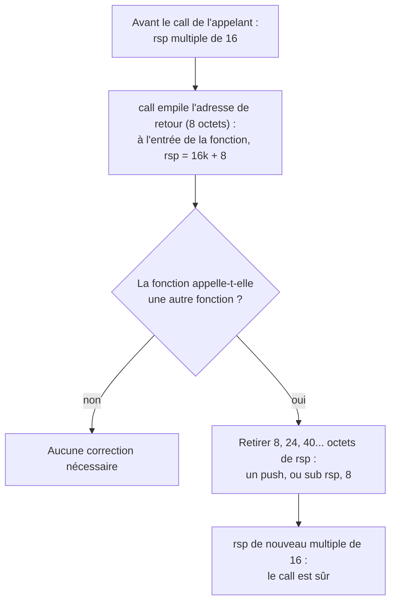

# Chapitre 16 : fonctions, appel de la libc et alignement de la pile

Le chapitre 15 a produit des programmes autonomes, qui ne parlent qu'au noyau. Ce chapitre ajoute ce qui manque pour écrire de vrais programmes : des fonctions, et l'accès aux fonctions de la libc comme `printf`. C'est aussi l'occasion de revoir, du côté de l'auteur, les règles de la convention d'appel lues au chapitre 5.

## 16.1 Écrire une fonction

Une fonction n'est qu'une étiquette suivie d'instructions terminées par `ret`. L'appelant utilise `call`, qui empile l'adresse de retour (chapitre 5). [exemples/longueur.asm](../exemples/longueur.asm) :

```nasm
; size_t longueur(const char *s)   s dans rdi, résultat dans rax
longueur:
    xor eax, eax                ; compteur = 0
.boucle:
    cmp byte [rdi+rax], 0       ; s[compteur] == 0 ?
    je .fin
    inc rax
    jmp .boucle
.fin:
    ret

_start:
    lea rdi, [rel texte]        ; 1er argument
    call longueur               ; rax = 19
    mov edi, eax                ; code de retour = longueur
    mov eax, 60
    syscall
```

```
$ ./longueur ; echo $?
19
```

Rien n'oblige une fonction écrite à la main à respecter la convention System V. Mais dès qu'elle appelle du code C, ou qu'elle est appelée par du code C, il faut la respecter **exactement**, sinon les valeurs arrivent dans les mauvais registres ou sont écrasées :

| Règle | Côté appelant | Côté fonction appelée |
|---|---|---|
| Arguments | dans `rdi`, `rsi`, `rdx`, `rcx`, `r8`, `r9`, puis sur la pile | les lire au même endroit |
| Retour | lire `rax` | écrire `rax` |
| Registres librement modifiables : `rax`, `rcx`, `rdx`, `rsi`, `rdi`, `r8` à `r11` | les considérer perdus après un `call` | peut les écraser |
| Registres conservés : `rbx`, `rbp`, `r12` à `r15` | peut compter sur eux après un `call` | doit les sauvegarder (`push`) et les restaurer (`pop`) s'il les utilise |
| Pile | `rsp` multiple de 16 au moment du `call` | voir section 16.3 |

Le cadre de pile `push rbp` / `mov rbp, rsp` n'est pas obligatoire : il ne sert qu'à faciliter l'accès aux variables locales et le débogage. Le code optimisé et le code écrit à la main s'en passent souvent.

Il est aussi possible de mélanger les langages : [exemples/somme3.asm](../exemples/somme3.asm) définit une fonction appelée depuis le C de [exemples/test_somme3.c](../exemples/test_somme3.c).

```nasm
; long somme3(long a, long b, long c)
somme3:
    lea rax, [rdi+rsi]          ; rax = a + b
    add rax, rdx                ; rax = a + b + c
    ret
```

```bash
nasm -f elf64 somme3.asm -o somme3.o
gcc test_somme3.c somme3.o -o test_somme3
./test_somme3                   # affiche 42
```

## 16.2 Appeler la libc

Pour utiliser `printf`, trois changements sont nécessaires par rapport au chapitre 15 :

1. le point d'entrée devient `main`, appelé par le code de démarrage de la libc avec `argc` dans `rdi` et `argv` dans `rsi` ; `main` se termine par `ret` et renvoie son code de retour dans `eax` ;
2. la fonction est déclarée `extern printf`, puis appelée avec `call printf wrt ..plt` ;
3. l'édition de liens se fait avec `gcc`, qui ajoute la libc et le code de démarrage.

```bash
nasm -f elf64 programme.asm -o programme.o
gcc programme.o -o programme
```

Le suffixe `wrt ..plt` demande de passer par la PLT, la table qui mène aux fonctions des bibliothèques partagées : ce sont les `call ...@plt` vus depuis le chapitre 5. Sans lui, gcc refuse de produire un exécutable PIE (position indépendante, chapitre 6) avec un message `relocation R_X86_64_PC32 against symbol printf ... recompile with -fPIE`. Pour la même raison, les données sont désignées par `[rel ...]`.

Deux détails propres à `printf` et aux fonctions à nombre variable d'arguments :

- avant l'appel, `al` doit contenir le nombre de **registres vectoriels** utilisés pour les arguments. Ces registres, `xmm0` à `xmm15`, sont des registres de 128 bits réservés aux calculs à virgule (et aux traitements en parallèle) ; les nombres à virgule y sont passés à la place de `rdi`, `rsi`... D'où le `xor eax, eax` que gcc place juste avant chaque `call printf` ;
- la chaîne de format doit se terminer par un octet nul, que NASM n'ajoute pas : `db "%d", 10, 0`.

Enfin, la ligne `section .note.GNU-stack noalloc noexec nowrite progbits` en fin de fichier indique que la pile ne doit pas être exécutable ; sans elle, `ld` affiche un avertissement.

## 16.3 L'alignement de la pile

La convention System V impose une règle supplémentaire, invisible tant qu'elle est respectée : **au moment d'un `call`, `rsp` doit être un multiple de 16**. Certaines instructions vectorielles (`movaps`) exigent en effet des adresses alignées, et les fonctions de la libc s'en servent pour leurs variables locales.

Le raisonnement à suivre :



[exemples/desaligne.asm](../exemples/desaligne.asm) oublie cette correction :

```nasm
main:
    ; volontairement, aucun push ni sub rsp ici : rsp n'est pas aligné sur 16
    lea rdi, [rel format]       ; "pi vaut environ %f\n"
    movsd xmm0, [rel pi]        ; un nombre à virgule se passe dans xmm0
    mov eax, 1                  ; un registre vectoriel utilisé
    call printf wrt ..plt
    xor eax, eax
    ret
```

```
$ ./desaligne
Segmentation fault
$ gdb -q ./desaligne
(gdb) run
Program received signal SIGSEGV, Segmentation fault.
(gdb) x/i $pc
=> 0x7ffff7c60136 <__printf+54>:  movaps XMMWORD PTR [rbp-0x80],xmm0
```

Le plantage survient **dans** `printf`, sur un `movaps`, alors que l'erreur est dans `main` : c'est le symptôme typique d'une pile mal alignée. Il n'est pas systématique (un `printf` sans nombre à virgule peut fonctionner par chance), ce qui le rend d'autant plus déroutant. Ajouter `push rbx` au début de `main` et `pop rbx` avant `ret` suffit à corriger le programme.

Côté reverse, cette règle explique des instructions qui semblent inutiles dans le code de gcc : un `sub rsp, 0x8` sans variable locale, ou un `push rbx` dont la valeur n'est jamais utilisée, servent simplement à aligner la pile.

## Exercices

**Exercice 16.1** Écrire en assembleur une fonction `long maximum(long a, long b)` (indice : `cmp` puis `cmovl`, ou un saut), l'appeler depuis un programme C sur le modèle de `test_somme3.c`, et la tester avec des valeurs négatives.

**Exercice 16.2** Écrire un `main` en assembleur qui affiche `argc vaut N` avec `printf`, où `N` est le nombre d'arguments. Tester avec `./programme a b c`.

**Exercice 16.3** Assembler `desaligne.asm`, observer le plantage dans GDB, puis afficher `p/x $rsp` à l'entrée de `main` (`break main`, `run`). Vérifier que la valeur se termine par 8. Corriger le programme et vérifier que `rsp` se termine par 0 juste avant le `call`.

## Fil rouge partie 3 : le keygen complet

Étape 2 : écrire `keygen.asm`, un `main` qui :

1. vérifie `argc`, et affiche `usage : keygen <nom>` avec `puts` en cas d'erreur (code de retour 1) ;
2. appelle une fonction `hacher(argv[1])` écrite en assembleur, qui renvoie dans `eax` le serial calculé par l'algorithme du coffre v3 : `h = 0x1337`, puis pour chaque caractère `c` : `h = h * 31 + c`, rotation de `h` de 3 bits à gauche (`rol`), et enfin `h ^ 0xC0FFEE` ;
3. affiche le résultat avec `printf` et le format `"%08X\n"` (8 chiffres hexadécimaux en majuscules).

La boucle de l'étape 1 (chapitre 15) fournit la structure de `hacher` : au lieu de compter les caractères, elle les incorpore au calcul. Vérification avec le keygen Python :

```
$ ./keygen Clemence
F6E88EDC
$ python3 /cours/solutions/scripts/keygen_v3.py Clemence
F6E88EDC
```

Pour finir, désassembler le keygen (`objdump -d -M intel keygen`) et comparer la fonction `hacher` avec celle du coffre v3 compilée par gcc. Quelles différences de style permettraient de deviner lequel des deux a été écrit à la main ?

Solutions : [solutions/partie3.md](../solutions/partie3.md#chapitre-16)

## Suivi

- [ ] Chapitre 16 : lecture
- [ ] Chapitre 16 : exercices
- [ ] Chapitre 16 : fil rouge
