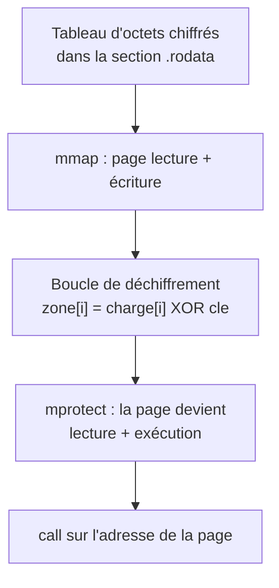

# Chapitre 3 : shellcode et loader chiffré

Un **shellcode** est une suite d'octets de code machine conçue pour être injectée puis exécutée dans un processus qui n'était pas prévu pour cela. Le nom vient de l'usage historique : ouvrir un interpréteur de commandes (`/bin/sh`). En CTF, la catégorie *pwn* demande souvent d'en écrire un ; en analyse de malware, les shellcodes sont omniprésents, généralement **chiffrés** et déchiffrés en mémoire par un petit programme appelé *loader* (chargeur). Ce chapitre traite les deux côtés : écrire un shellcode, puis analyser un loader.

## 3.1 Les contraintes d'un shellcode

Un shellcode n'est pas un programme complet : c'est un fragment de code copié à une adresse inconnue à l'avance. Il doit donc respecter trois contraintes :

| Contrainte | Raison | Technique |
|---|---|---|
| Aucune adresse absolue | l'adresse de chargement est inconnue | données construites sur la pile, adresses relatives à `rip` |
| Aucune section `.data` | seuls les octets du code sont copiés | chaînes poussées sur la pile avec `push` |
| Souvent, aucun octet nul (`0x00`) | une injection par `strcpy` ou `gets` s'arrête au premier 0 | instructions choisies pour leur encodage |

La troisième contrainte demande de regarder les octets produits par l'assembleur (la colonne du milieu d'`objdump`, chapitre 2 de la partie 2 ; encodage des sauts, chapitre 4 de la partie 3) :

| Instruction | Octets | Octet nul ? | Alternative sans nul | Octets |
|---|---|---|---|---|
| `mov eax, 1` | `b8 01 00 00 00` | oui | `xor eax, eax` puis `inc eax` | `31 c0 ff c0` |
| `mov eax, 60` | `b8 3c 00 00 00` | oui | `push 60` puis `pop rax` | `6a 3c 58` |
| `mov edi, 0` | `bf 00 00 00 00` | oui | `xor edi, edi` | `31 ff` |

Les constantes 32 bits sont toujours encodées sur 4 octets : une petite valeur est donc complétée par des zéros. `push` accepte en revanche une constante d'un seul octet.

## 3.2 Écrire un shellcode

[exemples/flag.asm](../exemples/flag.asm) affiche un message sans utiliser de section de données. La chaîne est découpée en blocs de 8 octets, poussés sur la pile **du dernier au premier**, car la pile croît vers les adresses basses : le dernier bloc poussé se retrouve au sommet, à l'adresse `rsp`, et la chaîne se lit ensuite dans l'ordre.

```nasm
_start:
    ; construire la chaîne sur la pile, du dernier bloc au premier
    mov rax, 0x5858585858580a7d ; "}\nXXXXXX" (les X ne sont pas affichés)
    push rax
    mov rax, 0x6572666669686365 ; "echiffre"
    push rax
    mov rax, 0x645f65646f636c6c ; "llcode_d"
    push rax
    mov rax, 0x6568737b47414c46 ; "FLAG{she"
    push rax

    ; write(1, rsp, 26)
    xor eax, eax
    inc eax                     ; eax = 1 (write), sans octet nul
    mov edi, eax                ; edi = 1 (sortie standard)
    mov rsi, rsp                ; la chaîne est au sommet de la pile
    push 26
    pop rdx                     ; rdx = 26, encodé en 3 octets sans nul
    syscall

    ; exit(0)
    push 60
    pop rax
    xor edi, edi
    syscall
```

Les constantes s'écrivent "à l'envers" à cause du little endian (chapitre 1 de la partie 2) : `0x6568737b47414c46` est rangé en mémoire sous la forme `46 4c 41 47 7b 73 68 65`, c'est-à-dire `FLAG{she`. Python les calcule sans erreur : `hex(int.from_bytes(b"FLAG{she", "little"))`.

Un second exemple classique, [exemples/shell.asm](../exemples/shell.asm), prépare l'appel système `execve("/bin//sh", NULL, NULL)` en 24 octets. C'est le squelette le plus courant des challenges *pwn* ; il est reproduit ici pour que sa structure soit reconnue à la lecture.

```nasm
_start:
    xor esi, esi                ; argv = NULL
    push rsi                    ; 8 octets nuls : la fin de la chaîne
    mov rdi, 0x68732f2f6e69622f ; "/bin//sh" : le double / donne 8 octets sans nul
    push rdi
    mov rdi, rsp                ; rdi = adresse de "/bin//sh"
    xor edx, edx                ; envp = NULL
    push 59
    pop rax                     ; numéro d'execve
    syscall
```

Le 0 de fin de chaîne est obtenu en poussant un registre nul, et non en l'écrivant dans le code. Le chemin `/bin//sh` est équivalent à `/bin/sh` pour le système, mais fait exactement 8 octets.

## 3.3 Extraire et tester les octets

Une fois assemblé, seul le contenu de la section `.text` est utile :

```bash
nasm -f elf64 flag.asm -o flag.o && ld flag.o -o flag
./flag                                  # test direct, comme un programme
objcopy -O binary -j .text flag flag.bin
xxd flag.bin                            # 65 octets
python3 -c "print(open('flag.bin','rb').read().count(0))"   # 0 octet nul
```

Pour tester le shellcode **comme un shellcode**, c'est-à-dire copié à une adresse quelconque, [exemples/lanceur.c](../exemples/lanceur.c) le charge dans une zone mémoire exécutable et saute dessus :

```c
unsigned char *code = mmap(NULL, 4096, PROT_READ | PROT_WRITE | PROT_EXEC,
                           MAP_PRIVATE | MAP_ANONYMOUS, -1, 0);
size_t n = fread(code, 1, 4096, f);
void (*shellcode)(void) = (void (*)(void))code;
shellcode();
```

`mmap` demande au noyau une page de 4096 octets avec les droits lecture, écriture et exécution. Par défaut, les données d'un programme ne sont pas exécutables : c'est la protection **NX** (*No eXecute*), qui marque la pile et les zones de données comme non exécutables pour empêcher d'y faire tourner du code injecté. Copier un shellcode dans un tableau ordinaire puis sauter dessus provoquerait donc un plantage. La conversion d'une adresse en pointeur de fonction se traduit en assembleur par un simple `call rax` (ou `call rbx`...) : **un `call` sur un registre dont la valeur vient d'un `mmap` est un indice fort de shellcode**.

```
$ gcc lanceur.c -o lanceur
$ ./lanceur flag.bin
65 octets charges en 0x7f583216d000
FLAG{shellcode_dechiffre}
```

Ce schéma `mmap` puis saut est exactement celui qu'un malware emploie pour exécuter une charge dissimulée. La seule différence est que la charge y arrive chiffrée, ce qui est l'objet de la section suivante.

## 3.4 Le loader chiffré

Dans un vrai échantillon, le shellcode n'apparaît jamais en clair dans le fichier : `strings` et un désassemblage direct ne montreraient rien. Il est stocké chiffré, le plus souvent par un simple XOR (chapitre 4 de la partie 3), et déchiffré en mémoire juste avant l'exécution. La séquence typique d'un loader est :



Le passage par `mprotect` est caractéristique : la page est d'abord modifiable (pour y écrire le code déchiffré), puis rendue exécutable mais non modifiable. Un `mmap` en lecture-écriture suivi d'un `mprotect` en lecture-exécution, autour d'une boucle avec un `xor`, décrit un loader avec une quasi-certitude.

## 3.5 Analyser un loader

C'est le travail de l'analyste : retrouver le shellcode caché **sans faire confiance** au programme. Deux approches se complètent.

**Approche dynamique (GDB).** Laisser le loader déchiffrer, puis l'arrêter juste avant le saut final et lire la mémoire. Il faut repérer dans le désassemblage l'instruction qui appelle le code déchiffré (`call rbx` dans l'exemple ci-dessous), y poser un point d'arrêt, puis extraire la zone :

```
(gdb) break *0x55555555523f      # l'adresse du call rbx
(gdb) run
(gdb) x/8i $rbx                   # le shellcode déchiffré est lisible
(gdb) dump binary memory charge.bin $rbx $rbx+0x41
```

**Approche statique (Python).** Rejouer le déchiffrement à la main, sans jamais lancer le programme, ce qui est la seule méthode sûre face à un échantillon réellement malveillant. Il faut lire trois valeurs dans le désassemblage : l'adresse du tableau (`lea rcx, [rip+...]`), sa taille (la borne du `cmp` de la boucle) et la clé (la constante du `xor`). Attention, le script lit le fichier sur le disque : l'adresse du tableau doit être convertie en position dans le fichier (section 4.6 de la partie 3) ; pour ce binaire, les deux coïncident (`0x2020`). La bibliothèque pwntools, installée dans le conteneur, désassemble ensuite les octets obtenus :

```python
from pwn import context, disasm
context.arch = "amd64"
donnees = open("chargeur", "rb").read()[0x2020:0x2020 + 0x41]
shellcode = bytes(b ^ 0xA7 for b in donnees)
print(disasm(shellcode))
```

Les deux méthodes doivent donner exactement les mêmes octets : c'est la vérification que l'analyse statique n'a rien manqué.

## Exercices

Ces exercices demandent d'écrire de l'assembleur, des scripts Python et un loader C. Solutions à part, dans [solutions/partie3.md](../solutions/partie3.md#chapitre-3).

### Exercice 3.1 - un shellcode sans octet nul (N1)

- **Fichier de départ :** `flag.asm`
- **À faire :** assembler, extraire `flag.bin` avec `objcopy`, vérifier en Python l'absence d'octet nul, puis modifier le message, réassembler et confirmer que le lanceur affiche le nouveau texte

### Exercice 3.2 - exit(42) minimal (N2)

- **Fichier à rendre :** un shellcode assembleur
- **À faire :** terminer le processus avec le code de retour 42, en un minimum d'octets et sans octet nul, puis le tester (`echo $?`)

### Exercice 3.3 - d'où viennent les octets nuls (N2)

- **À produire :** combien d'octets nuls apparaissent, et pourquoi

Dans `shell.asm`, remplacer `push 59 / pop rax` par `mov rax, 59` et comparer les octets avec `objdump`.

### Exercice 3.4 - un loader chiffré (N3)

- **Fichiers à rendre :** un script Python de chiffrement et un loader C
- **À faire :** chiffrer les octets de `flag.asm` avec une clé XOR au choix, puis écrire un loader qui les déchiffre dans une page `mmap` et saute dessus, sur le modèle du fil rouge. Vérifier que le flag s'affiche

### Exercice 3.5 - afficher hey (niveau 1)

- **Fichier à rendre :** un shellcode assembleur
- **Contraintes :** pas de section `.data` (la chaîne de 4 octets est poussée par une seule instruction `push`) ; petites constantes via `push imm8 / pop`

Afficher `hey\n` puis quitter, sans octet nul. Tester avec le lanceur et vérifier `count(0) == 0` sur les octets extraits.

### Exercice 3.6 - une chaîne de 8 octets (niveau 2)

- **Fichier à rendre :** un shellcode assembleur
- **Contraintes :** `mov r64, imm64` est autorisé ici car les 8 octets sont tous non nuls ; observer dans `objdump` pourquoi cela ne vaut pas pour une chaîne plus courte

Même programme avec la chaîne `reverse\n`, chargée dans un registre puis poussée. Vérifier à nouveau l'absence d'octet nul.

### Exercice 3.7 - déchiffrer un shellcode (niveau 3, analyse)

- **Fichier à rendre :** un script de déchiffrement
- **À faire :** sans jamais l'exécuter, déchiffrer un shellcode chiffré par un XOR roulant (`cle_i = 0x5A XOR i`), puis désassembler le résultat et décrire ce qu'il fait

Octets chiffrés :

```
30 5a 00 33 5f 00 14 e6 1c 60 0f 1e 1d 5d 54 55
19 03 c1 af 24 49 16 42 47 29 7c 19 77 b8 4b 40
```

!!! warning "Analyse défensive"
    On ne lance jamais un échantillon inconnu pour voir ce qu'il fait : le déchiffrement se fait à froid. Pour le désassemblage, `objdump -D -b binary -m i386:x86-64 -M intel octets.bin` ne dépend que de binutils (toujours présent) ; pwntools ou capstone font aussi l'affaire s'ils sont installés.

## Fil rouge partie 4 : analyser un loader

Le fichier [fil-rouge/partie3/chargeur.c](../fil-rouge/partie3/chargeur.c) est fourni, mais **l'exercice se fait sur le binaire compilé, sans lire la source** (la source n'est là que pour vérifier ensuite). Compiler puis analyser :

```bash
gcc -O1 -s chargeur.c -o chargeur     # -s retire les symboles, comme un vrai échantillon
```

1. Vérifier avec `strings chargeur | grep -i flag` que le flag n'apparaît pas en clair.
2. Dans `objdump -d -M intel chargeur`, repérer l'appel à `mmap`, la boucle de déchiffrement (le `xor`), l'appel à `mprotect`, puis le `call` qui saute sur le code déchiffré.
3. Méthode dynamique : poser un point d'arrêt sur ce `call` dans GDB et lire le shellcode avec `x/20i`. Quel flag affiche-t-il ?
4. Méthode statique : écrire un script Python qui rejoue le XOR à partir des trois valeurs lues (adresse, taille, clé) et désassemble le résultat avec pwntools, sans jamais lancer le binaire.
5. Confirmer que les deux méthodes donnent les mêmes octets.

Ce fil rouge réunit toute la progression : écriture d'assembleur (parties 2 et 4), reconnaissance d'un schéma de malware (chapitre 6 de la partie 3), déchiffrement XOR et lecture des octets d'une instruction (chapitre 4 de la partie 3), et manipulation de la mémoire dans GDB (chapitre 3 de la partie 3).

Solutions : [solutions/partie3.md](../solutions/partie3.md#chapitre-3)

## Suivi

- [ ] Partie 4, chapitre 3 : lecture
- [ ] Partie 4, chapitre 3 : exercices
- [ ] Partie 4, chapitre 3 : fil rouge
