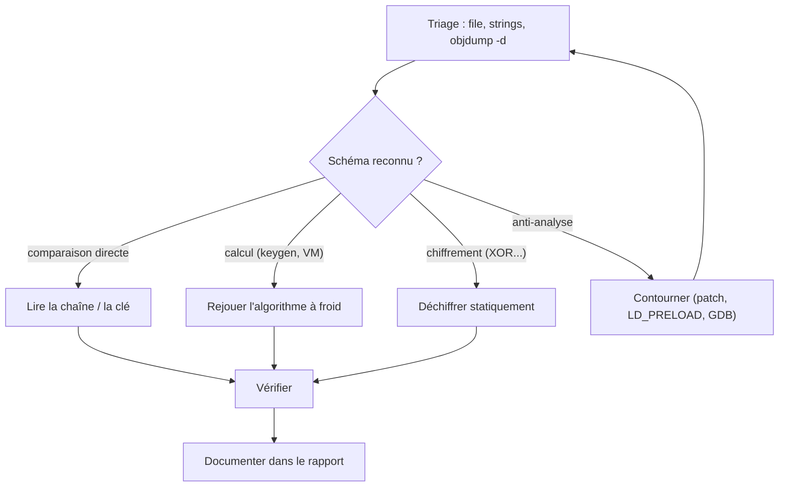

# Capstone : le projet final

Cette dernière partie n'apporte presque aucune notion nouvelle. Elle sert à prouver, sur des cibles proches de la réalité, que tout ce qui précède est devenu un réflexe. C'est le passage de l'exercice guidé à l'autonomie de l'analyste.

Elle se compose de deux épreuves complémentaires et d'un livrable :

1. **[Les défis CTF avancés](20-ctf-avance.md)** : trois crackmes qui combinent plusieurs techniques des parties 3 à 4 (keygen, machine virtuelle, multi-couches avec anti-debug). On y gagne un flag par défi.
2. **[Le cas de malware](21-cas-malware.md)** : un échantillon pédagogique multi-étapes, à analyser de bout en bout comme en situation réelle, puis à documenter.
3. **[Le rapport d'analyse](22-rapport-type.md)** : le livrable attendu d'un analyste, avec son modèle réutilisable et le rapport complet du cas étudié.

## Ce qu'on vise

À la fin de ce capstone, on doit être capable, devant un binaire inconnu, de :

- décider d'une stratégie (statique d'abord, dynamique ensuite, et quand recourir à l'un ou l'autre) ;
- reconnaître les schémas classiques (comparaison de chaîne, keygen, XOR, machine virtuelle, loader `mmap`/`mprotect`, anti-debug `ptrace`) sans relire le cours ;
- extraire une clé, un flag ou une charge **sans jamais exécuter aveuglément** un code hostile ;
- consigner le tout dans un rapport clair, exploitable par quelqu'un d'autre.

C'est exactement le profil demandé pour le reverse en CTF et pour l'analyse de malware.

## Règle d'or : le bac à sable

!!! danger "Avant de lancer quoi que ce soit"
    Le cas de malware est **inoffensif** (il n'écrit que dans `/tmp`, ne contacte que `127.0.0.1`, n'a aucune capacité destructrice), mais la bonne habitude se prend maintenant : **on n'exécute jamais un échantillon sur sa machine de travail**. On utilise une machine virtuelle jetable ou un conteneur isolé, sans accès au réseau réel, dont on peut revenir à un instantané propre. Même pour un code qu'on croit anodin.

    L'analyse statique, elle, ne lance rien : c'est toujours par elle qu'on commence.

## Comment aborder chaque cible

La méthode de la partie 3 reste la colonne vertébrale :

Les solutions complètes sont dans [solutions/partie4.md](../solutions/partie4.md), mais chaque défi doit d'abord être cherché seul : c'est le dernier entraînement avant les vraies compétitions.

## Suivi

- [ ] Capstone : bac à sable compris et prêt
- [ ] Capstone : méthode d'approche révisée
