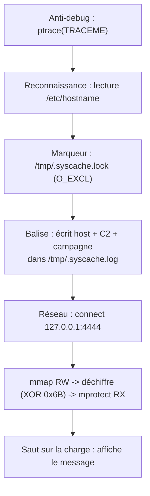

# Le rapport d'analyse

Une analyse qui reste dans la tête de l'analyste ne sert à rien. Le livrable réel est un rapport : clair, structuré, exploitable par quelqu'un qui n'a pas ouvert le binaire. Cette page donne un modèle réutilisable, puis le rapport complet du cas `specimen`.

## Le modèle réutilisable

Un bon rapport d'analyse de malware suit toujours à peu près la même ossature. Du plus synthétique (lisible par un responsable) au plus technique (utile à un autre analyste).

```markdown
# Rapport d'analyse : <nom de l'échantillon>

## 1. Résumé exécutif
Deux à quatre phrases, sans jargon : ce qu'est l'échantillon, ce qu'il
fait, le niveau de risque, et la recommandation principale.

## 2. Identification
- Nom de fichier, taille, type (`file`)
- Empreintes : SHA-256, éventuellement imphash
- Date d'analyse, analyste

## 3. Classification et verdict
Famille / catégorie présumée (loader, stealer, ransomware...), niveau de
confiance, et verdict (malveillant / suspect / bénin).

## 4. Chaîne d'exécution
Les étapes dans l'ordre, de l'exécution à la charge finale. Un schéma aide.

## 5. Capacités et techniques
Ce que l'échantillon sait faire, et par quels moyens (anti-debug,
chiffrement, injection...). On peut relier chaque technique à une tactique
(reconnaissance, évasion de défense, exécution, commande et contrôle).

## 6. Indicateurs de compromission (IOC)
Tableau : type, valeur, contexte. C'est la partie la plus directement
réutilisable (détection, chasse, blocage).

## 7. Recommandations
Détection (règle YARA, signature réseau), confinement, remédiation.

## 8. Annexes
Scripts de déchiffrement, désassemblages commentés, traces strace/ltrace.
```

!!! tip "Le piège du résumé exécutif"
    C'est la partie lue en premier et souvent la seule lue en entier. Elle doit tenir sans aucun terme technique : « programme qui se signale à un serveur distant et exécute une charge dissimulée ; risque modéré en l'état ; à bloquer et à détecter par les indicateurs ci-dessous ».

## Rapport complet du cas `specimen`

!!! warning "À lire après sa propre analyse"
    Ce rapport est la correction de l'épreuve de la page précédente. Les empreintes dépendent de votre compilation ; les valeurs d'IOC, elles, sont intrinsèques à l'échantillon.

### 1. Résumé exécutif

`specimen` est un **loader** : un programme qui, une fois lancé, se signale discrètement puis exécute une charge dissimulée et chiffrée. Il relève le nom de la machine, dépose un marqueur de présence, écrit une « balise » mentionnant un serveur de commande, tente une connexion réseau, puis déchiffre et exécute du code en mémoire. Dans cet échantillon pédagogique, la charge se contente d'afficher un message et aucune action n'est destructrice, mais la structure est celle d'un loader réel. **Verdict : malveillant par construction** ; à détecter et bloquer via les indicateurs ci-dessous.

### 2. Identification

| Champ | Valeur |
|---|---|
| Nom | `specimen` |
| Type | ELF 64 bits, lié dynamiquement, *stripped* |
| Empreinte | SHA-256 de votre binaire (`sha256sum specimen`) |
| Analyse | à froid (statique) puis dynamique en bac à sable |

### 3. Classification et verdict

Loader / *stager* à charge chiffrée. Confiance élevée : le trio `mmap` en lecture-écriture, boucle `xor`, `mprotect` en exécution est non ambigu. Verdict : **malveillant**.

### 4. Chaîne d'exécution



### 5. Capacités et techniques

| Tactique | Technique observée |
|---|---|
| Évasion de défense | Anti-debug par `ptrace(PTRACE_TRACEME)` : le programme s'interrompt s'il est déjà tracé |
| Évasion de défense | Chaînes sensibles chiffrées (XOR `0x3C`), charge chiffrée (XOR `0x6B`) : rien de lisible par `strings` |
| Reconnaissance | Lecture de `/etc/hostname` |
| Persistance (marqueur) | Création d'un fichier verrou unique `/tmp/.syscache.lock` |
| Commande et contrôle | Balise locale + tentative de connexion TCP `127.0.0.1:4444` |
| Exécution | Charge déchiffrée en mémoire et exécutée via `mmap`/`mprotect` |

### 6. Indicateurs de compromission

| Type | Valeur | Contexte |
|---|---|---|
| Fichier | `/tmp/.syscache.lock` | Marqueur de présence (mutex) |
| Fichier | `/tmp/.syscache.log` | Journal de balise déposé |
| Réseau | `127.0.0.1:4444` (TCP) | Tentative de connexion C2 |
| Domaine | `update.sync.example.invalid` | C2 déchiffré (XOR `0x3C`) |
| Chaîne | `CAMP-2026-ORANGE` | Identifiant de campagne (XOR `0x3C`) |
| Comportement | `mmap` RW puis `mprotect` RX autour d'une boucle `xor 0x6B` | Signature de loader |
| Charge | message `charge active: FLAG{malware_decode_ok}` | Effet de la charge (ici inoffensif) |

### 7. Recommandations

- **Détection statique** : règle YARA sur la séquence `mmap`/`mprotect` + la boucle XOR, ou sur les octets chiffrés du domaine C2 (voir la [partie 2, chapitre 13](../partie2-reverse/13-malware-analysis.md) pour l'écriture de règles).
- **Détection dynamique** : alerte sur la création de `/tmp/.syscache.lock` et sur tout `mprotect(..., PROT_EXEC)` suivant un `mmap` anonyme en écriture.
- **Réseau** : surveiller les résolutions de `*.example.invalid` et les connexions sortantes vers le port `4444`.
- **Confinement** : aucun effet persistant réel ici ; supprimer les deux fichiers `/tmp/.syscache.*` suffit à nettoyer.

### 8. Annexes

Scripts de déchiffrement et désassemblage commenté de la charge : [solutions/partie4.md](../solutions/partie4.md#cas-malware).

## Suivi

- [ ] Rapport : modèle compris et réutilisé
- [ ] Rapport : cas specimen documenté de bout en bout
